# Architecture — PDF Comparison Suite

**What this is.** The app and the `pdfsuite` CLI, drawn from the code as it stands
(verified 2026-10-14; re-checked 2026-10-18), and — in Part 4 — the target the Standing
Records rule, which is **not built**. Every box names the real file or function, or the
record that rules it. Where [`README.md`](../README.md) disagrees with the code, these
diagrams follow the code. Where the code disagrees with a record, the record wins
([SR-LAW-0](../records/0002_LAW-0-authority.md)) and the gap is a work item in
[`work/OPEN-WORK.md`](../work/OPEN-WORK.md).

**Legend.** Solid border = built · dashed = behind a feature flag · dotted = ruled, not built.

**Standalone SVGs.** Every diagram is also a self-contained SVG in [`docs/architecture/`](architecture/), linked under each diagram. They are rendered from the Mermaid blocks in this file — re-render them when a block changes.

**Contents**

- Part 1 · High level — [System overview](#system-overview) · [UI shell and state](#ui-shell-and-state) · [Feature flags](#feature-flags) · [Compare engine](#compare-engine-comparepage)
- Part 2 · Each tab — [Compare](#compare--loading-scanning-and-navigation) · [Side by side](#side-by-side) · [Overlapping](#overlapping) · [View report](#view-report) · [Page pairing](#page-pairing) · [Export and Import ZIP](#export-menu-and-import-zip) · [Spec driven comparison](#spec-driven-comparison) · [Inspect](#inspect) · [Batch compare](#batch-compare)
- Part 3 · CLI — [Build and engine reuse](#how-the-cli-is-built-and-reuses-the-engine) · [`generate`](#pdfsuite-generate) · [`compare`](#pdfsuite-compare) · [`pairs`](#pdfsuite-pairs) · [Verdict rules: app vs CLI](#verdict-rules-app-vs-cli)
- Part 4 · Target — [Packages and surfaces](#packages-and-surfaces-l3--l4) · [One compare core](#one-compare-core) · [The three output files](#the-three-output-files) · [The command line](#the-pdfsuite-command-line) · [Create, sync and hosting](#create-sync-and-hosting) · [Spec driven comparison, end to end](#spec-driven-comparison-end-to-end) · [Testing](#testing) · [The build order](#the-build-order)

---

# Part 1 · High level

## System overview

- **One engine, no React.** [`src/services`](../src/services/) holds the comparison logic; the four workspaces reach it through the Zustand stores.
- **The spec feature is sealed** in [`src/features/spec/`](../src/features/spec/README.md): its own engine, store and view, developed on a second machine. The app imports only its `index.ts`; the CLI would import only its `engine.ts` (W-11).
- **The Node CLI imports the same engine files unchanged**, with a small DOM shim that swaps the browser canvas for `@napi-rs/canvas`.
- **There is one CLI, the Node one** — the product is TypeScript ([SR-STACK-TYPESCRIPT](../records/0104_STACK-typescript.md)).
- **Where this is heading:** [Part 4](#part-4--target--what-the-records-rule-not-yet-built) — one core in `@pdfsuite` packages, called by the app and the CLI alike (L3, L4).

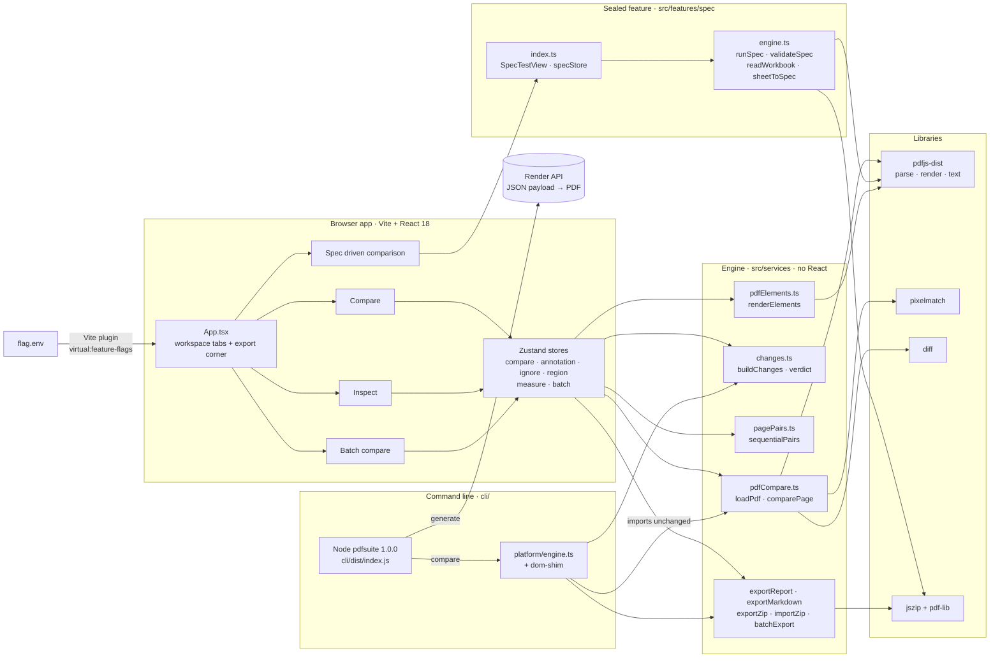

[Open as SVG](architecture/01-system-overview.svg)

## UI shell and state

- **The workspace is plain `useState`** in [`src/App.tsx`](../src/App.tsx); each workspace owns one store, and Compare also uses the annotation, ignore and region stores.
- **Two effects drive Compare:** compute the visible page; run a full scan automatically when the larger PDF has 60 pages or fewer.
- **Stores meet in two places only:** Batch's "Open in Compare" (`adoptPair`) and Import ZIP (`adoptImported` + annotation `replaceAll`).
- **Tab names as the code has them today:** `Batch compare · Compare · Spec driven comparison · Inspect`. **W-06** (🔴, names owed Arpit's confirmation) proposes three tabs — **Compare** (One · Many) · **Specification** · **Inspect** — with Batch folded into Compare as *Many*.

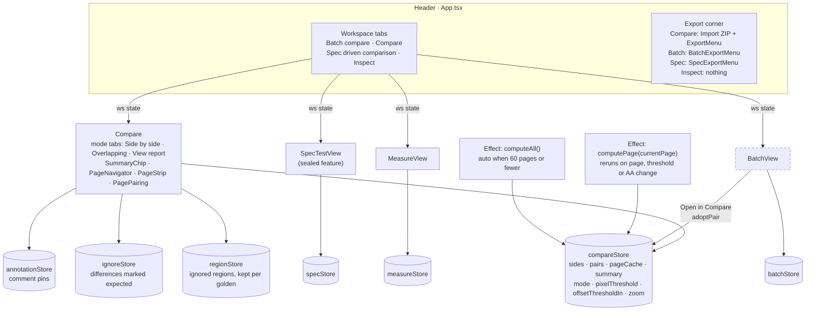

[Open as SVG](architecture/02-ui-shell-and-state.svg)

Code: `src/App.tsx` · `src/store/*.ts` · `src/main.tsx`

## Feature flags

- **`flag.env` → Vite plugin → `virtual:feature-flags`** ([`vite.config.ts`](../vite.config.ts)).
- **[`src/flags.ts`](../src/flags.ts) defaults every flag to on.** A missing key keeps the default; an unrecognised value warns and keeps the default.
- **Dev reloads the browser on save;** a production build bakes the values in.
- **Flags hide UI features and never change a result** — a ratified UI-only step ([SR-SURFACE-PARITY](../records/0106_SURFACE-parity.md)).

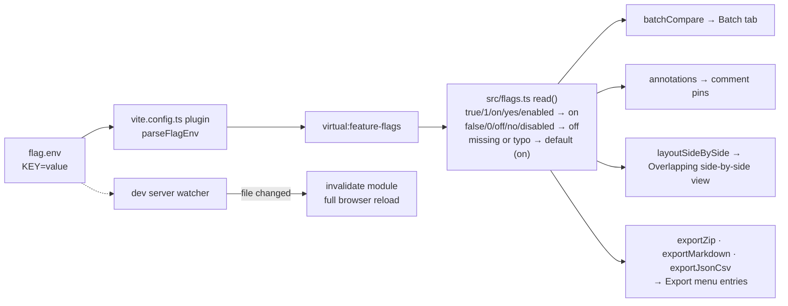

[Open as SVG](architecture/03-feature-flags.svg)

| flag | key in `flag.env` | value in `flag.env` | controls |
|---|---|---|---|
| annotations | `FEATURE_ANNOTATIONS` | true | comment pins in Side by side and Overlapping side-by-side |
| exportZip | `FEATURE_EXPORT_ZIP` | true | ZIP bundle export |
| batchCompare | `FEATURE_BATCH_COMPARE` | false | Batch compare workspace tab |
| layoutSideBySide | `FEATURE_LAYOUT_SIDE_BY_SIDE` | false | side-by-side view inside Overlapping (otherwise it opens on Pixel diff) |
| exportJsonCsv | `FEATURE_EXPORT_JSON_CSV` | false | JSON and CSV entries in every Export menu |
| exportMarkdown | `FEATURE_EXPORT_MARKDOWN` | false | Markdown fix-list export and viewer tab |

## Compare engine: `comparePage`

- **The golden page fixes the target box:** 2 px per point (144 DPI), capped at 1600 px wide. Both pages draw into it, so their coordinates line up.
- **A page of a different shape is scaled and centred (letterboxed),** and its glyph sizes are then not compared.
- **Three signals per page:** word diff of the text, position match of text runs, pixel diff. `buildChanges` turns them into removed · added · moved · restyled.

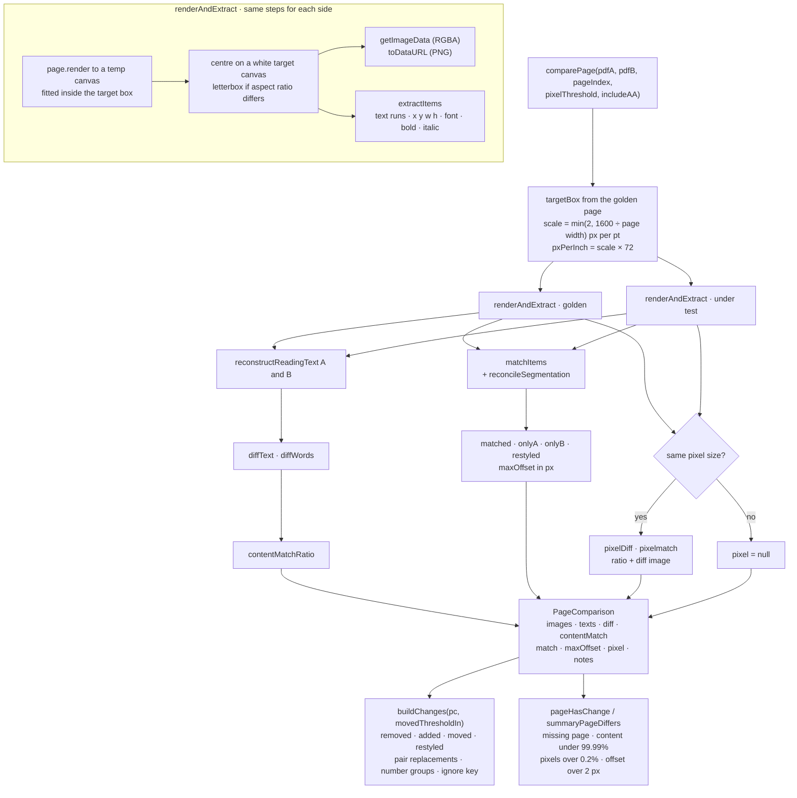

[Open as SVG](architecture/04-compare-engine.svg)

Code: [`src/services/pdfCompare.ts`](../src/services/pdfCompare.ts) · [`src/services/changes.ts`](../src/services/changes.ts) · [`src/types/compare.ts`](../src/types/compare.ts)

> **Watch.** Under Node, `loadPdf` sets no `standardFontDataUrl`. Text in non-embedded standard fonts may not be drawn, and the CLI hides that warning. CLI pixel results can therefore differ from the browser's. One opener with bundled fonts is **W-13** ([SR-PDF-SUPPORT](../records/0105_PDF-support.md)).

> **Watch.** Two "changed" rules exist: `pageHasChange` (the page strip and Next change — moved > 0.02 in ≈ 2.9 px) and `summaryPageDiffers` (the verdict — offset > 2 px). A 2.5 px shift fails the report but is skipped by Next change. One rule, `pageVerdict`, is **W-27** ([SR-COMPARE](../records/0111_COMPARE.md) decision 3).

---

# Part 2 · Each tab in detail

## Compare — loading, scanning and navigation

- **Loading either side clears** the page cache, the summary and any imported report.
- **The visible page is compared first;** the background scan then fills the summary chip and the changed-page strip.
- **"Next change" compares forward until `pageHasChange` is true**, reusing cached pages.

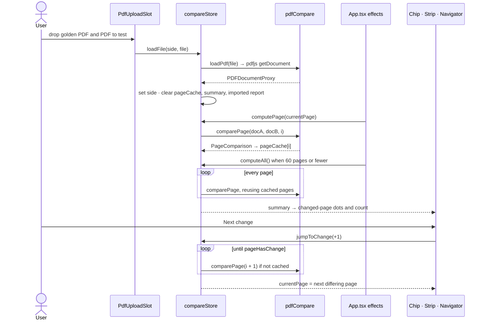

[Open as SVG](architecture/05-compare-loading-navigation.svg)

Code: `PdfUploadSlot.tsx` · `PageNavigator.tsx` · `PageStrip.tsx` · `SummaryChip.tsx` · `src/store/compareStore.ts`

> **Watch.** Nothing cancels a scan in flight. If a file is swapped mid-scan, the old result can land on the new pair.

## Side by side

- **Built from `pageCache[currentPage]` and `buildChanges`;** changes marked "expected" — one at a time, or by **ignored region** — are filtered out first.
- **Page highlight ↔ Changes row ↔ Diff word** are linked by hover.
- **"Mark expected" stores `changeRef(page, key)`** — change text plus a coarse vertical band — so it survives a recompute.
- **An ignored region is an area, not a difference:** drawn on the page, labelled ("holdings table"), kept against the golden so it carries to the next candidate; its changes are listed apart in the report. Neither kind of ignore changes pass/fail ([SR-SURFACE-PARITY](../records/0106_SURFACE-parity.md)).

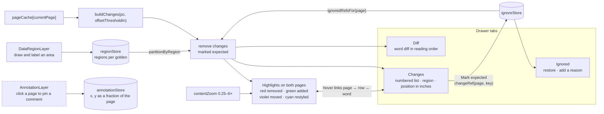

[Open as SVG](architecture/06-tab-side-by-side.svg)

Code: `src/components/compare/ContentCompareView.tsx` · `AnnotationLayer.tsx` · `DataRegionLayer.tsx` · `src/store/ignoreStore.ts` · `src/store/regionStore.ts` · `src/store/annotationStore.ts`

> **Watch.** Restyled text is shown here but does not change the page verdict; neither does marking a change or a region expected. Whether accepted differences become a core-side `expected.json` ledger is open on **W-07**.

## Overlapping

- **Two views:** Side by side (flag, off in `flag.env` now) and Pixel diff. With the flag off the switcher is hidden and the tab opens on Pixel diff.
- **Pixel diff draws pixelmatch's diff image,** with one box per change group, coloured by its strongest cause: text › style › layout.
- **`MeasureOverlay` marks removed, added, moved and restyled runs** with Δx/Δy in inches; a geometry table lists matched runs and links to the page by hover.

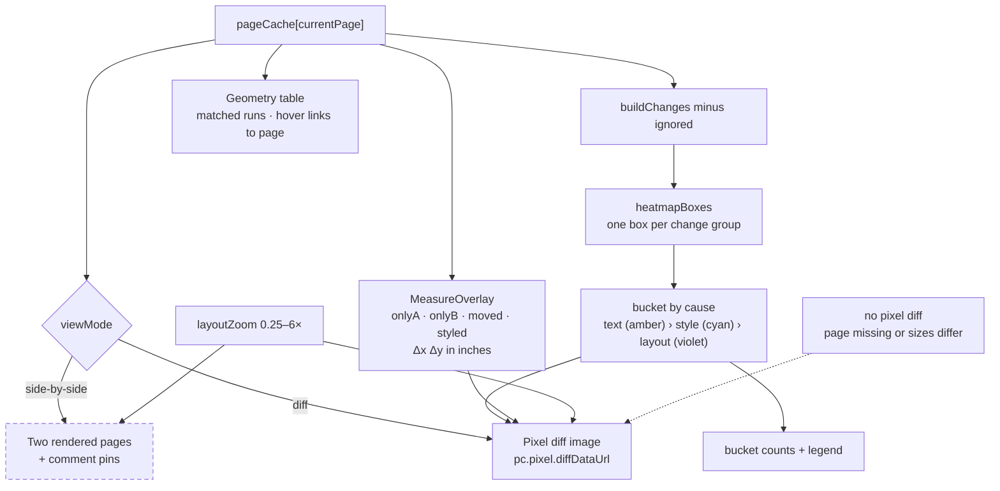

[Open as SVG](architecture/07-tab-overlapping.svg)

Code: `src/components/compare/LayoutCompareView.tsx` · `MeasureOverlay.tsx` · `changes.ts › heatmapBoxes`

## View report

- **An imported ZIP's own report is shown as it was saved.**
- **Otherwise the report is built once per comparison** and shown in a sandboxed iframe with scripts disabled.
- **Only failing pages get a detail section;** passing pages are counted in the header.

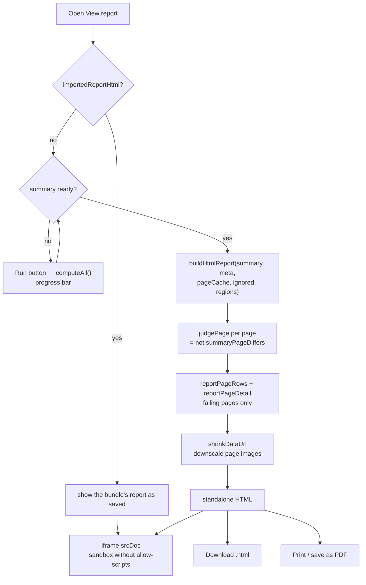

[Open as SVG](architecture/08-tab-view-report.svg)

Code: `src/components/compare/CompareReport.tsx` · [`src/services/exportReport.ts`](../src/services/exportReport.ts)

> **Verdict.** Fixed, not adjustable: a page fails if it differs at all.

> **Target.** This builder and the CLI's writer become one `buildReportHtml(result)` in `@pdfsuite/core`, rendering only from `result.json` — [SR-REPORT-HTML](../records/0108_REPORT-html.md), **W-27**.

## Page pairing

- **The unit of comparison is a pair, not a page number.** Page 5 against page 5 is only right while both documents hold the same pages in the same order; one inserted or dropped page makes every later comparison meaningless.
- **`pairs[]` is the navigation sequence** and `currentPage` indexes into it. It defaults to the straight 1:1 list, so nothing changes until someone pairs the pages.
- **Pairing is done by hand, and nothing is inferred.** "Pair pages" opens a list of rows; clicking either side opens that PDF in a page picker, scrollable, with a size control. "No matching page" marks a page added or removed. Done applies it; the button then reads "Revert to page by page comparison".
- **An automatic aligner exists in `pagePairs.ts` and is deliberately unwired** — a suggestion that is subtly wrong is worse than no suggestion in a tool whose job is to be believed. It is kept, tested, and tree-shaken out of the build.
- **The editor warns rather than prevents:** a page used in two pairs is compared twice, and says so.
- **Target:** the same `PagePair[]` becomes the CLI's `--pages "1:1,2:-,3:2"` — one pairing input to one core ([SR-COMPARE](../records/0111_COMPARE.md) decision 2, **W-27**, **W-09**).

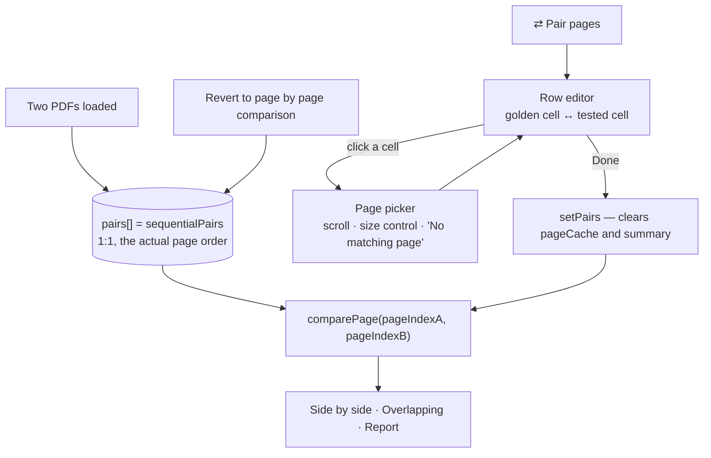

[Open as SVG](architecture/17-page-pairing.svg)

Code: [`src/services/pagePairs.ts`](../src/services/pagePairs.ts) · `src/components/compare/PagePairing.tsx` · `src/store/compareStore.ts`

## Export menu and Import ZIP

- **Every export reads the same inputs:** summary, page cache, ignored list, regions, annotations. Only HTML is always on.
- **The ZIP holds the HTML report and both original PDFs.** Comments become real PDF `/Text` annotations; page content is untouched.
- **Import reverses it:** PDFs found by `golden__` / `candidate__` prefix, comments read back from the annotations, both sides loaded into Compare.
- **Ratified UI-only** ([SR-SURFACE-PARITY](../records/0106_SURFACE-parity.md)): Markdown, CSV and the ZIP bundle stay in the app; the CLI writes the three files only. **Target:** the Export menu also offers `result.json`, `report.html` and `manifest.json` from the same builders as the CLI (**W-27** DoD 5).

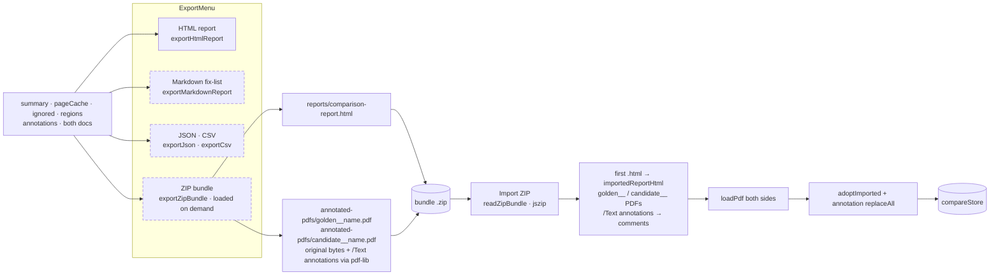

[Open as SVG](architecture/09-export-import-zip.svg)

Code: `ExportMenu.tsx` · `ImportBundleButton.tsx` · [`src/services/exportZip.ts`](../src/services/exportZip.ts) · [`src/services/importZip.ts`](../src/services/importZip.ts) · `exportMarkdown.ts`

## Spec driven comparison

> **Sealed feature.** Everything below lives in `src/features/spec/` and shares no file
> with the rest of the app, because it is developed on a second machine that cannot push.
> Work flows one way — this repository out, a zip in — so **the copy of that folder here
> is a stale mirror; the live one is on the other machine.** The app imports `index.ts`;
> the CLI imports `engine.ts`. See
> [`src/features/spec/README.md`](../src/features/spec/README.md),
> `sh scripts/check-boundary.sh` and `sh scripts/update-from-zip.sh`.

- **No golden PDF:** a JSON spec lists each page's expected elements in inches, points or millimetres from the top-left ([`spec-standard.md`](../spec-standard.md)).
- **A spec workbook is read in the app.** An `.xlsx`/`.csv` is parsed in the browser and each sheet converted to a one-page spec; the reader pairs **a sheet** with **a PDF page** from two lists.
- **The conversion reports what it could not do** — a colour, a conditional rule, a wording cell that is all merge fields, an element with no measurement. Nothing is guessed.
- **Each element is checked on its own,** with expected-vs-actual values and a box on the page.
- **"One page" mode checks one spec page against any PDF page** — for single-sheet specs that always say `"page": 1`.
- **The ruled target** — intake, check, three files, the same from the tab and `pdfsuite spec` — is drawn in [Part 4](#spec-driven-comparison-end-to-end).

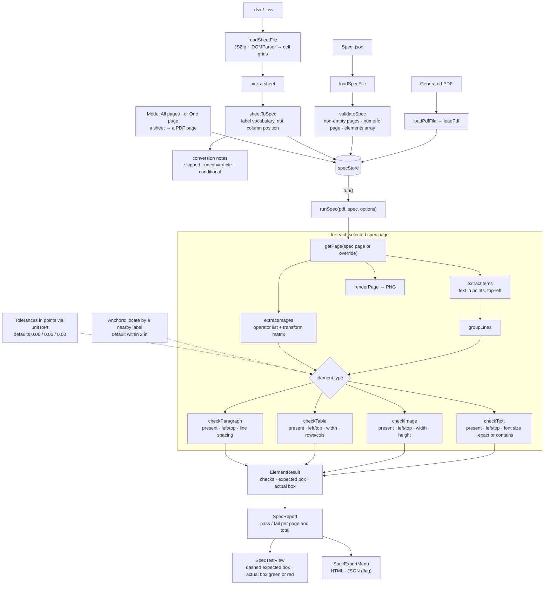

[Open as SVG](architecture/10-spec-driven-comparison.svg)

Code, all under [`src/features/spec/`](../src/features/spec/README.md): `index.ts` · `engine.ts` · `SpecTestView.tsx` · `specStore.ts` · `specCheck.ts` · `specExport.ts` · `sheetRead.ts` · `sheetSpec.ts` · `pdfjs.ts` · `types.ts` · `spec.css`

> **Watch.** Default tolerances are inch values applied in whatever unit the spec uses. The HTML export inserts `units` unescaped. Both are **W-04** DoD 1 ([SR-SPEC-CHECK](../records/0102_SPEC-check.md)). `readSheetFile` needs `DOMParser`, which the CLI's shim lacks — the `.xlsx` path of **W-11** waits on a DOM-free reader from the spec machine.

## Inspect

- **One PDF; hover any text run or image to outline it, click to select it.**
- **Position** gives the distance to all four page edges in inches, with guide lines. **Font & paragraph** (text only) gives font, size, weight, style and line height.
- **No export.** Each page renders when first opened and is then cached.
- **Target:** the maths moves to `inspectCore` in `@pdfsuite/core` and `pdfsuite inspect` writes the three files from the same functions ([SR-INSPECT](../records/0114_INSPECT.md), **W-28**).

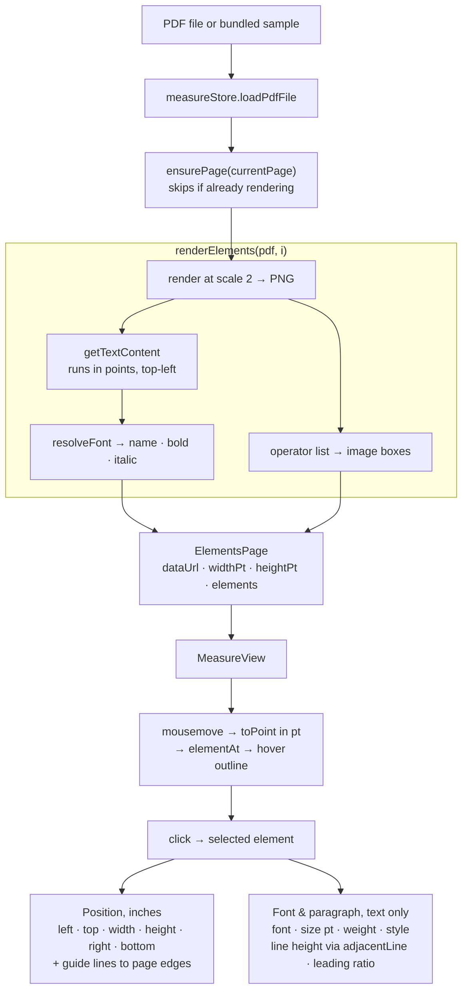

[Open as SVG](architecture/11-inspect-pdf.svg)

Code: `src/components/measure/MeasureView.tsx` · `src/store/measureStore.ts` · [`src/services/pdfElements.ts`](../src/services/pdfElements.ts)

> **Watch.** Line height and edge distances are computed inside `MeasureView.tsx`, so no CLI can give the same numbers today ([SR-SURFACE-PARITY](../records/0106_SURFACE-parity.md) Inspect rows). Weight comes from the font *name*, so stripped names read "Regular" — **W-15**.

## Batch compare

- **Add many PDFs to each side and pair them** — automatically by order or row by row. Pairs run in order, a page at a time.
- **Raw pixel buffers are dropped once a page is scored;** only PNG data URLs are kept.
- **"Open in Compare" hands the loaded documents** to the Compare workspace.
- **Target:** the tab becomes Compare's *Many* scope (**W-06**, names owed Arpit's confirmation) and its loop becomes `compareMany` in `@pdfsuite/compare`, the function `pdfsuite compare --each` also calls ([SR-BULK-COMPARE](../records/0113_BULK-compare.md), **W-27**, **W-09**).

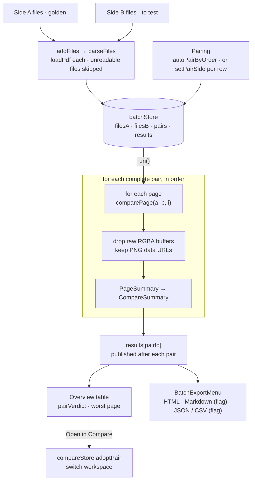

[Open as SVG](architecture/12-batch-compare.svg)

Code: `src/components/batch/BatchView.tsx` · `BatchExportMenu.tsx` · `src/store/batchStore.ts` · [`src/services/batchExport.ts`](../src/services/batchExport.ts)

> **Flag.** `FEATURE_BATCH_COMPARE=false` in `flag.env` now, so this tab is hidden.

---

# Part 3 · CLI

> **Status.** This is `pdfsuite` 1.0.0 as built. [SR-CLI](../records/0115_CLI.md) (accepted 2026-10-18) replaces it: one pair per command, `--each` for many, three output files, one console shape — **W-08**, **W-09**, **W-30**. `pairs.json`, folder inputs, the `pairs` command and the JUnit / CSV / Markdown writers go with W-09 (SR-CLI decision 9). The target is drawn in [Part 4](#the-pdfsuite-command-line).

## How the CLI is built and reuses the engine

- **esbuild bundles `cli/src` plus the app's `src/services`** into `dist/index.js`, taking pdf.js's legacy build from the repo-root `node_modules` ([`cli/build.mjs`](../cli/build.mjs)).
- **[`cli/src/platform/engine.ts`](../cli/src/platform/engine.ts) is the only import from the app;** it loads the DOM shim first.
- **Options resolve flag › config file › default.** Exit codes: 0 OK · 1 the PDFs regressed · 2 the tool or job is broken.

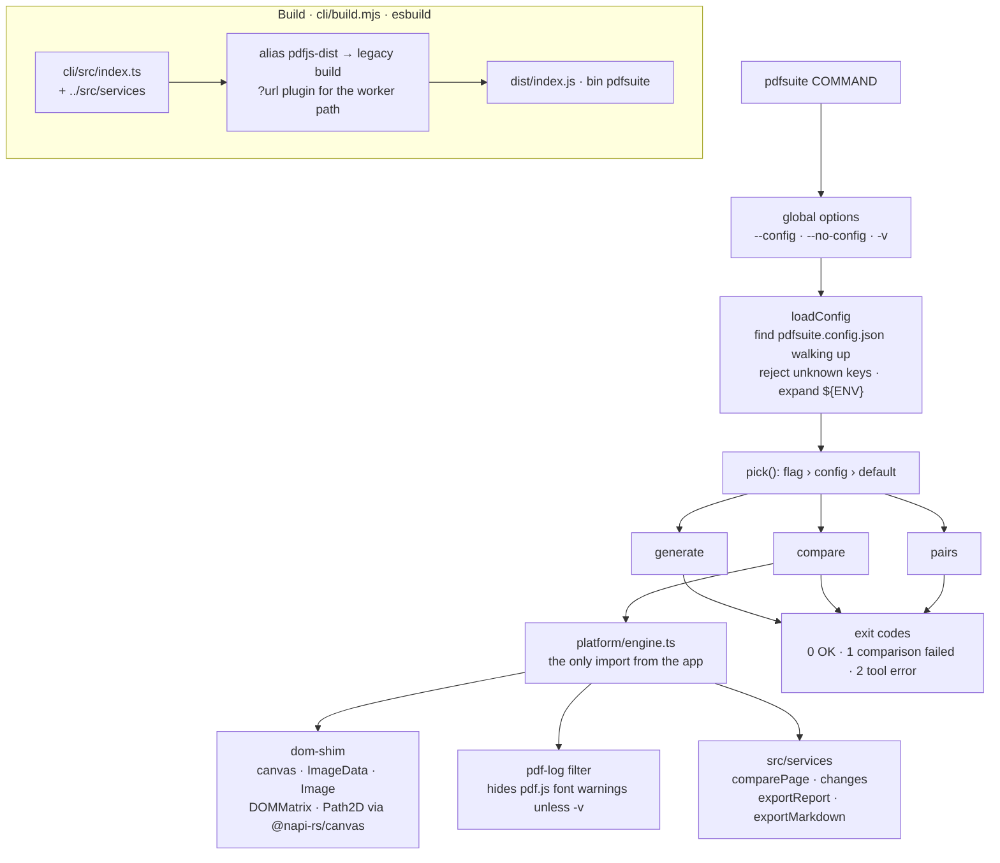

[Open as SVG](architecture/13-cli-build-and-engine.svg)

Code: `cli/src/index.ts` · `cli/src/core/config.ts` · `cli/src/core/exit.ts` · `cli/src/platform/dom-shim.ts`

> **Watch.** Commander exits 1 on bad arguments — the "PDFs regressed" code. The help text promises 2.

## `pdfsuite generate`

- **POSTs each `*.json` payload to the render API and saves the PDF.** Defaults assume a slow API: 4 in flight, 120 s timeout.
- **Retries only what a retry can fix:** 5xx and network errors. Timeouts only with `--retry-on-timeout`; 4xx never.
- **Writes `manifest.json`** (hashes, timings, redacted URL). Any failed document → exit 2, so a partial run never looks like a pass.
- **Ratified CLI-only** ([SR-SURFACE-PARITY](../records/0106_SURFACE-parity.md)): it runs in CI against an API with credentials; a browser would expose them and meet CORS.

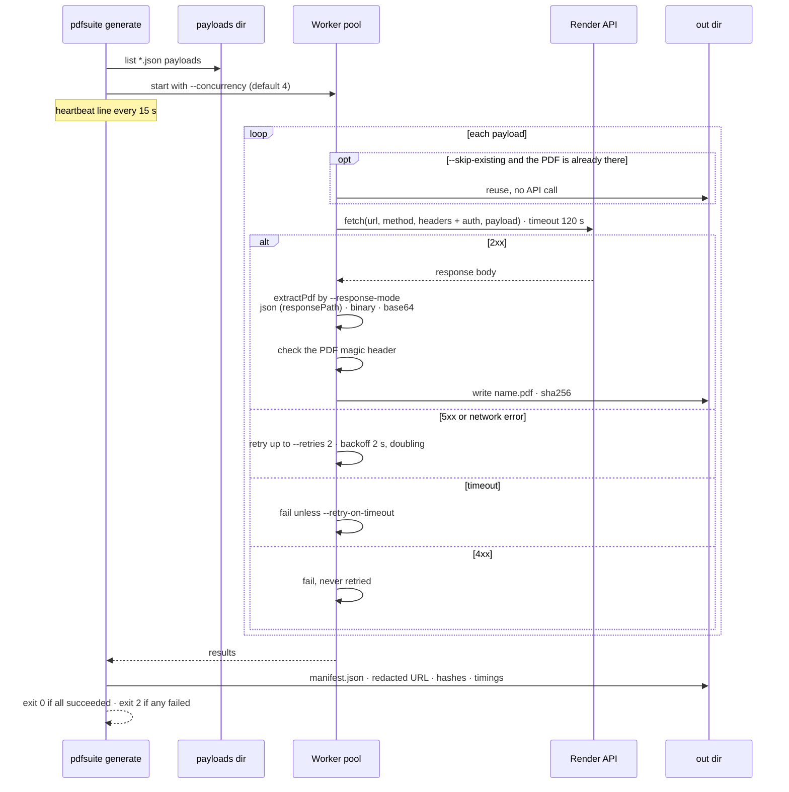

[Open as SVG](architecture/14-cli-generate.svg)

Code: [`cli/src/commands/generate.ts`](../cli/src/commands/generate.ts) · `cli/src/core/manifest.ts` · `cli/mock-api/server.js`

## `pdfsuite compare`

- **Packaged for npm as `pdfsuite` 1.0.0** (not yet published). `pdfsuite compare <golden> <candidate> <pairs.json> <reports>`. The flags still work and override a positional.
- **`pairs.json` maps each golden file to its candidate,** and may skip pages. An unresolved pair stops the run before any compare.
- **Same engine *and* same verdict as the app** — `summaryPageDiffers` decides both, so the two cannot disagree (see [Verdict rules](#verdict-rules-app-vs-cli)).
- **`--format` picks the reports.** JUnit has one testsuite per pair id, so Jenkins keeps per-pair history.

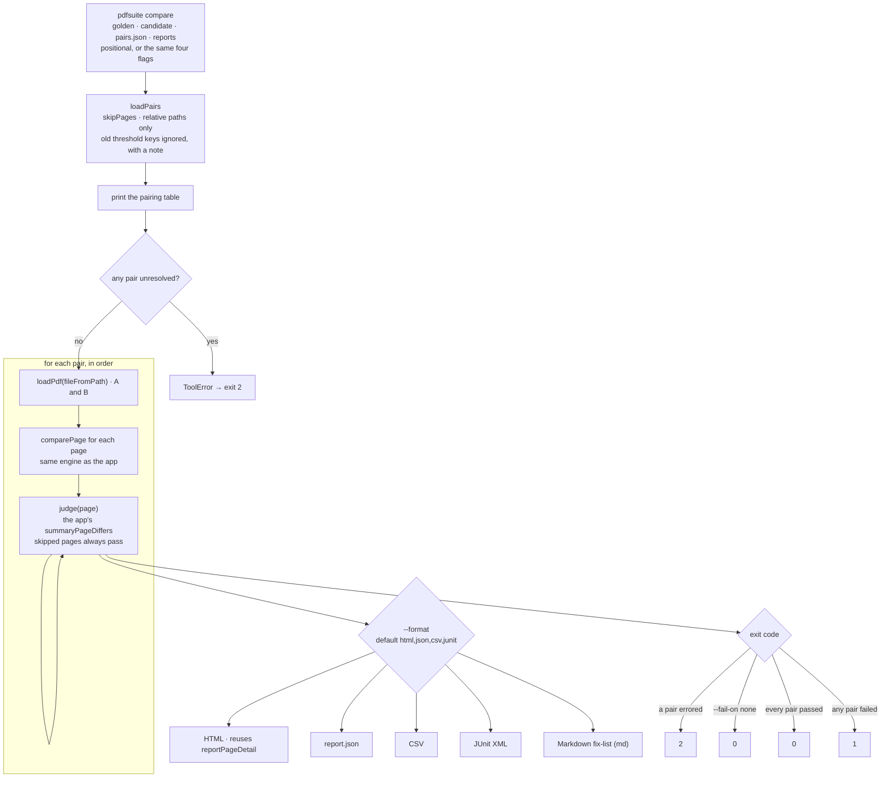

[Open as SVG](architecture/15-cli-compare.svg)

Code: [`cli/src/commands/compare.ts`](../cli/src/commands/compare.ts) · `cli/src/core/pairs.ts` · `cli/src/report/html.ts` · `cli/src/report/machine.ts` · `cli/fixtures/pairs.json`

> **Watch.** The page loop here is the third copy (Compare store, Batch store, this). `report.json` and the HTML writer differ from the app's exports. All of it is replaced by one core and three builders — **W-27**, then **W-09** rebuilds this command on them.

## `pdfsuite pairs`

- **A dry run:** resolves `pairs.json` against both folders and prints the table. Nothing is compared.
- **All three options are required; this command ignores the config file.**
- **Removed by W-09** (SR-CLI decision 9) — `--each` pairs by relative path and reports orphans itself.

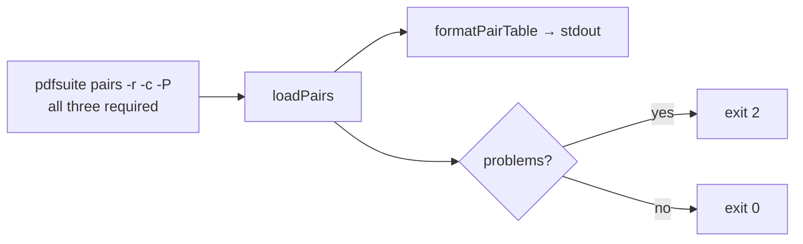

[Open as SVG](architecture/16-cli-pairs.svg)

## Verdict rules: app vs CLI

**Same engine, same judge.** `summaryPageDiffers` decides both, so a pair cannot FAIL in
the app and PASS in CI.

| check | app and CLI — `summaryPageDiffers` |
|---|---|
| content match | fails under 99.99% |
| pixels changed | fails over 0.2% |
| max text offset | fails over 2 px (≈0.014 in on Letter) |
| missing page | fails |
| tunable | **no** — the CLI's thresholds were removed; `skipPages` exempts a whole page, visibly |
| restyled text | ignored |

The CLI kept adjustable tolerances for a while after the app dropped them, which meant the
two disagreed about the same pair — and because esbuild strips types without checking them,
the drift went unnoticed until the HTML report crashed. `npm run build` in `cli/` now runs
`tsc --noEmit` first.

**What still disagrees (2026-10-18):** inside the app, the strip's `pageHasChange` (moved
> 0.02 in) and the verdict above; and the pixel sensitivity and anti-aliasing knobs, which
have the same defaults but separate controls on each surface. Both are **W-27**
([SR-SURFACE-PARITY](../records/0106_SURFACE-parity.md)); the knobs end up recorded in
`result.json`'s `policy` block ([SR-REPORT-JSON](../records/0109_REPORT-json.md)).

---

# Part 4 · Target — what the records rule, not yet built

**Source: the Standing Records**, accepted 2026-10-18 — [SR-LAW-3](../records/0005_LAW-3-one-function-ui-and-cli.md),
[SR-LAW-4](../records/0006_LAW-4-how-packages-work.md), [SR-NPM-PACKAGES](../records/0107_NPM-packages.md),
[SR-COMPARE](../records/0111_COMPARE.md), [SR-BULK-COMPARE](../records/0113_BULK-compare.md),
[SR-INSPECT](../records/0114_INSPECT.md), [SR-SPEC](../records/0112_SPEC.md), [SR-CLI](../records/0115_CLI.md),
[SR-REPORT-JSON](../records/0109_REPORT-json.md), [SR-REPORT-HTML](../records/0108_REPORT-html.md),
[SR-MANIFEST](../records/0110_MANIFEST.md), [SR-TESTING](../records/0116_TESTING.md),
[SR-PDF-SUPPORT](../records/0105_PDF-support.md). **None of this is built.** Every box names
its record; the item that builds it is in [`work/OPEN-WORK.md`](../work/OPEN-WORK.md). These
diagrams restate no rule — when a picture and a record disagree, the record is right and the
picture is redrawn.

## Packages and surfaces (L3 · L4)

- **L3 — one function, two surfaces.** Every step that produces a result lives once, in a package; the app and the CLI both import it. What stays on one side is listed and ratified in [SR-SURFACE-PARITY](../records/0106_SURFACE-parity.md).
- **L4 — pdfsuite is everything; a single package is a command line.** `npm create @pdfsuite` gives the web app and the CLI; `npm i @pdfsuite/compare` or `@pdfsuite/spec` alone gives that command for CI. One version across all seven; an upgrade never overwrites what a team changed.
- **Seven packages**, one repository, npm workspaces — **W-29** creates them; **W-44** writes SR-MONOREPO and settles the layout (`apps/web` for today's app, `packages/*` for the seven, room for a PDF viewer, designer and creator). This repository's own app becomes a `create` shell over `ui`.
- **L2 — only open-source, free dependencies**, dev tools included ([SR-LAW-2](../records/0004_LAW-2-open-source-only.md)): npm workspaces over Nx or Turborepo, whose hosted caches are paid.

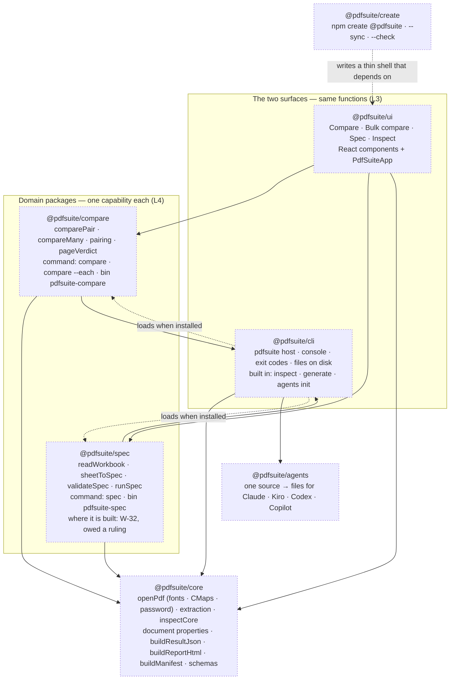

[Open as SVG](architecture/19-target-packages-and-surfaces.svg)

| package | depends on | gives you | built by |
|---|---|---|---|
| `@pdfsuite/core` | `pdfjs-dist`, `pdf-lib` (exact) | a library | W-29 |
| `@pdfsuite/compare` | `core`, `cli` | `pdfsuite compare`, `--each`, `pdfsuite-compare` | W-29, W-27, W-09 |
| `@pdfsuite/spec` | `core`, `cli` | `pdfsuite spec`, `pdfsuite-spec` | W-32 (🔴), W-11 |
| `@pdfsuite/cli` | `core`, `agents` | `pdfsuite` | W-30 |
| `@pdfsuite/agents` | — | `pdfsuite agents init` | W-10 |
| `@pdfsuite/ui` | `core`, `compare`, `spec`; React as a peer | the screens | W-33 |
| `@pdfsuite/create` | — | `npm create @pdfsuite` | W-31, W-34 |

The install table, the sync rules and the hosting rule are [SR-NPM-PACKAGES](../records/0107_NPM-packages.md) §1.

## One compare core

- **`comparePair` is the only entry** for one pair; **`compareMany`** is the only loop for many — the Compare tab, the Bulk compare tab, `pdfsuite compare` and `--each` all call them ([SR-COMPARE](../records/0111_COMPARE.md), [SR-BULK-COMPARE](../records/0113_BULK-compare.md)).
- **One page rule, `pageVerdict`,** replaces `pageHasChange` and `summaryPageDiffers`; its limits live in the constants file ([SR-CONSTANTS](../records/0103_CONSTANTS.md), **W-05**). Every knob that moves it is recorded in `result.json`.
- **Pairing is an input** (`PagePair[]`) — the tab's editor and the CLI's `--pages` produce the same list; unpaired pages are reported as added or removed.
- **Three pure builders return strings;** the app wraps them in a download, the CLI writes them to disk — so both produce the same files, and a parity test proves it byte for byte.

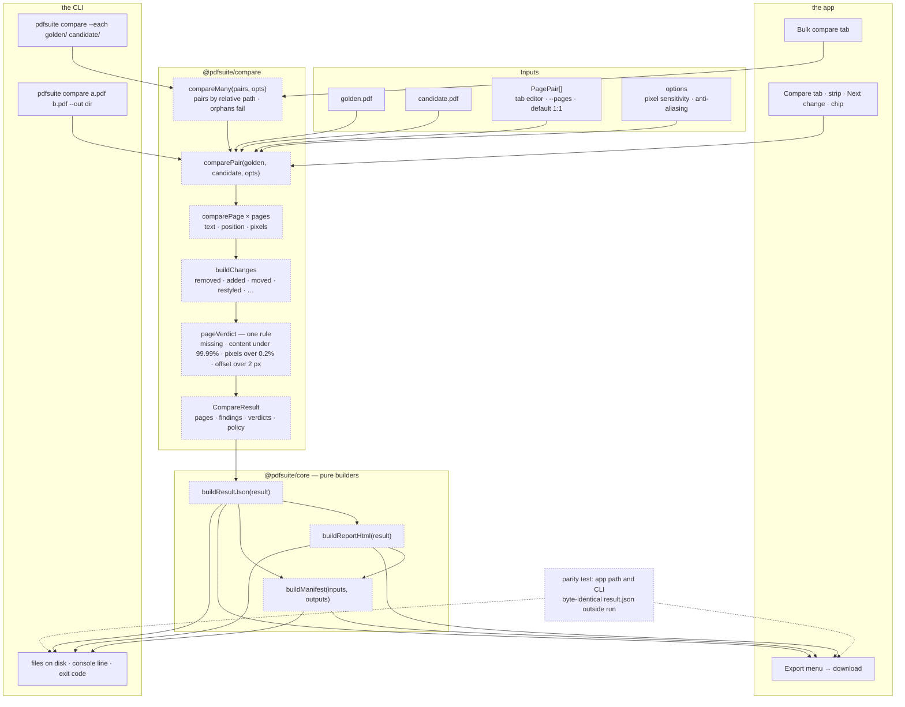

[Open as SVG](architecture/20-target-one-compare-core.svg)

Built by **W-27** (core, rule, pairing, builders, app and CLI on them), after **W-29**.

## The three output files

- **`result.json` is the answer**; everything else — `report.html`, the console line, the exit code — is derived from it ([SR-REPORT-JSON](../records/0109_REPORT-json.md)). Versioned schema `pdfsuite.result/1`, shipped in `@pdfsuite/core`; byte-stable outside the one `run` block; positions in inches, font sizes in points; stable finding ids.
- **`report.html` is the page a person reads** ([SR-REPORT-HTML](../records/0108_REPORT-html.md)): one self-contained file, no script, no request, images embedded for failing pages only, every value escaped, the same bytes from the app and the CLI for the same `result.json`.
- **`manifest.json` is the receipt** ([SR-MANIFEST](../records/0110_MANIFEST.md)): every input and output with bytes and SHA-256, written last, no timestamp, no absolute path.
- **Nothing else is written** — JUnit, CSV and Markdown left the CLI with the ruling; the app keeps Markdown, CSV and the ZIP as ratified UI-only views.

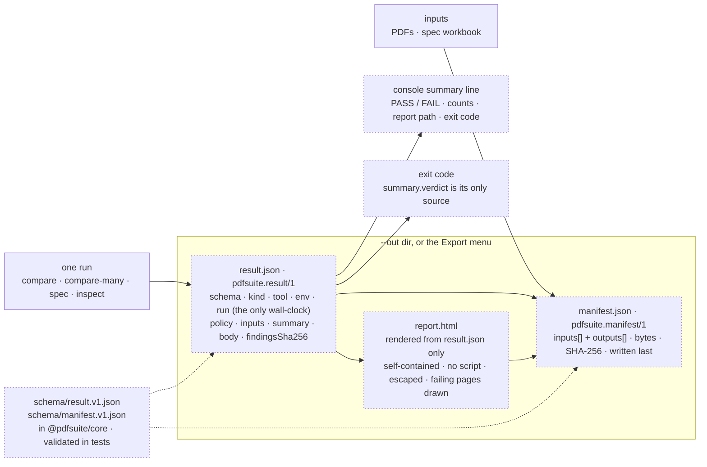

[Open as SVG](architecture/21-target-three-output-files.svg)

Built by **W-27** (the builders), **W-09** (compare writes them), **W-11** (spec), **W-28** (inspect); contracts tested by **W-39**.

## The `pdfsuite` command line

- **One host.** `@pdfsuite/cli` owns `pdfsuite`; `compare` and `spec` are loaded from their packages when installed — missing → exit 2 with the `npm i` to run; a different version → exit 2 ([SR-CLI](../records/0115_CLI.md), [SR-NPM-PACKAGES](../records/0107_NPM-packages.md) decisions 3–4, **W-30**).
- **One pair per command;** many by `--each`, the same function in one process. Inputs positional, options long flags, `--out` names the folder.
- **stdout carries only the console shape;** progress, tables and warnings go to stderr (**W-08**). Exit codes 0 pass · 1 fail · 2 broken; whether 2 splits into usage 2 / runtime 3 is open on **W-07**.
- **Secrets never on the command line** — `--password-env`, `--password-file` (**W-16**); redacted everywhere. No network except `generate`.

```mermaid
flowchart TB
  classDef plan stroke-dasharray: 2 3
  U["pdfsuite COMMAND … --out DIR"] --> HOST["@pdfsuite/cli host<br/>flag › PDFSUITE_* › config file › default"]
  HOST --> LOAD{"command"}
  LOAD -->|"compare · compare --each"| PC["@pdfsuite/compare command module<br/>comparePair · compareMany"]
  LOAD -->|"spec · --validate-only"| PS["@pdfsuite/spec command module<br/>intake · runSpec"]
  LOAD -->|"inspect"| PI["built in → @pdfsuite/core inspectCore"]
  LOAD -->|"generate"| PG["built in → render API"]
  LOAD -->|"agents init"| PA["built in → @pdfsuite/agents"]
  LOAD -->|"not installed · wrong version"| X2A["exit 2 + the npm i to run"]
  PC & PS & PI --> OUT["result.json · report.html · manifest.json"]
  OUT --> CON["stdout: header · one line per pair · summary line<br/>stderr: progress · tables · warnings"]
  OUT --> EX{"exit"}
  EX -->|"every check passes"| E0["0"]
  EX -->|"a page, pair, assertion or orphan fails"| E1["1"]
  EX -->|"bad arguments · unreadable file · wrong password"| E2["2"]
  E3["3? usage vs runtime split<br/>open on W-07"] -.-> E2
  BIN["pdfsuite-compare · pdfsuite-spec<br/>own bins for global installs"] -.-> PC & PS
  class HOST,LOAD,PC,PS,PI,PG,PA,X2A,OUT,CON,EX,E0,E1,E2,E3,BIN plan
```

[Open as SVG](architecture/22-target-cli.svg)

Built by **W-08** (console), **W-09** (compare, `--each`), **W-30** (host, bins, version check), **W-11** (spec), **W-28** (inspect), **W-16** (passwords), **W-10** (agents, publishing).

## Create, sync and hosting

- **`npm create @pdfsuite`** writes a thin shell over `@pdfsuite/ui` — a new Vite + React app, or `src/pdfsuite/` added to an existing React app with no existing file edited and the one router line printed ([SR-NPM-PACKAGES](../records/0107_NPM-packages.md) decision 7, **W-31**).
- **Every file it writes is recorded** with its SHA-256 in `.pdfsuite/installed.json`; **`--sync`** replaces a file only while its hash still matches, writes `<file>.pdfsuite-new` beside an edited one, bumps every `@pdfsuite/*` to one version, and `--check` exits 1 when behind — the executable form of L4 decision 5 (**W-34**).
- **The app is a static single-page app at any URL:** relative assets, hash routing by default, pdf.js worker, fonts and character maps served beside it; PDFs never leave the browser (**W-35**, **W-13**).

```mermaid
flowchart LR
  classDef plan stroke-dasharray: 2 3
  N["npm create @pdfsuite my-app"] --> NEW["new Vite + React app<br/>main.tsx mounts PdfSuiteApp · config · theme<br/>+ core · compare · spec · ui · agents"]
  E["npm create @pdfsuite .<br/>in an existing React app"] --> ADD["src/pdfsuite/ added · deps added<br/>no existing file edited · router line printed"]
  NEW & ADD --> REC[".pdfsuite/installed.json<br/>version · every written file · SHA-256"]
  S["npm create @pdfsuite@latest -- --sync"] --> CHK{"per recorded file"}
  REC --> CHK
  CHK -->|"hash matches"| REP["replace"]
  CHK -->|"hash differs"| KEEP["keep · write file.pdfsuite-new · list it"]
  CHK -->|"deleted by the team"| DEL["stays deleted"]
  S --> VER["@pdfsuite/* → one exact version<br/>nothing else in package.json touched"]
  CI["--sync --check"] -.->|"exit 1 when behind"| CHK
  NEW --> HOST["static host, any URL or sub-path<br/>relative assets · hash routes · pdf.js assets beside the app<br/>no server · no network"]
  class NEW,ADD,REC,CHK,REP,KEEP,DEL,VER,CI,HOST plan
```

[Open as SVG](architecture/23-target-create-sync-hosting.svg)

Built by **W-33** (`ui`), **W-31** (`create`, both modes), **W-34** (`--sync`), **W-35** (any URL).

## Spec driven comparison, end to end

- **Excel is the truth.** A Template v2 workbook is loaded with sheetpane's `@sheetpane/import` (browser and Node) and read in TypeScript, validated with every problem named by its cell, and compiled to a spec JSON in which every value names its sheet and cell; a spec JSON uploaded directly is used as is ([SR-SPEC-INTAKE](../records/0101_SPEC-intake.md), **W-02**). No converter in another language; no LLM — deterministic and auditable.
- **No guesswork (decision 7a).** One row, one value, one Unit cell from a closed list; a blank, in-value, unknown or disallowed unit — or `px` without a declared *Pixels per inch* — is an **error** that names the cell, never "probably inches". The legacy nested layout is only a migration input: it yields a draft v2 workbook for a person to confirm, never an assertion. The validation report, the plain-words preview and the annotated workbook are **W-48**; the in-place sheet view is **W-46**.
- **The checker runs spec JSON only** ([SR-SPEC-CHECK](../records/0102_SPEC-check.md), **W-04**): Pages List binding, order, missing and extra pages, fonts, colour by ΔE, wording, tolerances in the spec's units, coverage "N of M rows checked"; nothing passes silently.
- **The same functions from the Spec tab and `pdfsuite spec`**, through the sealed feature's `engine.ts` ([SR-SPEC](../records/0112_SPEC.md), **W-11**); three files out, every finding with its cell. `.xlsx` on the command line waits on the reader moving to `@sheetpane/import` (it reads without a DOM) on the spec machine.
- **Packaging as `@pdfsuite/spec`** is **W-32** — where it is built is owed a ruling, because the live feature exists only on the spec machine.

```mermaid
flowchart TB
  classDef plan stroke-dasharray: 2 3
  XL["spec.xlsx · Template v2<br/>one row, one value, one Unit cell"] --> RD["readWorkbook<br/>@sheetpane/import · visible cells · size limits"]
  LEG["legacy nested layout"] -.->|"draft v2 workbook<br/>a person confirms"| XL
  RD --> PARSE["sheetToSpec<br/>Pages List · page sheets · Lists · Settings"]
  PARSE --> VAL["validateSpec<br/>error · warning · info — each with its cell<br/>unit blank · in-value · unknown · px without density = error"]
  JS["spec.json<br/>used as is"] --> VAL
  VAL --> SJ["spec JSON<br/>every value: source {sheet, cell}<br/>workbook SHA-256 · template version"]
  SJ & PDF["report.pdf"] --> BIND["bind pages<br/>Pages List · order · missing · extra · optional · variants"]
  BIND --> READ["read the page<br/>geometry · fragments · fonts · colour · images · no text layer"]
  READ --> CMPX["compare each assertion<br/>wording rules · tolerances in the row's own unit"]
  CMPX --> COV["coverage<br/>checked · noted · unverifiable · excluded"]
  COV --> OUT["result.json · report.html · manifest.json<br/>every finding names its cell"]
  subgraph SURF["two surfaces, one engine.ts"]
    TAB["Spec tab<br/>upload · validation report · highlights on the page"]
    CLI["pdfsuite spec spec.xlsx report.pdf --out dir<br/>--pages · --validate-only"]
  end
  TAB & CLI --> RD
  PKG["@pdfsuite/spec<br/>W-32: built where? A · B · C"] -.-> SURF
  class RD,PARSE,VAL,SJ,BIND,READ,CMPX,COV,OUT,TAB,CLI,PKG,LEG plan
```

[Open as SVG](architecture/18-target-spec-driven-comparison.svg)

Built by **W-05** (constants) → **W-02** (intake) and **W-04** (checker); **W-48** (the validation contract: plain words, annotated workbook, `--validate-only`); **W-11** (the command); **W-32** (the package, 🔴). Fixtures: [`work/samples/excel-spec-template-v2/`](../work/samples/excel-spec-template-v2/README.md) — Template v2 with ten planted intake errors, the matching and deviating PDFs. No legacy-layout fixture is committed.

## Testing

- **A feature works when every numbered decision of its record has a test named after it**, and its veto condition runs as one; a check lists the unproven decisions ([SR-TESTING](../records/0116_TESTING.md), **W-36**). Runner: Node's built-in `node:test`.
- **A fictional, realistic sample set** — statements, invoices, letters as PDFs, a spec workbook — with deviations planted on purpose and listed in `expected.json`, generated deterministically in TypeScript (**W-37**); run end to end through the app path and the CLI and **scored** found · missed · extra — a miss fails (**W-38**).
- **Contracts and security** — schema (Ajv, dev-only), manifest hashes, exit codes, console shape, escaping fuzz, no network, no secret (**W-39**); **browser flows** in Playwright, dev-only (**W-40**). Both are open source (L1).
- **CI is GitHub Actions** (SR-TESTING decision 10): every check on each pull request; an approved release publishes every `@pdfsuite` package at one version with trusted publishing and provenance (**W-43**).
- **Blind batches** — an AI that has never seen this project writes the cases and the answer key from a prompt; the key lives in a sealed folder no agent may read; a person runs the judge (**W-41**).

```mermaid
flowchart TB
  classDef plan stroke-dasharray: 2 3
  subgraph PROOF["npm test — every commit, under two minutes"]
    REC["record decisions<br/>SR-X dN"] --> T["named tests<br/>unit · reference · known-answer · property · parity · contracts"]
    FIX["fixtures<br/>one change each · W-12 PDF kinds"] --> T
    COV["decision-coverage check<br/>decisions with no test = the unproven list"]
    REC --> COV
  end
  subgraph E2E["npm run test:samples · test:e2e · test:pack"]
    SAMP["sample set · W-37<br/>PDFs + .xlsx · planted deviations · expected.json"] --> RUNS["runs through the app path and the CLI"]
    RUNS --> SC["scorecard<br/>found · missed · extra · time · memory<br/>a miss fails"]
    PW["Playwright · each tab · exports · sub-path hosting<br/>any off-host request fails"]
    PACK["packed tarballs · create · --sync"]
  end
  subgraph BLIND["blind batches · W-41"]
    PR["PROMPT-compare.md · PROMPT-spec.md<br/>public contracts only"] --> AI["independent AI, fresh chat"]
    AI --> INZ["inputs.zip → blind:place"]
    AI --> ANZ["answers.zip → sealed folder<br/>git-ignored · deny rules · hooks · agent messages"]
    INZ --> BR["blind:run"] --> JD["blind:judge — a person only<br/>found · missed · extra · verdict agreement"]
    ANZ --> JD
    JD --> SPENT["batch spent → joins the sample set"]
  end
  SPENT -.->|"regression"| SAMP
  T & COV & SC --> GREEN["green = proven"]
  CI["GitHub Actions<br/>npm provenance for publishing"] -.-> PROOF & E2E
  class REC,T,FIX,COV,SAMP,RUNS,SC,PW,PACK,PR,AI,INZ,ANZ,BR,JD,SPENT,GREEN,CI plan
```

[Open as SVG](architecture/24-target-testing.svg)

Built by **W-36**, **W-37**, **W-38**, **W-39**, **W-40**, **W-41**; **W-12** supplies the PDF-kinds corpus.

## The build order

**Which item waits on which** — read from the `waits on` words of [`work/OPEN-WORK.md`](../work/OPEN-WORK.md)
on 2026-10-18. Green items can start now; red ones wait on a ruling in the inbox. The
PDF-kinds chain (right) closes each gap in [SR-PDF-SUPPORT](../records/0105_PDF-support.md).

```mermaid
flowchart LR
  classDef ready fill:#dff5e1,stroke:#2e7d32
  classDef ruling fill:#fde0e0,stroke:#c62828
  subgraph SPEC["spec"]
    W05["W-05 constants"] --> W02["W-02 spec intake"] & W04["W-04 spec checker"]
    W02 --> W48["W-48 validation contract"]
  end
  subgraph PKG["packages · core · CLI · UI"]
    W29["W-29 workspaces"] --> W27["W-27 one compare core"] & W30["W-30 CLI host"] & W33["W-33 ui package"]
    W27 --> W09["W-09 compare, one pair, --each"] & W39["W-39 contract + security tests"]
    W09 --> W10["W-10 agents + publish"] & W11["W-11 pdfsuite spec"] & W28["W-28 pdfsuite inspect"]
    W33 --> W31["W-31 npm create"] & W35["W-35 any URL"] & W40["W-40 Playwright"]
    W31 --> W34["W-34 --sync"]
    W32["W-32 @pdfsuite/spec"] -.-> W11
    W07["W-07 compare redesign, 6 points"] -.-> W09
  end
  subgraph TEST["testing · CI"]
    W37["W-37 sample set"] --> W38["W-38 scorecard"]
    W36["W-36 npm test"]
    W41["W-41 blind batches"]
    W43["W-43 CI/CD on GitHub Actions"]
  end
  subgraph KINDS["PDF kinds · SR-PDF-SUPPORT"]
    W12["W-12 kinds corpus + harness"] --> W13["W-13 one loader · fonts · CMaps"] & W17["W-17 form fields"] & W18["W-18 XFA"] & W19["W-19 annotations"] & W20["W-20 page kind"] & W21["W-21 tags"] & W22["W-22 colour"] & W23["W-23 geometry"] & W24["W-24 page sizes"]
    W13 --> W14["W-14 font embedding"] & W16["W-16 passwords"]
    W14 --> W15["W-15 weight from descriptor"] & W25["W-25 signatures"] & W26["W-26 document properties"]
  end
  subgraph REPO["repository"]
    W44["W-44 monorepo layout · SR-MONOREPO"] -.-> W29
    W45["W-45 rename the repository"]
  end
  W01["W-01 claim components"]
  W06["W-06 tab names"]
  W08["W-08 console output"]
  W42["W-42 PDF viewer pop-up"]
  class W05,W29,W36,W37,W41,W12,W01,W08,W43,W44 ready
  class W32,W07,W45,W42,W06 ruling
```

[Open as SVG](architecture/25-build-order.svg)

**Keystones:** **W-29** (everything in the packages lane hangs off it; **W-44** settles the layout it builds in), **W-05** (both spec items), **W-12** (thirteen PDF-kinds items), **W-37** (the scorecard). **Independent and ready:** W-01, W-08, W-36, W-41, W-43, W-44. **Owed a ruling:** W-32, W-07's six points, W-06 (tab names), W-42 (build or not), W-45 (name and owner), and the verdict effect of the new finding types (W-14, W-19, W-21, W-24, W-25, W-26 build with their stated defaults meanwhile).
