# Architecture — PDF Comparison Suite

**What this is.** The app and the `pdfsuite` CLI, drawn from the code as it stands
(verified 2026-10-14). Every box names the real file or function. Where
[`README.md`](../README.md) disagrees with the code, these diagrams follow the code.

**Legend.** Solid border = built · dashed = behind a feature flag · dotted = planned, not built.

**Standalone SVGs.** Every diagram is also a self-contained SVG in [`docs/architecture/`](architecture/), linked under each diagram. They are rendered from the Mermaid blocks in this file — re-render them when a block changes.

**Contents**

- Part 1 · High level — [System overview](#system-overview) · [UI shell and state](#ui-shell-and-state) · [Feature flags](#feature-flags) · [Compare engine](#compare-engine-comparepage)
- Part 2 · Each tab — [Compare 2 PDFs](#compare-2-pdfs--loading-scanning-and-navigation) · [Side by side](#side-by-side) · [Overlapping](#overlapping) · [View report](#view-report) · [Export and Import ZIP](#export-menu-and-import-zip) · [Spec driven comparison](#spec-driven-comparison) · [Inspect PDF](#inspect-pdf) · [Batch compare](#batch-compare)
- Part 3 · CLI — [Build and engine reuse](#how-the-cli-is-built-and-reuses-the-engine) · [`generate`](#pdfsuite-generate) · [`compare`](#pdfsuite-compare) · [`pairs`](#pdfsuite-pairs) · [Verdict rules: app vs CLI](#verdict-rules-app-vs-cli)
- Part 4 · [Planned](#planned--excel--spec-conversion-and-deferred-cli-work)

---

# Part 1 · High level

## System overview

- **One engine, no React.** [`src/services`](../src/services/) holds all comparison logic; the four workspaces reach it through six Zustand stores.
- **The Node CLI imports the same engine files unchanged**, with a small DOM shim that swaps the browser canvas for `@napi-rs/canvas`.
- **There is one CLI, the Node one** — the product is TypeScript ([SR-STACK-TYPESCRIPT](../records/0104_STACK-typescript.md)).

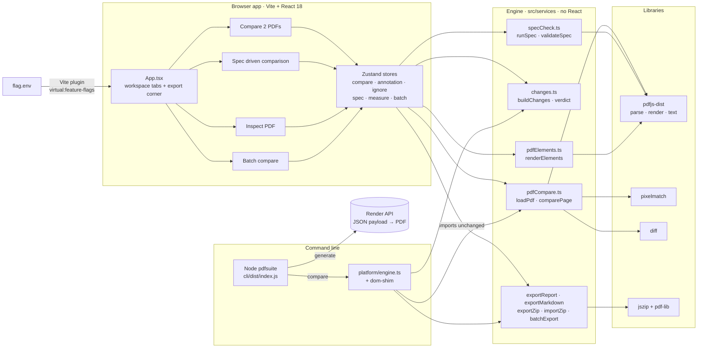

[Open as SVG](architecture/01-system-overview.svg)

## UI shell and state

- **The workspace is plain `useState`** in [`src/App.tsx`](../src/App.tsx); each workspace owns one store, and Compare also uses the annotation and ignore stores.
- **Two effects drive Compare:** compute the visible page; run a full scan automatically when the larger PDF has 60 pages or fewer.
- **Stores meet in two places only:** Batch's "Open in Compare" (`adoptPair`) and Import ZIP (`adoptImported` + annotation `replaceAll`).

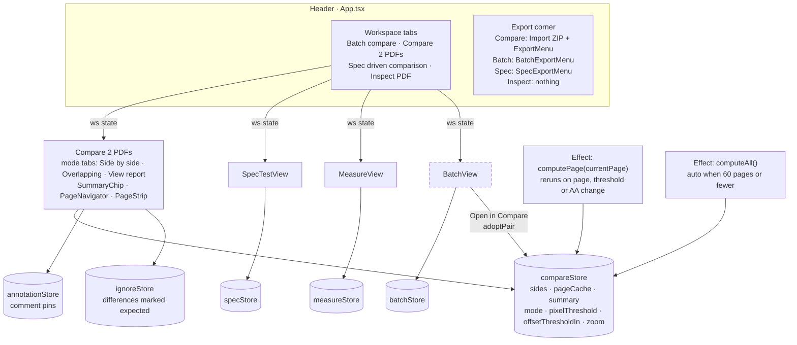

[Open as SVG](architecture/02-ui-shell-and-state.svg)

Code: `src/App.tsx` · `src/store/*.ts` · `src/main.tsx`

## Feature flags

- **`flag.env` → Vite plugin → `virtual:feature-flags`** ([`vite.config.ts`](../vite.config.ts)).
- **[`src/flags.ts`](../src/flags.ts) defaults every flag to on.** A missing key keeps the default; an unrecognised value warns and keeps the default.
- **Dev reloads the browser on save;** a production build bakes the values in.

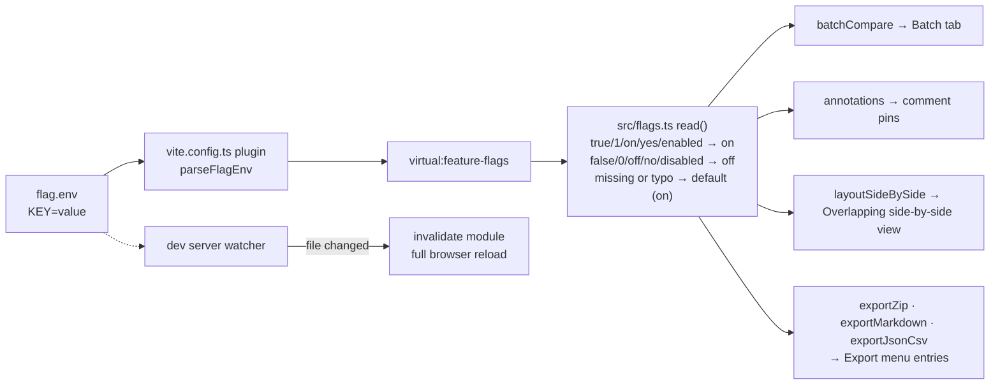

[Open as SVG](architecture/03-feature-flags.svg)

| flag | key in `flag.env` | value in `flag.env` | controls |
|---|---|---|---|
| annotations | `FEATURE_ANNOTATIONS` | true | comment pins in Side by side and Overlapping side-by-side |
| exportZip | `FEATURE_EXPORT_ZIP` | true | ZIP bundle export |
| batchCompare | `FEATURE_BATCH_COMPARE` | false | Batch compare workspace tab |
| layoutSideBySide | `FEATURE_LAYOUT_SIDE_BY_SIDE` | false | side-by-side view inside Overlapping (otherwise it opens on Pixel diff) |
| exportJsonCsv | `FEATURE_EXPORT_JSON_CSV` | false | JSON and CSV entries in every Export menu |
| exportMarkdown | `FEATURE_EXPORT_MARKDOWN` | false | Markdown fix-list export and viewer tab |

## Compare engine: `comparePage`

- **The golden page fixes the target box:** 2 px per point (144 DPI), capped at 1600 px wide. Both pages draw into it, so their coordinates line up.
- **A page of a different shape is scaled and centred (letterboxed),** and its glyph sizes are then not compared.
- **Three signals per page:** word diff of the text, position match of text runs, pixel diff. `buildChanges` turns them into removed · added · moved · restyled.

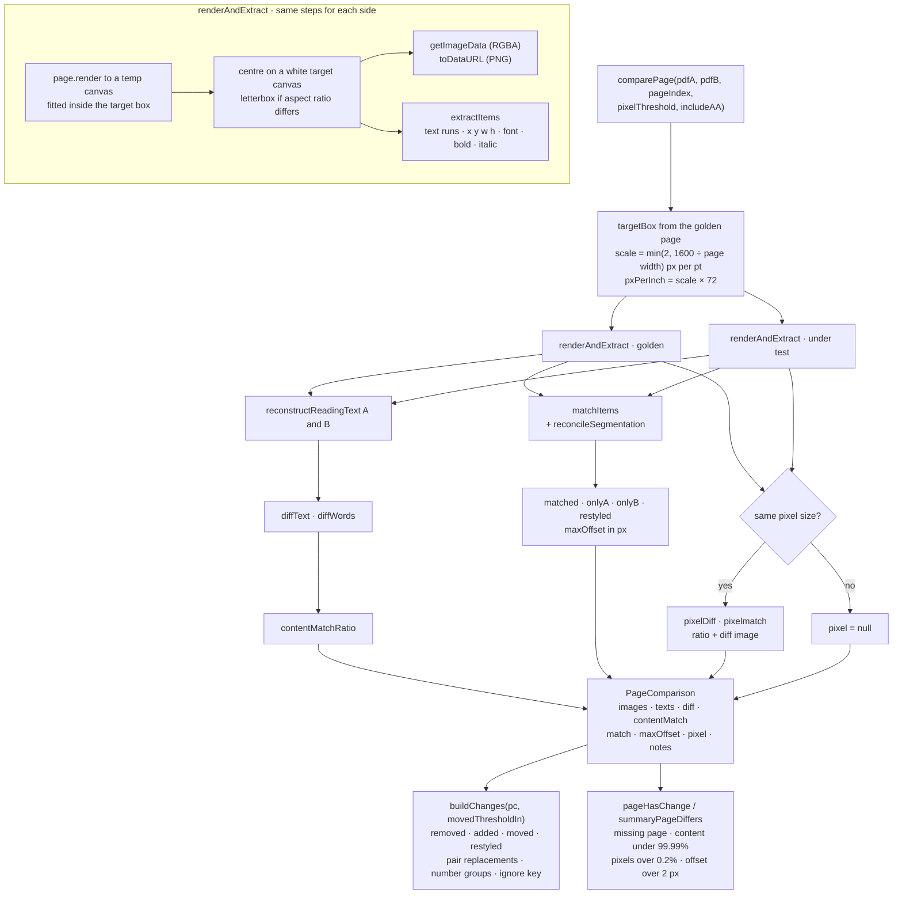

[Open as SVG](architecture/04-compare-engine.svg)

Code: [`src/services/pdfCompare.ts`](../src/services/pdfCompare.ts) · [`src/services/changes.ts`](../src/services/changes.ts) · [`src/types/compare.ts`](../src/types/compare.ts)

> **Watch.** Under Node, `loadPdf` sets no `standardFontDataUrl`. Text in non-embedded standard fonts may not be drawn, and the CLI hides that warning. CLI pixel results can therefore differ from the browser's.

---

# Part 2 · Each tab in detail

## Compare 2 PDFs — loading, scanning and navigation

- **Loading either side clears** the page cache, the summary and any imported report.
- **The visible page is compared first;** the background scan then fills the summary chip and the changed-page strip.
- **"Next change" compares forward until `pageHasChange` is true**, reusing cached pages.

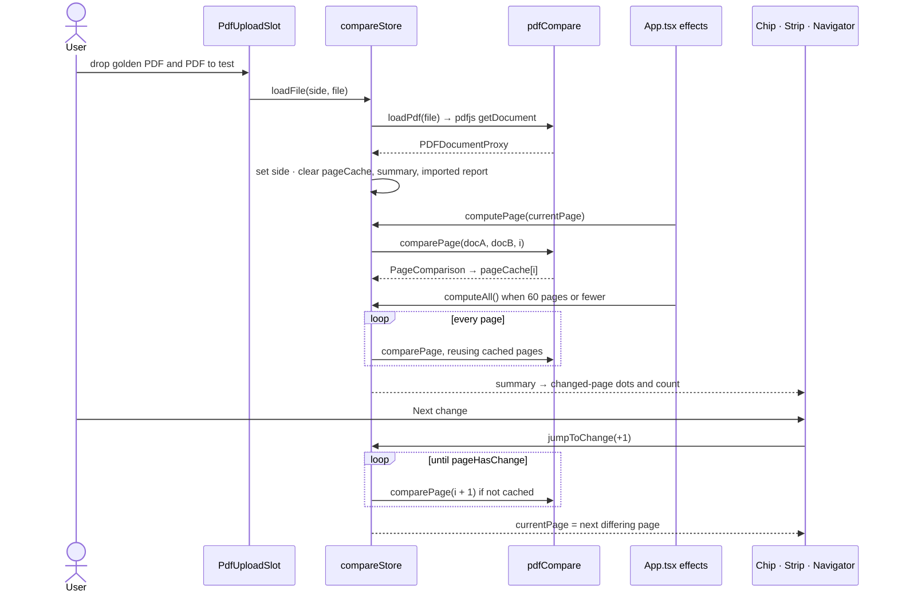

[Open as SVG](architecture/05-compare-loading-navigation.svg)

Code: `PdfUploadSlot.tsx` · `PageNavigator.tsx` · `PageStrip.tsx` · `SummaryChip.tsx` · `src/store/compareStore.ts`

> **Watch.** Nothing cancels a scan in flight. If a file is swapped mid-scan, the old result can land on the new pair.

## Side by side

- **Built from `pageCache[currentPage]` and `buildChanges`;** changes marked "expected" are filtered out first.
- **Page highlight ↔ Changes row ↔ Diff word** are linked by hover.
- **"Mark expected" stores `changeRef(page, key)`** — change text plus a coarse vertical band — so it survives a recompute.

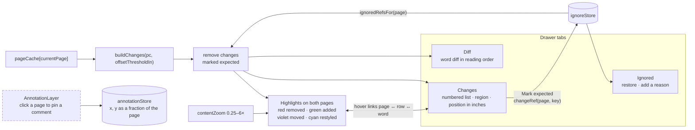

[Open as SVG](architecture/06-tab-side-by-side.svg)

Code: `src/components/compare/ContentCompareView.tsx` · `AnnotationLayer.tsx` · `src/store/ignoreStore.ts` · `src/store/annotationStore.ts`

> **Watch.** Restyled text is shown here but does not change the page verdict; neither does marking a change expected.

## Overlapping

- **Two views:** Side by side (flag, off in `flag.env` now) and Pixel diff. With the flag off the switcher is hidden and the tab opens on Pixel diff.
- **Pixel diff draws pixelmatch's diff image,** with one box per change group, coloured by its strongest cause: text › style › layout.
- **`MeasureOverlay` marks removed, added, moved and restyled runs** with Δx/Δy in inches; a geometry table lists matched runs and links to the page by hover.

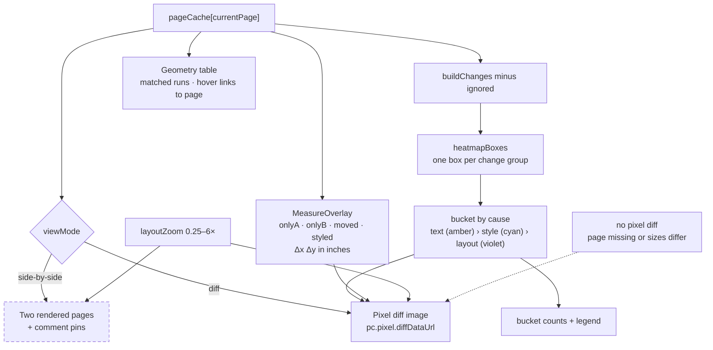

[Open as SVG](architecture/07-tab-overlapping.svg)

Code: `src/components/compare/LayoutCompareView.tsx` · `MeasureOverlay.tsx` · `changes.ts › heatmapBoxes`

## View report

- **An imported ZIP's own report is shown as it was saved.**
- **Otherwise the report is built once per comparison** and shown in a sandboxed iframe with scripts disabled.
- **Only failing pages get a detail section;** passing pages are counted in the header.

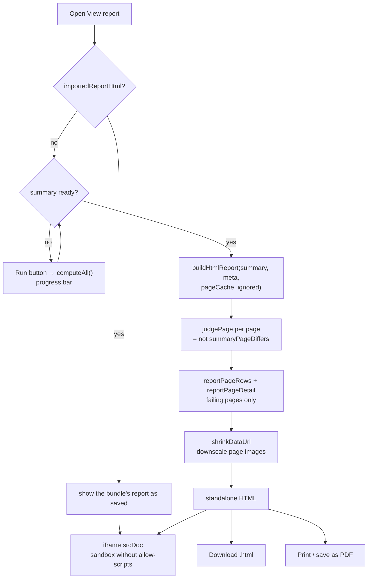

[Open as SVG](architecture/08-tab-view-report.svg)

Code: `src/components/compare/CompareReport.tsx` · [`src/services/exportReport.ts`](../src/services/exportReport.ts)

> **Verdict.** Fixed, not adjustable: a page fails if it differs at all.

## Page pairing

- **The unit of comparison is a pair, not a page number.** Page 5 against page 5 is only right while both documents hold the same pages in the same order; one inserted or dropped page makes every later comparison meaningless.
- **`pairs[]` is the navigation sequence** and `currentPage` indexes into it. It defaults to the straight 1:1 list, so nothing changes until someone pairs the pages.
- **Pairing is done by hand, and nothing is inferred.** "Pair pages" opens a list of rows; clicking either side opens that PDF in a page picker, scrollable, with a size control. "No matching page" marks a page added or removed. Done applies it; the button then reads "Revert to page by page comparison".
- **An automatic aligner exists in `pagePairs.ts` and is deliberately unwired** — a suggestion that is subtly wrong is worse than no suggestion in a tool whose job is to be believed. It is kept, tested, and tree-shaken out of the build.
- **The editor warns rather than prevents:** a page used in two pairs is compared twice, and says so.

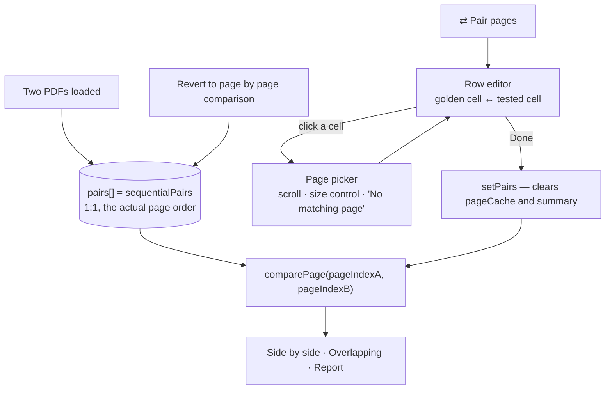

Code: [`src/services/pagePairs.ts`](../src/services/pagePairs.ts) · `src/components/compare/PagePairing.tsx` · `src/store/compareStore.ts`

## Export menu and Import ZIP

- **Every export reads the same inputs:** summary, page cache, ignored list, annotations. Only HTML is always on.
- **The ZIP holds the HTML report and both original PDFs.** Comments become real PDF `/Text` annotations; page content is untouched.
- **Import reverses it:** PDFs found by `golden__` / `candidate__` prefix, comments read back from the annotations, both sides loaded into Compare.

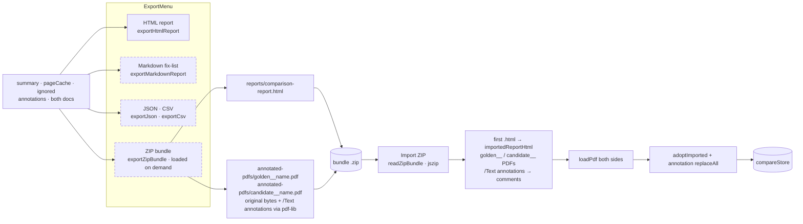

[Open as SVG](architecture/09-export-import-zip.svg)

Code: `ExportMenu.tsx` · `ImportBundleButton.tsx` · [`src/services/exportZip.ts`](../src/services/exportZip.ts) · [`src/services/importZip.ts`](../src/services/importZip.ts) · `exportMarkdown.ts`

## Spec driven comparison

> **Sealed feature.** Everything below lives in `src/features/spec/` and shares no file
> with the rest of the app, because it is developed on a second machine that cannot push.
> Work flows one way — this repository out, a zip in — so **the copy of that folder here
> is a stale mirror; the live one is on the other machine.** The app imports `index.ts`;
> the CLI imports `engine.ts`. See
> [`src/features/spec/README.md`](../src/features/spec/README.md),
> `sh scripts/check-boundary.sh` and `sh scripts/update-from-zip.sh`.

- **No golden PDF:** a JSON spec lists each page's expected elements in inches, points or millimetres from the top-left ([`spec-standard.md`](../spec-standard.md)).
- **A spec workbook is read in the app.** An `.xlsx`/`.csv` is parsed in the browser and each sheet converted to a one-page spec; the reader pairs **a sheet** with **a PDF page** from two lists.
- **The conversion reports what it could not do** — a colour, a conditional rule, a wording cell that is all merge fields, an element with no measurement. Nothing is guessed.
- **Each element is checked on its own,** with expected-vs-actual values and a box on the page.
- **"One page" mode checks one spec page against any PDF page** — for single-sheet specs that always say `"page": 1`.

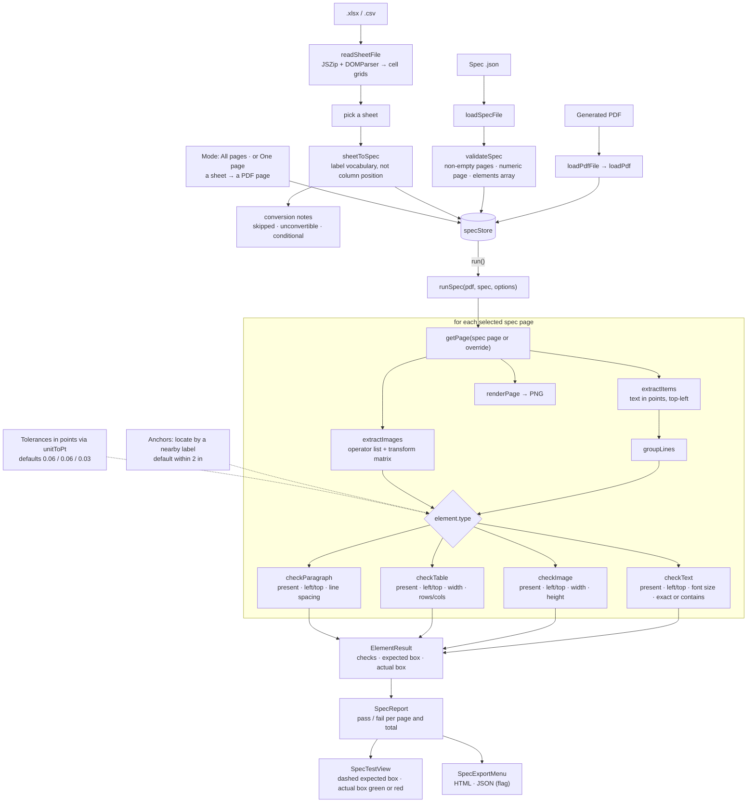

[Open as SVG](architecture/10-spec-driven-comparison.svg)

Code, all under [`src/features/spec/`](../src/features/spec/README.md): `index.ts` · `engine.ts` · `SpecTestView.tsx` · `specStore.ts` · `specCheck.ts` · `specExport.ts` · `sheetRead.ts` · `sheetSpec.ts` · `pdfjs.ts` · `types.ts` · `spec.css`

> **Watch.** Default tolerances are inch values applied in whatever unit the spec uses. The HTML export inserts `units` unescaped.

## Inspect PDF

- **One PDF; hover any text run or image to outline it, click to select it.**
- **Position** gives the distance to all four page edges in inches, with guide lines. **Font & paragraph** (text only) gives font, size, weight, style and line height.
- **No export.** Each page renders when first opened and is then cached.

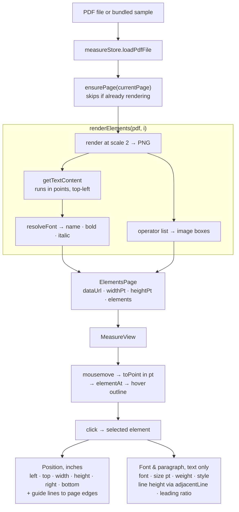

[Open as SVG](architecture/11-inspect-pdf.svg)

Code: `src/components/measure/MeasureView.tsx` · `src/store/measureStore.ts` · [`src/services/pdfElements.ts`](../src/services/pdfElements.ts)

## Batch compare

- **Add many PDFs to each side and pair them** — automatically by order or row by row. Pairs run in order, a page at a time.
- **Raw pixel buffers are dropped once a page is scored;** only PNG data URLs are kept.
- **"Open in Compare" hands the loaded documents** to the Compare workspace.

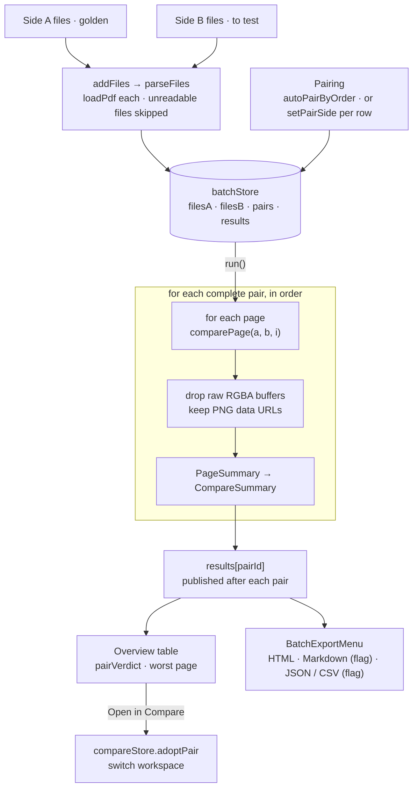

[Open as SVG](architecture/12-batch-compare.svg)

Code: `src/components/batch/BatchView.tsx` · `BatchExportMenu.tsx` · `src/store/batchStore.ts` · [`src/services/batchExport.ts`](../src/services/batchExport.ts)

> **Flag.** `FEATURE_BATCH_COMPARE=false` in `flag.env` now, so this tab is hidden.

---

# Part 3 · CLI

## How the CLI is built and reuses the engine

- **esbuild bundles `cli/src` plus the app's `src/services`** into `dist/index.js`, taking pdf.js's legacy build from the repo-root `node_modules` ([`cli/build.mjs`](../cli/build.mjs)).
- **[`cli/src/platform/engine.ts`](../cli/src/platform/engine.ts) is the only import from the app;** it loads the DOM shim first.
- **Options resolve flag › config file › default.** Exit codes: 0 OK · 1 the PDFs regressed · 2 the tool or job is broken.

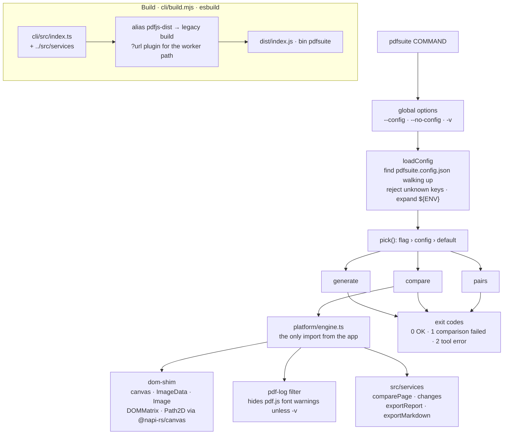

[Open as SVG](architecture/13-cli-build-and-engine.svg)

Code: `cli/src/index.ts` · `cli/src/core/config.ts` · `cli/src/core/exit.ts` · `cli/src/platform/dom-shim.ts`

> **Watch.** Commander exits 1 on bad arguments — the "PDFs regressed" code. The help text promises 2.

## `pdfsuite generate`

- **POSTs each `*.json` payload to the render API and saves the PDF.** Defaults assume a slow API: 4 in flight, 120 s timeout.
- **Retries only what a retry can fix:** 5xx and network errors. Timeouts only with `--retry-on-timeout`; 4xx never.
- **Writes `manifest.json`** (hashes, timings, redacted URL). Any failed document → exit 2, so a partial run never looks like a pass.

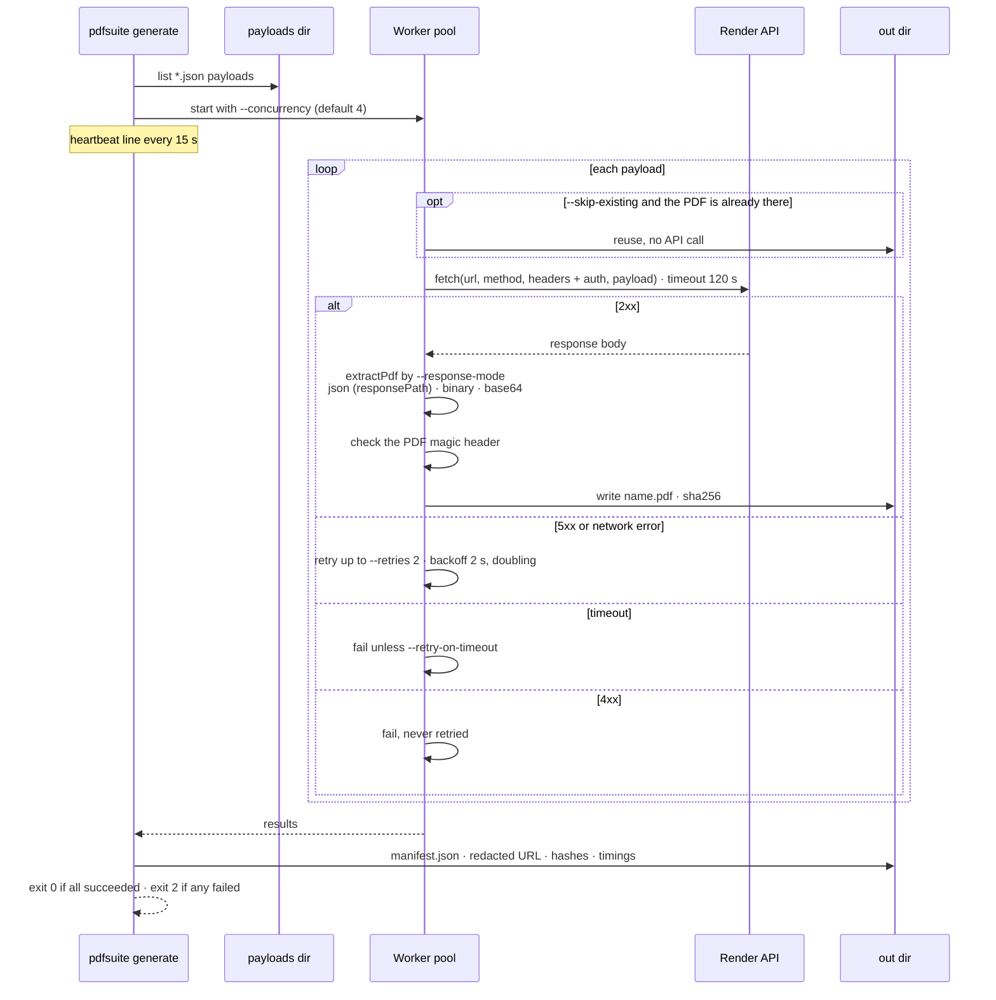

[Open as SVG](architecture/14-cli-generate.svg)

Code: [`cli/src/commands/generate.ts`](../cli/src/commands/generate.ts) · `cli/src/core/manifest.ts` · `cli/mock-api/server.js`

## `pdfsuite compare`

- **Published to npm as `pdfsuite`.** `npm i -g pdfsuite`, then `pdfsuite compare <golden> <candidate> <pairs.json> <reports>`. The flags still work and override a positional.
- **`pairs.json` maps each golden file to its candidate,** and may skip pages. An unresolved pair stops the run before any compare.
- **Same engine *and* same verdict as the app** — `summaryPageDiffers` decides both, so the two cannot disagree (see [Verdict rules](#verdict-rules-app-vs-cli)).
- **`--format` picks the reports.** JUnit has one testsuite per pair id, so Jenkins keeps per-pair history.

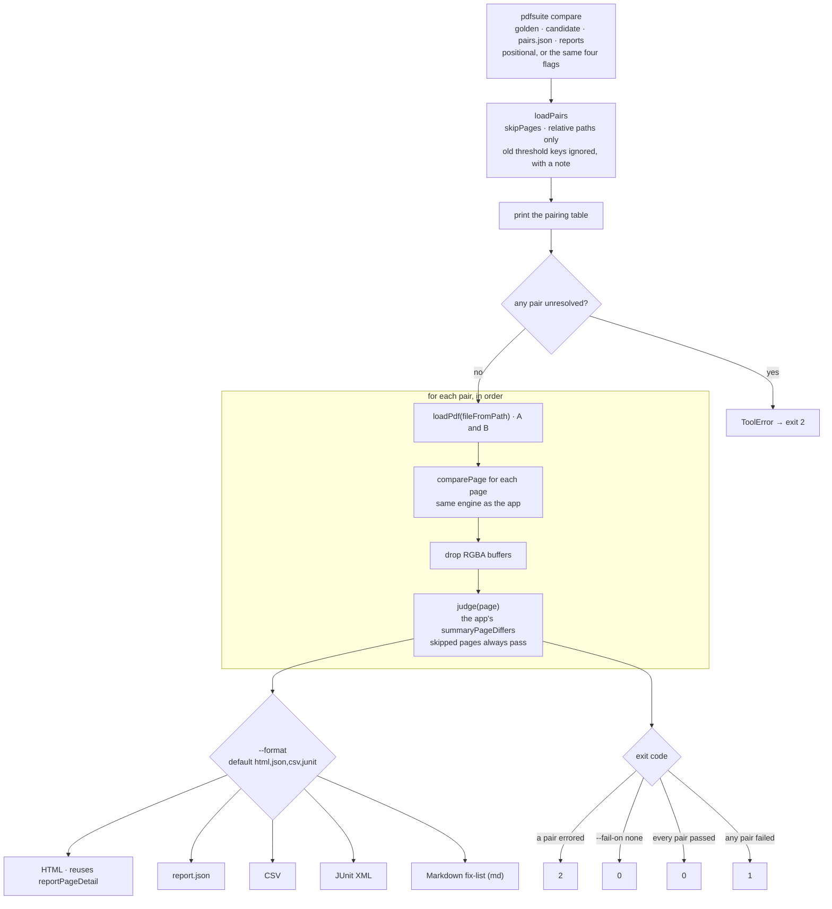

[Open as SVG](architecture/15-cli-compare.svg)

Code: [`cli/src/commands/compare.ts`](../cli/src/commands/compare.ts) · `cli/src/core/pairs.ts` · `cli/src/report/html.ts` · `cli/src/report/machine.ts` · `cli/fixtures/pairs.json`

## `pdfsuite pairs`

- **A dry run:** resolves `pairs.json` against both folders and prints the table. Nothing is compared.
- **All three options are required; this command ignores the config file.**

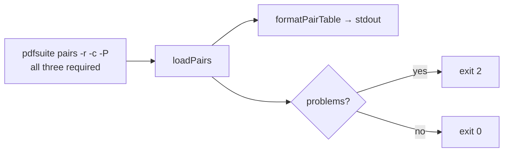

[Open as SVG](architecture/16-cli-pairs.svg)

## Verdict rules: app vs CLI

**Same engine, same judge.** `summaryPageDiffers` decides both, so a pair cannot FAIL in
the app and PASS in CI.

| check | app and CLI — `summaryPageDiffers` |
|---|---|
| content match | fails under 99.99% |
| pixels changed | fails over 0.2% |
| max text offset | fails over 2 px (≈0.014 in on Letter) |
| missing page | fails |
| tunable | **no** — the CLI's thresholds were removed; `skipPages` exempts a whole page, visibly |
| restyled text | ignored |

The CLI kept adjustable tolerances for a while after the app dropped them, which meant the
two disagreed about the same pair — and because esbuild strips types without checking them,
the drift went unnoticed until the HTML report crashed. `npm run build` in `cli/` now runs
`tsc --noEmit` first.

---

# Part 4 · Planned

## Planned — Excel → spec conversion, and deferred CLI work

Source: [`tools/plan.md`](../tools/plan.md) and [`cli/plan.md`](../cli/plan.md). **None of this is built.**

- **Three stages with a reviewable artifact in the middle** — a sheet the parser gets wrong is fixed once, and the fix is kept.
- **Only confident values become assertions;** weaker ones get wider tolerances, become notes, or appear only in the conversion report.
- **Deferred CLI work:** stem-match and manifest pairing, `bless` (promote candidates to goldens), worker-thread parallelism, a Docker image for stable fonts.

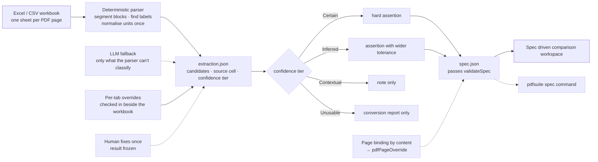

[Open as SVG](architecture/18-planned-spec-conversion.svg)
