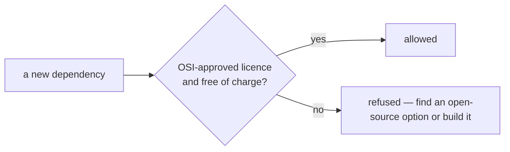

# SR-LAW-2 — L2, only open-source dependencies; nothing paid

## §1 — For humans

**pdfsuite depends only on open-source software that costs nothing.** No paid SDK, no
licence key, no "free tier" of a commercial product, no source-available licence. Anyone
can install, build, test and ship pdfsuite without buying anything or asking anyone.

**Arpit, 2026-10-18:** *"Create a law. No paid dependency, only open source dependencies to
be used. Put it as law one and renumber the existing laws."*



<details>
<summary><b>ASCII twin</b></summary>

```text
   a new dependency --> OSI-approved licence and free of charge? --yes--> allowed
                                                                 --no---> refused
```

</details>

## §2 — For agents

### Context

On 2026-10-18 all 183 installed packages (app and CLI, direct and transitive) were open
source: MIT, ISC, Apache-2.0, BSD-2/3-Clause, 0BSD, MPL-2.0 or Apache-2.0, MIT or
GPL-3.0, MIT and Zlib, and one CC-BY-4.0 data package (`caniuse-lite`). Commercial PDF
viewers (Nutrient, Apryse) had just been named and rejected for W-42.

### Decision

1. **Every dependency is open source and free:** runtime, development, build and test
   packages, bundled fonts and assets — direct and transitive — carry an OSI-approved
   licence and cost nothing to use.
2. **Never allowed:** a paid or licence-keyed package; a free tier or trial of a paid
   product; a source-available licence (BSL, SSPL, Elastic, Commons Clause); a package with
   no licence.
3. **A dual-licensed package** is allowed only under its open-source licence.
4. **Data and fonts** may carry an open content licence — CC0, CC-BY-4.0, SIL OFL.
5. **Not dependencies:** services a user points pdfsuite at (the render API in `generate`),
   the CI system, and AI tools used to write code or generate test data — they are chosen by
   the user, and the product runs without them.
6. **Adding a dependency names its licence** in the change that adds it; an exception to
   this law cannot be ratified — the law changes or the dependency goes.

### Consequences

- Any record or work item proposing a paid option is void in that part (L0 precedence).
- **Enforced today:** nothing mechanical; `B-014` names the licence check over every
  installed package.

### Alternatives considered

| option | why it lost |
|---|---|
| Allow paid tools where clearly better | Arpit ruled no paid dependency, without exception |
| Allow source-available licences | they restrict use and can change terms; not open source |

### Reference (required)

- The licence scan above, over `node_modules` and `cli/node_modules`, 2026-10-18
- [`package.json`](../package.json) · [`cli/package.json`](../cli/package.json)

### Veto condition

**Reopen this decision if:** any installed package — direct or transitive — has a licence
outside decisions 1–4.

**How to check it:** read every `node_modules/**/package.json` `license` field (and `cli/`'s) and list any not on the allow-list.

---

## References

**Records** — [SR-LAWS](0001_LAWS.md) · [SR-LAW-0](0002_LAW-0-authority.md) · [SR-NPM-PACKAGES](0107_NPM-packages.md) · [SR-TESTING](0116_TESTING.md)

**Code** — [`package.json`](../package.json) · [`cli/package.json`](../cli/package.json)
