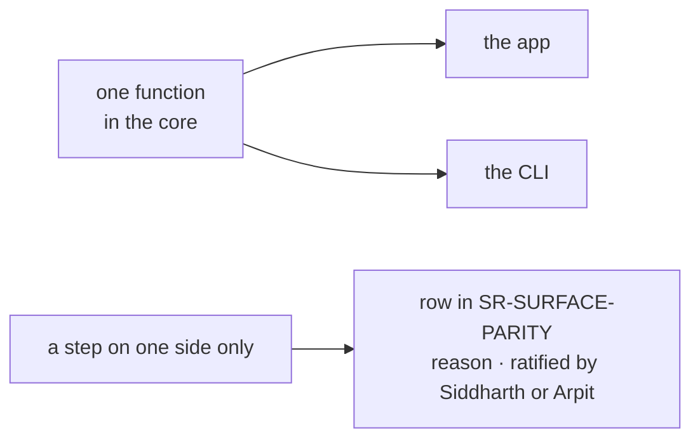

# SR-LAW-3 — L3, the UI and the CLI run the same functions

## §1 — For humans

**Whatever the app can do, the command line does with the same function — and the
other way round.** Not a copy, not a port: one function, imported by both. Then a
pair cannot pass in the browser and fail in CI.

**A step may exist on one side only if someone said so.** Each such step is written
down in [SR-SURFACE-PARITY](0106_SURFACE-parity.md) with its reason, and Siddharth or
Arpit ratifies it — or decides it should be shared after all.

**Arpit, 2026-10-18:** *"Everything that will be used in the UI will be present in the
CLI as well. The function should always be the same. Whichever are not the same, there
needs to be a reason and it needs to be called out and it needs to be ratified or the
decision needs to be made whether it should be CLI only or UI only by either person,
Siddharth or Arpit."*



<details>
<summary><b>ASCII twin</b></summary>

```text
   one function in the core --+--> the app
                              +--> the CLI
   a step on one side only ------> SR-SURFACE-PARITY row (reason, ratified by Siddharth or Arpit)
```

</details>

## §2 — For agents

### Context

The app and the CLI drifted once already: the CLI kept tolerances the app had dropped, and
the two returned different verdicts for the same pair until a crash exposed it
(`docs/ARCHITECTURE.md` §Verdict rules). On 2026-10-18 the page loop existed three times
and "page changed" had two definitions.

### Decision

1. **One function per step.** Every step that produces a result — opening a PDF,
   comparing, listing changes, judging, checking a spec, extracting elements, building a
   report — is one function in the core, called by both the UI and the CLI. A second
   implementation, a copy or a "CLI version" of it is a violation.
2. **A surface keeps only its I/O.** The UI may own how a result is shown, navigated,
   annotated and downloaded; the CLI may own its arguments, console output, exit codes and
   files on disk. Each such surface-only step is still listed in SR-SURFACE-PARITY.
3. **Every difference is named, reasoned and ratified.** A step present on one surface
   only, or done differently on each, has a row in SR-SURFACE-PARITY with its reason and
   the name and date of the person who ratified it — Siddharth or Arpit. An unratified row
   is a decision owed and sits in the *Blocked on Siddharth or Arpit* inbox until ruled.
4. **A new capability lands on both surfaces in the same change**, or lands with its
   SR-SURFACE-PARITY row filed for ratification in that change.
5. **The sealed spec feature obeys through its contract:** the Spec tab and `pdfsuite
   spec` call the same functions exported from `src/features/spec/engine.ts`.

### Consequences

- **Today's violations** are the ❌ and ⚠️ rows of SR-SURFACE-PARITY; each names the work
  item that closes it.
- **Enforced today:** nothing mechanical — judgment, plus W-27's parity test for Compare.
  A general check is `B-013`.

### Alternatives considered

| option | why it lost |
|---|---|
| Share only the verdict | the verdict was shared on 2026-10-18 and the surfaces still disagreed on what "changed" means |
| Let each surface evolve and reconcile later | drift is found by a failing build, after people trusted the wrong answer |
| Forbid any surface-only step | a download button and an exit code are genuinely surface-specific; listing and ratifying them is enough |

### Reference (required)

- [SR-SURFACE-PARITY](0106_SURFACE-parity.md) — the table of every step and every exception
- The feature records this law governs — SR-COMPARE, SR-BULK-COMPARE, SR-SPEC, SR-INSPECT, SR-CLI, SR-REPORT-HTML, SR-REPORT-JSON, SR-MANIFEST (listed under References)
- [`cli/src/platform/engine.ts`](../cli/src/platform/engine.ts) — the CLI's one door into the core

### Veto condition

**Reopen this decision if:** a result-producing step is implemented separately for the UI
and the CLI without a ratified SR-SURFACE-PARITY row.

**How to check it:** `grep -rn "comparePage(\|runSpec(\|renderElements(" src/store src/components cli/src` — after W-27, only the core may call these.

---

## References

**The feature records** — [SR-COMPARE](0111_COMPARE.md) · [SR-BULK-COMPARE](0113_BULK-compare.md) · [SR-SPEC](0112_SPEC.md) · [SR-INSPECT](0114_INSPECT.md) · [SR-CLI](0115_CLI.md) · [SR-REPORT-HTML](0108_REPORT-html.md) · [SR-REPORT-JSON](0109_REPORT-json.md) · [SR-MANIFEST](0110_MANIFEST.md)

**Records** — [SR-LAWS](0001_LAWS.md) · [SR-LAW-0](0002_LAW-0-authority.md) · [SR-SURFACE-PARITY](0106_SURFACE-parity.md)

**Code**

- [`cli/src/platform/engine.ts`](../cli/src/platform/engine.ts) · [`src/features/spec/engine.ts`](../src/features/spec/engine.ts)

**Project docs**

- [`docs/ARCHITECTURE.md`](../docs/ARCHITECTURE.md) §Verdict rules: app vs CLI
