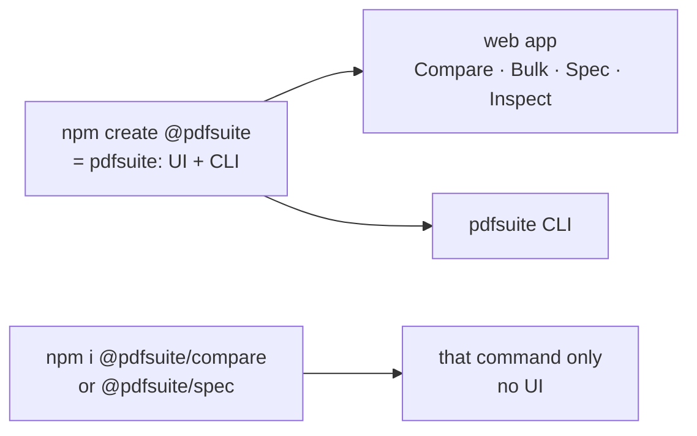

# SR-LAW-4 — L4, how the pdfsuite packages work

## §1 — For humans

**pdfsuite is everything; a single package is a command line.** `npm create @pdfsuite`
gives a team the whole product — a web app with Compare, Bulk compare, Spec and Inspect,
hostable at any URL, and the full CLI. Install only `@pdfsuite/compare` or
`@pdfsuite/spec` in another repository and you get that capability on the command line,
for Jenkins or any test suite — no UI.

**Every package moves together, and an upgrade respects your changes.** All packages
carry one version. Syncing a newer pdfsuite into an app replaces only the files nobody
touched; anything a team edited is left in place and listed.

**Arpit, 2026-10-18:** *"PDF suite is everything. That means it will have the UI, which
will have compare, spec, and inspect in UI as well as through CLI. And if individual
packages like compare or spec are installed anywhere, then it'll just be available through
CLI."* … *"Create a law on how these packages are going to work."*



<details>
<summary><b>ASCII twin</b></summary>

```text
   npm create @pdfsuite  = pdfsuite --+--> web app (Compare, Bulk, Spec, Inspect)
                                      +--> pdfsuite CLI
   npm i @pdfsuite/compare | spec -------> that command only, no UI
```

</details>

## §2 — For agents

### Context

On 2026-10-18 Arpit set out how the product reaches consumers: one full install that is
the whole product, and single packages that bring only their command line. SR-NPM-PACKAGES
holds the package list and mechanics; this law holds what must stay true whatever that
list becomes.

### Decision

1. **pdfsuite is everything.** `npm create @pdfsuite` delivers the whole product: the web
   app (Compare, Bulk compare, Spec, Inspect) and the CLI — into a new app or an existing one.
2. **A domain package alone is a command line.** Installing `@pdfsuite/compare` or
   `@pdfsuite/spec` brings its CLI commands and its library, and never a UI.
3. **One capability, one package.** Engine logic lives in `core` and the domain packages;
   screens only in `ui`; the command host only in `cli`; scaffolding and sync only in
   `create`; agent files only in `agents`. No package re-implements another's capability (L3).
4. **One version.** Every `@pdfsuite` package carries the same version and is released
   together; a run that finds two versions refuses to proceed.
5. **An upgrade never overwrites what the consumer changed.** Sync replaces only generated
   files whose content is still exactly what pdfsuite wrote; everything else is left in
   place and listed, with the new version beside it.
6. **Changing the package set** — adding, merging or removing a package — is a ruling by
   Siddharth or Arpit, recorded in SR-NPM-PACKAGES in the same change.

### Consequences

- SR-NPM-PACKAGES implements this law; its decisions may change, these may not without a
  new ruling.
- **Enforced today:** nothing — no package exists yet. W-30 enforces decision 4, W-34
  decision 5, W-29's import check decision 3.

### Alternatives considered

| option | why it lost |
|---|---|
| Every package carries its own UI | Arpit: a single package is used in CI, where a UI is dead weight |
| Independent package versions | two engines in one run could disagree — L3 broken by install |
| Re-scaffold on upgrade | overwrites what teams changed; the reason sync exists |

### Reference (required)

- [SR-NPM-PACKAGES](0107_NPM-packages.md) — the packages, the install table, the sync and hosting rules
- [SR-LAW-3](0005_LAW-3-one-function-ui-and-cli.md) — one function for the UI and the CLI
- The feature records this law governs — SR-COMPARE, SR-BULK-COMPARE, SR-SPEC, SR-INSPECT, SR-CLI, SR-REPORT-HTML, SR-REPORT-JSON, SR-MANIFEST (listed under References)

### Veto condition

**Reopen this decision if:** a domain package ships UI code, two `@pdfsuite` packages
publish different versions in one release, or a sync rewrites a file whose hash differs
from the one pdfsuite recorded.

**How to check it:** `npm ls --workspaces` versions all equal; `grep -rln "react" packages/compare packages/spec` empty; W-34's sync test.

---

## References

**The feature records** — [SR-COMPARE](0111_COMPARE.md) · [SR-BULK-COMPARE](0113_BULK-compare.md) · [SR-SPEC](0112_SPEC.md) · [SR-INSPECT](0114_INSPECT.md) · [SR-CLI](0115_CLI.md) · [SR-REPORT-HTML](0108_REPORT-html.md) · [SR-REPORT-JSON](0109_REPORT-json.md) · [SR-MANIFEST](0110_MANIFEST.md)

**Records** — [SR-LAWS](0001_LAWS.md) · [SR-LAW-3](0005_LAW-3-one-function-ui-and-cli.md) · [SR-NPM-PACKAGES](0107_NPM-packages.md)
