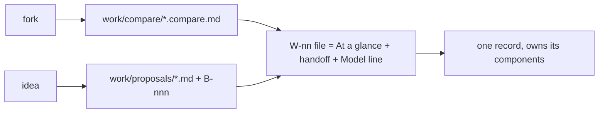

# SR-WORK-LIFECYCLE — how a feature travels

## §1 — For humans

**A fork gets a compare doc; a parked idea gets a proposal.** When work starts,
the handoff — goal, definition of done, constraints, the model that should run
it — lives in the item's own file.

**Every item file opens with an *At a glance* table** — what, why, done when,
status, waits on, who, record — the one screen to put up in a meeting. A plan
of three or more steps adds its flowchart beneath it.

**Every item file names its people** — who filed it, and who last updated it
and when — in its front matter.

**A finished feature leaves one record behind**, and that record owns the code
it produced.



<details>
<summary><b>ASCII twin</b></summary>

```text
   fork ---> compare doc --\
                            >--> W-nn file (At a glance + handoff + Model) ---> one record
   idea ---> proposal -----/
```

</details>

## §2 — For agents

### Context

Handoffs kept in a separate directory drift from the item they describe; a
handoff that names no model gets executed by whichever is open.

### The lifecycle discipline (normative)

1. **On a fork, a compare doc first** — `work/compare/<name>.compare.md`:
   verdict block on top, context, options, matrix, consequences, references,
   **reopen-trigger** (a condition, not a date). Siddharth or Arpit accepts or overrides the
   verdict.
2. **On a parked idea, a proposal** — `work/proposals/<name>.md`, `status:
   proposed`, with a **graduation trigger**. Every proposal has one `B-nnn` row.
3. The design of record is the record itself, updated **before** building.
4. **The handoff lives in the item's own detail file** — context, definition
   of done, constraints, key files, edge cases, open questions. There is no
   handoff directory.
4a. **The item file opens with `## At a glance`** — the first thing under the
    `# W-nn — title` line, before the ask, the `**Model:**` line and the goal.
    It is what goes on screen in a meeting, so it stands alone: nobody follows
    a link to learn what the item is or where it stands.
4b. **Its table has exactly seven rows, in this order:** What · Why · Done
    when · Status · Waits on · Who · Record. One line each, plain words. The
    shape is the template in `work/open/README.md`.
4c. **The Status row is checked, not trusted.** It opens with the item's ball
    exactly as its `OPEN-WORK.md` row carries it, and says `N of M DoD done` —
    N the ✅ rows of the Definition-of-done table, M all of its rows. An edit
    that re-balls the row or changes a DoD state updates the glance in the
    same change.
4d. **A plan of three or more steps gets a picture** — a Mermaid flowchart
    and its collapsed ASCII twin, inside *At a glance*, directly under the
    table. One picture per item; a second diagram belongs further down.
4e. **The front matter names who filed the item and who last updated it:**
    `filed_by: <name>`, `updated: YYYY-MM-DD` and `updated_by: <name>`, after
    `filed`. A name is the **person** — Siddharth, Arpit, or whoever asked —
    never a model, a surface or "agent"; a session acting on its own initiative
    names the person whose session it is. `filed_by` never changes; any edit to
    the file rewrites `updated` and `updated_by` in the same change, and
    `updated` is never earlier than `filed`.
5. The prompt is paste-ready and sits beside its handoff: explore → plan →
   implement → verify.
6. **Every handoff names the model that should execute it** — a `**Model:**`
   line with one sentence of why. `**Model:** NONE — <who, and why>` is legal;
   a blank is the only wrong answer.
7. By task: **Opus** when the output quality *is* the deliverable and no test
   catches a bad one (design, debate, ambiguous diagnosis, calling a gate,
   anything touching a law) · **Sonnet** for a written definition of done with
   checks to verify it · **Haiku** for mechanical bulk edits with an exact rule.
8. When borderline, say Opus and say why it was close.
9. One feature, one record, written from `records/TEMPLATE.md` on completion,
   with its components added to the ownership table in the same change.
10. Every rule, record and material decision carries a reference.
11. An implemented proposal is archived in the change that writes its record.

### Consequences

- **Enforced today:** decisions 4a–4c and the shape of 4e, by `scripts/check-work-items.sh` —
  in-session through `.claude/hooks/guard-work-items.sh`, and at commit
  through `scripts/sr-guard.sh` once it is installed as the `commit-msg` hook.
- **Judgment today:** every other rule, decision 4d included, and whether a
  glance row is *true* — the check proves its shape and its Status counts only.
  For 4e it proves the three keys are present, are names not models, and that
  `updated` ≥ `filed`; that `updated_by` was bumped on the last edit is judgment
  (git history is the audit trail).
- Decision 9 is what retires `W-01`'s placeholder ownership, one component at
  a time.

### Alternatives considered

- A separate `handoffs/` directory — rejected: two files per item, and the
  second goes stale.
- A glance generated from the file by a script — rejected for now: the
  markdown itself is what is presented, and the Status row, the part that
  moves, is already checked against its two sources.
- A free-form summary instead of fixed rows — rejected: items presented side
  by side in a meeting have to answer the same seven questions in the same
  place.

### Reference (required)

- [`records/TEMPLATE.md`](TEMPLATE.md) · [`work/open/README.md`](../work/open/README.md) — the item-file template
- [`scripts/check-work-items.sh`](../scripts/check-work-items.sh) — decisions 4a–4c, 4e

### Veto condition

**Reopen this decision if:** an item file in `work/open/` has no `**Model:**` line,
or does not open with its *At a glance* table.

**How to check it:** `grep -L '^\*\*Model:\*\*' work/open/W-*.md; bash scripts/check-work-items.sh`

---

## References

**Records** — [SR-WORK-OPEN-QUEUE](0051_WORK-open-queue.md) · [SR-WORK-BACKLOG](0052_WORK-backlog.md)

**Code**

- [`scripts/check-work-items.sh`](../scripts/check-work-items.sh)
- [`.claude/hooks/guard-work-items.sh`](../.claude/hooks/guard-work-items.sh)

**Project docs**

- [`work/compare/README.md`](../work/compare/README.md) · [`work/proposals/README.md`](../work/proposals/README.md)
