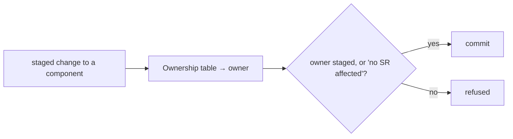

# SR-WORK-OWNERSHIP — owns, describes, and the commit guard

## §1 — For humans

**Every file in the repo has exactly one owner** — a record, or an open work
item while no record exists yet. The table lives in the register.

**Change a file, touch its owner in the same commit** — or write `no SR
affected` in the commit message. A `commit-msg` hook checks this.



<details>
<summary><b>ASCII twin</b></summary>

```text
   staged change ---> owner from table ---> owner staged or "no SR affected"? --yes--> commit
                                                                             \--no---> refused
```

</details>

## §2 — For agents

### Context

Records drift when nothing ties a code change to the record that describes it;
a mechanical tie is crude but it is the only one that runs every time.

### The ownership discipline (normative)

1. Two relations: `owns` (exactly one record per component) and `describes`
   (any number). `describes` never substitutes for `owns`.
2. Both are declared in the register, in two marked tables.
3. **The guard demands the owner and every describer** be staged in the same
   commit as a change to the component — or the commit message carries
   `no SR affected` on its own line.
4. A `describes` row states **why**, in its note cell.
5. Most specific wins, for `owns` only.
6. `scripts/sr-guard.sh` runs as a **`commit-msg`** hook — never `pre-commit`,
   because the escape line has to be read from the message, which does not
   exist at `pre-commit` time. Install once:
   `ln -sf ../../scripts/sr-guard.sh .git/hooks/commit-msg`.
7. `--no-verify` leaves no trace; when CI exists it runs the same check from
   history (`records/RULE-SINCE` is its baseline).
8. The guard proves a record was **touched**, never that it is coherent.

### Consequences

- **Enforced today:** decisions 3 and 5, by `scripts/sr-guard.sh` once it is
  installed as the `commit-msg` hook.
- The same hook also runs SR-WORK-LIFECYCLE's item-file check
  (`scripts/check-work-items.sh`) when a commit stages an open item file or
  the queue — one install, two gates; the guard states neither rule.
- **Judgment today:** `owns:` ↔ table agreement (B-002); decision 7 until CI
  exists.
- Every product path is owned by `W-01` at setup, so a product change stages
  `work/open/W-01-*.md` or says `no SR affected` until records replace it.

### Alternatives considered

- A `pre-commit` hook — rejected: it cannot read the escape line.
- Ownership by directory convention — rejected: it is a judgment, and the
  table is the answer.

### Reference (required)

- [`scripts/sr-guard.sh`](../scripts/sr-guard.sh)
- [`records/README.md`](README.md) §Ownership and §Describes

### Veto condition

**Reopen this decision if:** a tracked path matches no row of the Ownership table.

**How to check it:** `git ls-files` against the paths between the `OWNERSHIP-TABLE` markers in `records/README.md`

---

## References

**Records** — [SR-LAW-0](0002_LAW-0-authority.md)

**Code**

- [`scripts/sr-guard.sh`](../scripts/sr-guard.sh)

**Project docs**

- [`records/README.md`](README.md) · [`records/RULE-SINCE`](RULE-SINCE)
