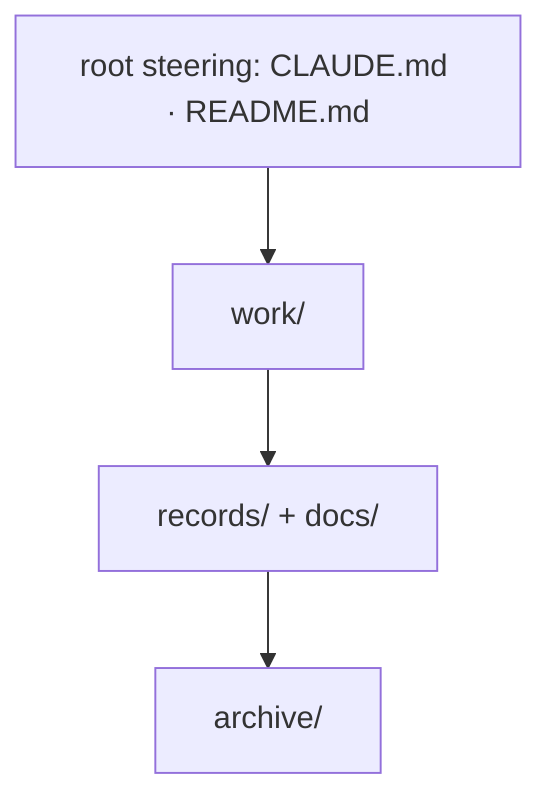

# SR-WORK-GOVERNANCE — the governance map

## §1 — For humans

**Every file that governs how work is done sits in one of four layers.** This
record says which, who reads it, what enforces it, and when it changes.



<details>
<summary><b>ASCII twin</b></summary>

```text
   root steering ---> work/ ---> records/ + docs/ ---> archive/
```

</details>

## §2 — For agents

### Context

Without a map, a new governing file appears in an arbitrary place and nobody
knows what enforces it.

### The governance discipline (normative)

Four layers; every governing file sits in exactly one. The map names homes
and restates no rule. **It carries no counts** — a count in prose is a fact
with an expiry date.

| layer | files | audience | enforced by | update trigger |
|---|---|---|---|---|
| root steering | `CLAUDE.md` · `README.md` · `CHANGELOG.md` | agent / human | hooks + guard | any rule or pointer changes |
| `work/` | `OPEN-WORK.md` · `BACKLOG.md` · `open/` · `BLOCKED.json` · `NOW.md` · `WORKLOG.md` · `INTERVIEW.md` · `IMPLEMENTATION.md` · `LESSONS.md` · `MACHINE.md` · `compare/` · `proposals/` · `samples/` (fictional test samples — product fixtures, owned in the register's table, not by this record; Arpit, 2026-10-18) | both | hooks (`inject-inbox`, `stop-if-blocked`, `require-progress`, `session-lock`, `guard-open-work-inbox`, `guard-work-items`) | the same change as the work |
| `records/` + `docs/` | `records/README.md` (register) · `records/NNNN_*.md` · `records/TEMPLATE.md` · `records/RULE-SINCE` · `docs/GLOSSARY.md` | both | `scripts/sr-guard.sh` | the owning code or the decision changes |
| `archive/` | everything retired, mirroring the live tree | both | judgment (no second `archive/` anywhere) | a closure or a retirement |

A governing file gets its row in the change that adds it and loses it in the
change that retires it.

### Consequences

- **Enforced today:** nothing checks the map itself; it is judgment.
- `CHANGELOG.md` does not exist yet; its row stands for when one is added.

### Alternatives considered

- Let `work/README.md` be the map — rejected: it maps `work/` only.

### Reference (required)

- [`CLAUDE.md`](../CLAUDE.md) §Layout · [`work/README.md`](../work/README.md)

### Veto condition

**Reopen this decision if:** a governing file exists that no layer row names.

**How to check it:** `ls work/ records/ docs/` against the table above

---

## References

**Records** — [SR-WORK-DOCS](0055_WORK-docs.md) · [SR-WORK-REGISTRY](0060_WORK-registry.md)

**Project docs**

- [`CLAUDE.md`](../CLAUDE.md) · [`work/README.md`](../work/README.md) · [`records/README.md`](README.md)
