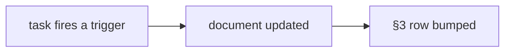

# SR-WORK-REGISTRY — the doc registry

## §1 — For humans

**Every maintained document has a row here** saying what event must update it
and when it was last checked. A task that fires a trigger updates the document
and bumps its row together.



<details>
<summary><b>ASCII twin</b></summary>

```text
   task fires trigger ---> document updated ---> §3 row bumped
```

</details>

## §2 — For agents

### Context

A doc with no stated trigger is updated by nobody; a doc with no verified date
cannot be told apart from a stale one.

### The registry discipline (normative)

1. The registry is §3 of this record — a table, no other file.
2. Every maintained document has an **update trigger** and a **last verified**
   date; a task that fires a trigger updates the document *and* bumps its row
   in the same change.
3. A row is `| Document | Update trigger | Last verified | Notes |`.
4. Live documents only; an archived document loses its row in the same change.
5. No row points into `archive/`. 6. Every row's target exists. 7. One row
   per document. 8. A new maintained document gets its row in the same change.
9. A row older than about thirty days is a review prompt, not a failure.
10. At task end, scan the trigger column.

### Consequences

- **Enforced today:** nothing — decisions 5–8 are backlog row B-003.

### Alternatives considered

- A separate `DOCS-REGISTRY.md` file — rejected: a second file is a second
  thing to keep in step with the rules.

### Reference (required)

- §3 below.

### Veto condition

**Reopen this decision if:** a row in §3 names a file that does not exist.

**How to check it:** `grep -oE '^\| \`[^\`]+\`' records/0060_WORK-registry.md | tr -d '|\` ' | xargs ls`

---

## §3 — The registry

| Document | Update trigger | Last verified | Notes |
|---|---|---|---|
| `CLAUDE.md` | any rule or pointer changes | 2026-10-16 | 2026-10-16 — `cli-py/` dropped from the map (W-03) |
| `work/README.md` | a file is added to or removed from `work/` | 2026-10-13 | 2026-10-13 — created at setup |
| `work/OPEN-WORK.md` | the same change as the work it tracks | 2026-10-16 | 2026-10-16 — W-03, W-04, W-05 filed; W-02 rescoped; inbox row on Python dev scripts |
| `work/BACKLOG.md` | a record names something nobody is doing | 2026-10-16 | 2026-10-16 — B-008 to B-012 filed |
| `work/open/README.md` | the item-file contract changes | 2026-10-13 | 2026-10-13 — created at setup |
| `work/INTERVIEW.md` | direction, a decision or the live state changes — during the session | 2026-10-16 | 2026-10-16 — Excel-spec rulings recorded; four records filed |
| `work/IMPLEMENTATION.md` | something lands | 2026-10-16 | 2026-10-16 — records 0101–0104 filed, nothing built yet |
| `work/LESSONS.md` | a failure teaches something durable | 2026-10-13 | 2026-10-13 — created at setup |
| `work/MACHINE.md` | a surface breaks in a way the code did not cause | 2026-10-13 | 2026-10-13 — created at setup |
| `work/compare/README.md` | a fork opens, closes, or its trigger fires | 2026-10-13 | 2026-10-13 — created at setup |
| `work/proposals/README.md` | an idea is filed, graduates, or is rejected | 2026-10-16 | 2026-10-16 — excel-spec-comparison graduated |
| `docs/GLOSSARY.md` | a term is coined or redefined | 2026-10-16 | 2026-10-16 — spec JSON, extraction JSON, validation report, template v2, Pages List, inferred |
| `records/README.md` | a record's state, ownership or number changes | 2026-10-16 | 2026-10-16 — records 0101–0104; spec paths moved from W-01; `cli-py/` row removed (W-03) |
| `records/TEMPLATE.md` | the convention changes | 2026-10-13 | 2026-10-13 — created at setup |
| `docs/ARCHITECTURE.md` | a change to `src/` or `cli/` alters a flow, a store, a tab, a command, a flag or a verdict rule | 2026-10-16 | 2026-10-16 — Python wrapper section and node removed (W-03) |
| `docs/architecture/` | a Mermaid block in `docs/ARCHITECTURE.md` changes — re-render its SVG | 2026-10-16 | 2026-10-16 — 01 re-rendered, 17 removed (W-03) |
| `work/proposals/excel-spec-comparison.md` | the research behind the spec records changes; archived when W-02 and W-04 close | 2026-10-16 | 2026-10-16 — graduated into four records; open questions answered |
| `tools/samples/excel-spec-hierarchical/README.md` | `generate.py`'s pages, layout or deviations change | 2026-10-16 | 2026-10-16 — created with the sample |

(`WORKLOG.md`, `NOW.md`, `BLOCKED.json` and `archive/README.md` carry no row:
the first is append-only, the next two are overwritten every session, the last
is a map of frozen things.)

---

## References

**Records** — [SR-WORK-DOCS](0055_WORK-docs.md) · [SR-WORK-GOVERNANCE](0059_WORK-governance.md)
