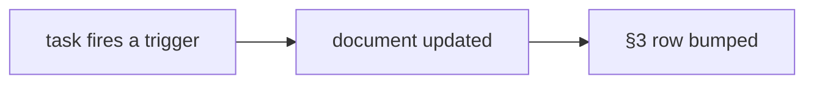

# SR-WORK-REGISTRY — the doc registry

## §1 — For humans

**Every maintained document has a row here** saying what event must update it
and when it was last checked. A task that fires a trigger updates the document
and bumps its row together.



<details>
<summary><b>ASCII twin</b></summary>

```text
   task fires trigger ---> document updated ---> §3 row bumped
```

</details>

## §2 — For agents

### Context

A doc with no stated trigger is updated by nobody; a doc with no verified date
cannot be told apart from a stale one.

### The registry discipline (normative)

1. The registry is §3 of this record — a table, no other file.
2. Every maintained document has an **update trigger** and a **last verified**
   date; a task that fires a trigger updates the document *and* bumps its row
   in the same change.
3. A row is `| Document | Update trigger | Last verified | Notes |`.
4. Live documents only; an archived document loses its row in the same change.
5. No row points into `archive/`. 6. Every row's target exists. 7. One row
   per document. 8. A new maintained document gets its row in the same change.
9. A row older than about thirty days is a review prompt, not a failure.
10. At task end, scan the trigger column.

### Consequences

- **Enforced today:** nothing — decisions 5–8 are backlog row B-003.

### Alternatives considered

- A separate `DOCS-REGISTRY.md` file — rejected: a second file is a second
  thing to keep in step with the rules.

### Reference (required)

- §3 below.

### Veto condition

**Reopen this decision if:** a row in §3 names a file that does not exist.

**How to check it:** `grep -oE '^\| \`[^\`]+\`' records/0060_WORK-registry.md | tr -d '|\` ' | xargs ls`

---

## §3 — The registry

| Document | Update trigger | Last verified | Notes |
|---|---|---|---|
| `CLAUDE.md` | any rule or pointer changes | 2026-11-06 | 2026-11-06 — the spec section rewritten: the feature is `@pdfsuite/spec` behind three barrels (W-32) |
| `work/README.md` | a file is added to or removed from `work/` | 2026-10-18 | 2026-10-18 — `design/` added |
| `work/OPEN-WORK.md` | the same change as the work it tracks | 2026-11-09 | 2026-11-09 — W-31, W-34, W-46, W-52 and W-06 closed; W-52 filed from B-022; **W-06’s inbox row paid and removed**, six rulings left |
| `work/design/README.md` | the Design canvas changes — every file re-exported in one change | 2026-10-18 | 2026-10-18 — created: Proof design system and 15 screen boards exported |
| `work/BACKLOG.md` | a record names something nobody is doing | 2026-11-09 | 2026-11-09 — **B-022 left**, promoted to W-52 and built; B-019, B-020 (W-32), B-021 (W-33); `B-016` had been issued twice, so the Compare-report row became **B-018**. Next free: B-023 |
| `work/open/README.md` | the item-file contract changes | 2026-10-18 | 2026-10-18 — template opens with *At a glance*; front matter gains `filed_by`, `updated`, `updated_by` |
| `work/INTERVIEW.md` | direction, a decision or the live state changes — during the session | 2026-11-09 | 2026-11-09 — sheetpane is published, which unblocked W-46; the packaging items through W-34 |
| `work/IMPLEMENTATION.md` | something lands | 2026-11-09 | 2026-11-09 — W-31, W-34, W-46, W-52 and W-06 (three tabs); 2026-11-06 — W-30, W-32, W-28 and W-33 |
| `work/LESSONS.md` | a failure teaches something durable | 2026-11-09 | 2026-11-09 — a path in an extended tsconfig resolves where it is written; a rule about not losing data has to be run twice; 2026-11-06 — a plugin boundary is a bundle boundary; a driven click is not a mouse; a fix that can prove itself |
| `work/MACHINE.md` | a surface breaks in a way the code did not cause | 2026-10-13 | 2026-10-13 — created at setup |
| `work/compare/README.md` | a fork opens, closes, or its trigger fires | 2026-10-13 | 2026-10-13 — created at setup |
| `work/proposals/README.md` | an idea is filed, graduates, or is rejected | 2026-10-16 | 2026-10-16 — excel-spec-comparison graduated |
| `docs/GLOSSARY.md` | a term is coined or redefined | 2026-11-09 | 2026-11-09 — the tab names (W-06); 2026-11-06 — command module, host, barrel |
| `records/README.md` | a record's state, ownership or number changes | 2026-10-18 | 2026-10-18 — law files renumbered 0003–0006 to match handles L1–L4; SR-LAW-2 open source at 0004 |
| `records/TEMPLATE.md` | the convention changes | 2026-10-13 | 2026-10-13 — created at setup |
| `docs/ARCHITECTURE.md` | a change to `src/` or `packages/` alters a flow, a store, a tab, a command, a flag or a verdict rule | 2026-11-06 | 2026-11-06 — Part 3 redrawn as a host that loads its commands (W-30, W-32); the Inspect section follows W-28; the UI shell and the workspace follow W-33 |
| `docs/architecture/` | a Mermaid block in `docs/ARCHITECTURE.md` changes — re-render its SVG | 2026-11-06 | 2026-11-06 — 02 (the UI shell), 11 (Inspect), 13 (the CLI build), 18, 19 and 27 re-rendered for W-28, W-30, W-32 and W-33 |
| `work/proposals/excel-spec-comparison.md` | the research behind the spec records changes; archived when W-02 and W-04 close | 2026-10-16 | 2026-10-16 — graduated into four records; open questions answered |
| `work/samples/excel-spec-template-v2/README.md` | `generate.ts`'s rows, planted errors or the PDFs change | 2026-10-18 | 2026-10-18 — moved from `tools/samples/`; legacy sample deleted; expected results carried over |

(`WORKLOG.md`, `NOW.md`, `BLOCKED.json` and `archive/README.md` carry no row:
the first is append-only, the next two are overwritten every session, the last
is a map of frozen things.)

---

## References

**Records** — [SR-WORK-DOCS](0055_WORK-docs.md) · [SR-WORK-GOVERNANCE](0059_WORK-governance.md)
