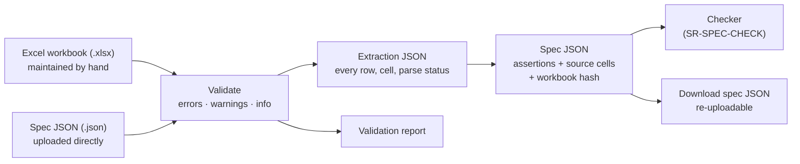

# SR-SPEC-INTAKE — the spec workbook, its validation, and its conversion to spec JSON

## §1 — For humans

**The Excel workbook is the truth, and people maintain it by hand.** Pages are added
and values edited in Excel because Excel is easy to maintain. The tool never checks a
PDF against Excel directly: it first **validates** the workbook, then **compiles** it
into a **spec JSON**, and the checker runs that JSON. A spec JSON can also be uploaded
directly and takes the same path.

**Every value remembers where it came from.** Each assertion in the spec JSON carries
its sheet and cell, so a finding later says *which cell* the PDF disagrees with.



<details>
<summary><b>ASCII twin</b></summary>

```text
  .xlsx (by hand) --\
                     >--> validate --> extraction JSON --> spec JSON --> checker (SR-SPEC-CHECK)
  .json (direct) ---/        |                                |
                             v                                v
                     validation report              download, re-upload later
```

</details>

---

## §2 — For agents

### Context

Spec workbooks are written by people: one sheet per PDF page, nested rows, values in
prose ("5.75 inches from top of page"), merged cells, notes and screenshots. Today the
app accepts only a JSON spec, labels its upload "CSV spec" yet rejects CSV, and points
at a converter that is not in the repo. The fictional fixture
[`tools/samples/excel-spec-hierarchical/`](../tools/samples/excel-spec-hierarchical/README.md)
reproduces the hand-written shape.

### Decision

**A · Input and the one engine path**

1. **The spec upload accepts `.xlsx` (the main path) and `.json` (direct).** Everything
   else is rejected with its own message: `.xls`, `.xlsm`, `.csv`, and a
   password-protected `.xlsx` ("remove the password and re-upload"). The upload reads
   **Excel or JSON spec**.
2. **The checker runs only spec JSON.** An uploaded workbook is compiled to spec JSON;
   an uploaded JSON is validated against the same schema. One checking path for both.
3. **The reader is TypeScript, runs in the browser, and adds no dependency** — it
   unzips with the `jszip` the app already ships. The CLI uses the same module through
   its engine seam. There is no second reader in any language (SR-STACK-TYPESCRIPT).

**B · File safety**

4. **Size limits:** the raw file is checked against the upload limit **before** unzipping;
   the unzipped total is capped to stop a zip bomb (limits in SR-CONSTANTS). Media parts
   are skipped, never loaded. Embedded screenshots are human reference and are never read.
5. **Value cells hold literals.** A formula with a saved result: the result is used and
   the cell gets a warning ("replace the formula with its value"). A formula with no saved
   result: warning, the value is missing, the rest proceeds.
6. **Only what is visible is read.** Hidden sheets, rows and columns and filtered-out rows
   are skipped and listed in the validation report. A hidden sheet named in the Pages
   List is a **warning**; that page is uncovered.

**C · The workbook template**

7. **Template v2 is the format for new and edited sheets:**
   - **Pages List** sheet, one row per PDF page: Tab · Page name · Page type
     (Required · Optional · Conditional) · Orientation · Variant group · Repeats (a range;
     blank = at least one) · Identifying text · Comments.
   - **Page sheets**, one row per parameter and **no merged cells**: ID · Element · Part ·
     Group · Parameter · Value · Unit · From · Check? (Yes · Note · No) · Tolerance ·
     Exact text (Yes · No) · Pattern · Notes · Description.
   - **Description** is optional and human-only; it is never read.
   - **Changing text** is `<<dynamic>>` with a Pattern (e.g. `Quarter {n} {yyyy}`);
     **alternative wordings** are separate rows of the same element, any one of which passes.
   - **Lists** sheet feeds dropdowns: groups, parameters, units, edges, fonts, and named
     colours with hex. It is also the label vocabulary.
   - **Settings** sheet: units, tolerances, page size (optionally pinned), colour
     threshold, template version. It overrides SR-CONSTANTS for that workbook.
   - Screenshots float over cells; never paste one into a cell.
8. **The legacy nested layout is still accepted.** Merged ranges are forward-filled,
   prose values are parsed with a built-in vocabulary, and **every value read from a
   legacy sheet is marked inferred** (lower confidence).

**D · Reading values**

9. **Numbers are normalised:** comma decimals, fractions (`3/8`, `2 1/8`), a leading dot
   (`.5`) and numbers stored as text all read as numbers. `~` marks the value inferred.
   A **range** (`0.5–0.75`, `0.5 - 0.75`, `0.5 to 0.75`; a number on both sides) is the
   tolerance band. A range **and** a Tolerance in the same row is an **error**.
10. **Rich text in a wording cell** (one word italic in the cell) becomes a per-word style
    assertion, marked inferred. An explicit style row for that element wins.
11. **Editing marks:** strikethrough removes the row from the check and lists it; a
    highlight fill is shown as a note; a cell comment is shown beside its element. None
    of them changes a result.
12. **Relative values resolve when their reference exists:** "centered", "full width",
    "% of width", "same as page N", "from left of container", and "same as above" (the
    nearest row above with a value for that parameter). Chains are followed up to a depth
    cap (SR-CONSTANTS) with loop detection. An unresolved reference is a warning plus a note.

**E · Validation and outputs**

13. **Every upload is validated before any PDF check.** Three severities:
    - **Error** — on the file or the Pages List it stops the run; on an element it
      removes that element from the check and lists it. Examples: wrong file type; no
      Pages List; a listed tab with no sheet or a sheet not listed; an element with no
      position; an unparseable number; an unknown unit; a duplicate ID; one parameter with
      two values; text with no wording; a range plus a Tolerance.
    - **Warning** — checked, with lower confidence. Examples: an element outside the page
      or its container; overlapping elements; text estimated to overflow; an unknown
      parameter name (with the nearest known name); a colour name that does not match its
      hex; `<<dynamic>>` with no Pattern; a formula cell; a hidden sheet that is listed.
    - **Info** — goes to coverage: things with no check yet, notes, conditional pages.
14. **Three downloadable outputs:** the **validation report** (each line with its cell);
    the **extraction JSON** (every row: sheet, cell, raw text, parsed value, status —
    parsed, note, excluded or unreadable); the **spec JSON** (assertions only, each with
    `source: {sheet, cell}`, plus the workbook's SHA-256 and template version). The spec
    JSON download can be uploaded again directly.
15. **Nobody hand-edits the JSON.** A correction goes into the workbook, or into a
    per-sheet overrides file checked in beside it.
16. **Fixtures freeze the expected extraction and spec JSON** of the committed fictional
    workbooks; a parser change that alters them fails the suite. Real workbooks are never
    committed.
17. **The uploader is responsible** for uploading the right, current workbook and PDF. The
    tool records which pair it tested (SR-SPEC-CHECK) and does not police freshness.

### Consequences

- **Built today:** a JSON spec upload and `validateSpec` (shape only). Everything else in
  this record is unbuilt — **W-02** builds it, after **W-05** creates the constants file.
- **Deferred by Arpit (2026-10-16), in the backlog:** stale-pair detection (B-008),
  Draft/Ready status per page sheet (B-009), version diff between two spec JSONs (B-010).
- **Owned:** `spec-standard.md` (the JSON format and template v2, rewritten by W-02),
  `src/features/spec/types.ts` (the spec JSON type), and the fictional fixture.
- **Enforced today:** nothing; decision 16 becomes a gate when W-02's fixtures land.

### Alternatives considered

| option | why it lost |
|---|---|
| A converter outside the app (Python, `openpyxl`) | the workbook must upload in the app; a second implementation drifts; the product is TypeScript (SR-STACK-TYPESCRIPT) |
| SheetJS or ExcelJS | a new dependency for cells `jszip` already reads; SheetJS's npm release is stale, ExcelJS has not been published since 2023 |
| Keep merged-cell nesting as the template | merges break silently when rows are inserted or sorted; legacy sheets stay readable through decision 8 |
| Only a fixed template, no legacy reading | existing sheets would stop working on day one |
| Check the PDF straight from Excel, no JSON | no reviewable, diffable artifact; two engine inputs |
| LLM-first extraction | not deterministic, not auditable |

### Reference (required)

- [`src/features/spec/types.ts`](../src/features/spec/types.ts) — today's spec JSON type
- [`spec-standard.md`](../spec-standard.md) — today's JSON format; §7 is the old fixed-column plan this replaces
- [`tools/samples/excel-spec-hierarchical/README.md`](../tools/samples/excel-spec-hierarchical/README.md) — the legacy-layout fixture and its expected results
- [`work/proposals/excel-spec-comparison.md`](../work/proposals/excel-spec-comparison.md) — the research and the observed sheet conventions

### Veto condition

**Reopen this decision if:** a second spec reader exists beside the TypeScript one, in any
language.

**How to check it:** `git ls-files | grep -iE 'spec-from-excel|xlsx.*\.(py|rb|java)$'` returns nothing

---

## References

**Records** — [SR-SPEC-CHECK](0102_SPEC-check.md) · [SR-CONSTANTS](0103_CONSTANTS.md) · [SR-STACK-TYPESCRIPT](0104_STACK-typescript.md) · [SR-LAW-0](0002_LAW-0-authority.md)

**Code**

- [`src/features/spec/types.ts`](../src/features/spec/types.ts) · [`src/features/spec/specStore.ts`](../src/features/spec/specStore.ts) · [`src/features/spec/specCheck.ts`](../src/features/spec/specCheck.ts) `validateSpec`

**Project docs**

- [`spec-standard.md`](../spec-standard.md) · [`tools/samples/excel-spec-hierarchical/README.md`](../tools/samples/excel-spec-hierarchical/README.md) · [`work/proposals/excel-spec-comparison.md`](../work/proposals/excel-spec-comparison.md)
