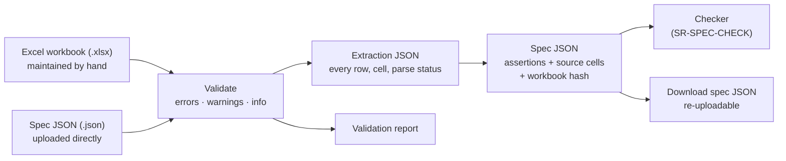

# SR-SPEC-INTAKE — the spec workbook, its validation, and its conversion to spec JSON

## §1 — For humans

**The Excel workbook is the truth, and people maintain it by hand.** Pages are added
and values edited in Excel because Excel is easy to maintain. The tool never checks a
PDF against Excel directly: it first **validates** the workbook, then **compiles** it
into a **spec JSON**, and the checker runs that JSON. A spec JSON can also be uploaded
directly and takes the same path.

**Every value remembers where it came from.** Each assertion in the spec JSON carries
its sheet and cell, so a finding later says *which cell* the PDF disagrees with.

**Nothing is guessed.** A measurement is a number in one cell and a unit in the next, chosen
from a short list. A row with no unit, a unit written inside the number (`"14 pt"`), a
unit the parameter cannot take, or a value the reader cannot be sure of is an **error** that
names the cell — it is never read as "probably inches". **Arpit, 2026-10-18:** *"If there is
a value like 2 and it is in pixels, I want to be 100 % sure that's what it is. No guesswork.
If it is wrong, throw an error."*



<details>
<summary><b>ASCII twin</b></summary>

```text
  .xlsx (by hand) --\
                     >--> validate --> extraction JSON --> spec JSON --> checker (SR-SPEC-CHECK)
  .json (direct) ---/        |                                |
                             v                                v
                     validation report              download, re-upload later
```

</details>

---

## §2 — For agents

### Context

Spec workbooks are written by people: one sheet per PDF page, nested rows, values in
prose ("5.75 inches from top of page"), merged cells, notes and screenshots. Today the
app accepts only a JSON spec, labels its upload "CSV spec" yet rejects CSV, and points
at a converter that is not in the repo. The fictional fixture
[`work/samples/excel-spec-template-v2/`](../work/samples/excel-spec-template-v2/README.md)
is the same kind of report written in Template v2 (the legacy-layout sample was deleted on
2026-10-18; it is in git history).

### Decision

**A · Input and the one engine path**

1. **The spec upload accepts `.xlsx` (the main path) and `.json` (direct).** Everything
   else is rejected with its own message: `.xls`, `.xlsm`, `.csv`, and a
   password-protected `.xlsx` ("remove the password and re-upload"). The upload reads
   **Excel or JSON spec**.
2. **The checker runs only spec JSON.** An uploaded workbook is compiled to spec JSON;
   an uploaded JSON is validated against the same schema. One checking path for both.
3. **The workbook is loaded with sheetpane's `@sheetpane/import` and shown with its
   `@sheetpane/grid`** — Arpit's own MIT-licensed package, pinned exactly. **Arpit,
   2026-10-19:** *"sheetpane is the one we are going to use to load excel and display."*
   `read()` gives one plain `Workbook` object — raw values, display text, merges, hidden
   sheets, rows and columns, saved formula values, rich-text runs, the file's SHA-256 — and
   pdfsuite's TypeScript validator and compiler read that object, never the zip. The same
   `read()` runs in the browser and under Node (its own XML reader when `DOMParser` is
   absent), so the CLI uses the same module through its engine seam. There is no second
   reader in any language (SR-STACK-TYPESCRIPT); `@sheetpane/import`'s refusals
   (`unsupported-format`, `password-or-legacy`, …) are mapped to decision 1's messages.

**B · File safety**

4. **Size limits:** the raw file is checked against the upload limit **before** unzipping;
   the unzipped total is capped to stop a zip bomb (limits in SR-CONSTANTS). Media parts
   are skipped, never loaded. Embedded screenshots are human reference and are never read.
5. **Value cells hold literals.** A formula with a saved result: the result is used and
   the cell gets a warning ("replace the formula with its value"). A formula with no saved
   result: warning, the value is missing, the rest proceeds.
6. **Only what is visible is read.** Hidden sheets, rows and columns and filtered-out rows
   are skipped and listed in the validation report. A hidden sheet named in the Pages
   List is a **warning**; that page is uncovered.

**C · The workbook template**

7. **Template v2 is the format for new and edited sheets:**
   - **Pages List** sheet, one row per PDF page: Tab · Page name · Page type
     (Required · Optional · Conditional) · Orientation · Variant group · Repeats (a range;
     blank = at least one) · Identifying text · Comments.
   - **Page sheets**, one row per parameter: Element · Part · Group · Parameter · Value · Unit ·
     From · Check? (Yes · Note · No) · Tolerance · Exact text (Yes · No) · Pattern · Notes ·
     Description. **A row is identified by its sheet and row number** — there is no ID
     column; every report and every `source` cell already names the row. **Element, Part and
     Group are merged and centred over the rows they label** (Arpit, 2026-10-18: repeating
     the word makes no sense); a merge is a declared range in the file and is read as exactly
     that — never a guess. Merges are allowed in those three columns only; a merge reaching
     Parameter or any column to its right is an error, and so is a blank Element, Part or Group
     cell outside a merge — the reader never forward-fills. **One cell, one fact:** a
     position is *Parameter* `Top`, *Value* `5.75`, *Unit* `in`, *From* `top of page` — never
     the sentence "5.75 inches from top of page". A baseline, a wrap point, a line break and a
     line spacing are each their own row.
   - **The template carries its own guard rails:** dropdowns (Excel data validation) on
     Group, Parameter, Unit, From, Check? and Exact text, fed by the Lists sheet; conditional
     formatting turns the Unit cell red when its Parameter needs a unit and none is given, and
     the Value cell red when it holds text where a number is required. Excel shows the error
     before the upload does; the upload repeats it (decision 13).
   - **Description** is optional and human-only; it is never read.
   - **Changing text** is `<<dynamic>>` with a Pattern (e.g. `Quarter {n} {yyyy}`);
     **alternative wordings** are separate rows of the same element, any one of which passes.
   - **Lists** sheet feeds dropdowns: groups, **parameters with their kind and allowed
     units**, units, edges (*From*), fonts, and named colours with hex. It is also the label
     vocabulary; a parameter not on it is an error.
   - **Settings** sheet: tolerances, page size (optionally pinned), colour threshold,
     **pixels per inch** (blank unless the workbook uses `px`), template version. It
     overrides SR-CONSTANTS for that workbook. It holds **no default unit**: a unit is stated
     on every row (decision 7a).
   - Screenshots float over cells; never paste one into a cell.
7a. **Units are explicit, closed and checked — never inferred.** The Unit cell is one of
    `in` · `mm` · `cm` · `pt` · `px` · `%` · `count`, or blank only for a parameter whose kind
    takes none (text, yes/no, colour, font, list). The Lists sheet names each parameter's
    kind and allowed units (font size and line spacing: `pt`; positions and sizes: `in`,
    `mm`, `cm`, `pt`, `px`, `%`; rows and columns: `count`). Each of these is an **error** on
    that row: a unit-taking parameter with a blank Unit; a unit written inside the Value;
    a Unit the parameter cannot take; `px` while Settings gives no *Pixels per inch*; a
    Value that is not a number where the kind requires one. No fallback exists — not the
    workbook's Settings, not the row above, not the column header, not the parameter's
    usual unit. **Arpit, 2026-10-18.**
8. **The legacy nested layout is accepted only as a migration input.** The reader
   forward-fills merged ranges and parses prose with its built-in vocabulary, but **writes no
   assertion from it**: it produces a draft Template v2 workbook in which every cell it
   inferred is highlighted and every cell it could not read is red, for a person to confirm
   in Excel and upload. The confirmed v2 workbook is what gets checked. (Arpit,
   2026-10-18: no guesswork reaches a result.)

**D · Reading values**

9. **Numbers are normalised, never interpreted:** comma decimals, fractions (`3/8`,
   `2 1/8`), a leading dot (`.5`) and numbers stored as text all read as numbers — these are
   spellings, not guesses. `~`, `about`, `approx.` or any other word in a numeric Value is an
   **error** ("state a Tolerance instead"). A **range** (`0.5–0.75`, `0.5 - 0.75`, `0.5 to 0.75`; a number on both sides) is the
   tolerance band. A range **and** a Tolerance in the same row is an **error**.
10. **Rich text in a wording cell** (one word italic in the cell) becomes a per-word style
    assertion, marked inferred. An explicit style row for that element wins.
11. **Editing marks:** strikethrough removes the row from the check and lists it; a
    highlight fill is shown as a note; a cell comment is shown beside its element. None
    of them changes a result.
12. **Relative values resolve when their reference exists:** "centered", "full width",
    "% of width", "same as page N", "from left of container", and "same as above" (the
    nearest row above with a value for that parameter). Chains are followed up to a depth
    cap (SR-CONSTANTS) with loop detection. An unresolved reference is a warning plus a note.

**E · Validation and outputs**

13. **Every upload is validated before any PDF check.** Three severities:
    - **Error** — on the file or the Pages List it stops the run; on an element it
      removes that element from the check and lists it. Examples: wrong file type; no
      Pages List; a listed tab with no sheet or a sheet not listed; an element with no
      position; an unparseable number; a missing, unknown, in-value or disallowed unit; `px`
      with no *Pixels per inch*; a colour name whose hex does not match the Lists sheet; a
      blank Element, Part or Group cell outside a merge; a merge that reaches a value column;
      one parameter with two values; text with no wording; a range plus a Tolerance; an
      approximate value (`~`).
    - **Warning** — checked, with lower confidence. Examples: an element outside the page
      or its container; overlapping elements; text estimated to overflow; an unknown
      parameter name (with the nearest known name); `<<dynamic>>` with no Pattern; a formula
      cell; a hidden sheet that is listed.
    - **Info** — goes to coverage: things with no check yet, notes, conditional pages.
14. **Four downloadable outputs:** the **validation report** (each line with its cell, and
    for every accepted row the assertion **in plain words** — "Report title: top edge 5.75 in
    from the top of the page, ± 0.06 in" — so a person sees exactly what the machine
    understood); the **annotated workbook** (the uploaded `.xlsx` with every error cell
    filled red and a *Validation* sheet listing them, to fix in Excel and re-upload);
    the **extraction JSON** (every row: sheet, cell, raw text, parsed value, status —
    parsed, note, excluded or unreadable); the **spec JSON** (assertions only, each with
    `source: {sheet, cell}`, plus the workbook's SHA-256 and template version). The spec
    JSON download can be uploaded again directly.
15. **Nobody hand-edits the JSON.** A correction goes into the workbook, or into a
    per-sheet overrides file checked in beside it.
16. **Fixtures freeze the expected extraction and spec JSON** of the committed fictional
    workbooks; a parser change that alters them fails the suite. Real workbooks are never
    committed.
17. **The uploader is responsible** for uploading the right, current workbook and PDF. The
    tool records which pair it tested (SR-SPEC-CHECK) and does not police freshness.

### Consequences

- **Built today:** a JSON spec upload and `validateSpec` (shape only). Everything else in
  this record is unbuilt — **W-02** builds it, after **W-05** creates the constants file.
- **Deferred by Arpit (2026-10-16), in the backlog:** stale-pair detection (B-008),
  Draft/Ready status per page sheet (B-009), version diff between two spec JSONs (B-010).
- **Owned:** `spec-standard.md` (the JSON format and template v2, rewritten by W-02),
  `src/features/spec/types.ts` (the spec JSON type), and the one fictional fixture,
  `work/samples/excel-spec-template-v2/` — Template v2 with every unit explicit, labels merged,
  the decision-7a guard rails built into the file, ten planted intake errors, and the two
  PDFs. **No legacy-layout fixture is committed** (deleted 2026-10-18 on Arpit's instruction);
  decision 8's migration path is tested against a legacy sheet built in the test from the v2
  data, never a real workbook.
- **The Validate tab** — the validation report, the plain-words preview and the annotated
  workbook inside the Spec tab — is **W-46**.
- **Enforced today:** nothing; decision 16 becomes a gate when W-02's fixtures land.

### Alternatives considered

| option | why it lost |
|---|---|
| A converter outside the app (Python, `openpyxl`) | the workbook must upload in the app; a second implementation drifts; the product is TypeScript (SR-STACK-TYPESCRIPT) |
| SheetJS or ExcelJS | SheetJS's npm release is stale, ExcelJS has not been published since 2023; neither draws the sheet, so the screen would need a second reader |
| pdfsuite's own reader on `jszip` (this record's decision 3 until 2026-10-19) | the sheet view (W-46) would parse the file a second time, and two readers can disagree on a merge or a sheet name; sheetpane already reads everything decision 3 lists, in the browser and in Node — Arpit, 2026-10-19 |
| Merged cells anywhere, including values (the legacy nesting) | a merge over a value hides which row it belongs to; merges are kept for the three label columns, where Excel refuses to sort unequal merges and an inserted edge row shows up as a blank-label error |
| An ID column | a second name for what the sheet and row number already say; it drifts when rows move |
| Only a fixed template, no legacy reading | existing sheets would stop working on day one |
| Check the PDF straight from Excel, no JSON | no reviewable, diffable artifact; two engine inputs |
| LLM-first extraction | not deterministic, not auditable |
| A workbook-wide default unit (Settings) with blank Unit cells | a blank cannot be told from a forgotten unit; Arpit: no guesswork |
| Infer the unit from the parameter ("font size is always pt") | right until the one sheet where it is not; the Lists sheet *constrains* units, it never supplies them |
| Check inferred legacy values at lower confidence | a lower-confidence pass is still a pass; inference now stops at a draft a person confirms |

### Reference (required)

- [`src/features/spec/types.ts`](../src/features/spec/types.ts) — today's spec JSON type
- [`spec-standard.md`](../spec-standard.md) — today's JSON format; §7 is the old fixed-column plan this replaces
- [`work/samples/excel-spec-template-v2/README.md`](../work/samples/excel-spec-template-v2/README.md) — the same report as a Template v2 workbook: explicit units, dropdowns, red cells
- [`work/proposals/excel-spec-comparison.md`](../work/proposals/excel-spec-comparison.md) — the research and the observed sheet conventions
- [arpitarya/sheetpane](https://github.com/arpitarya/sheetpane) — `@sheetpane/import` (the reader, decision 3) and `@sheetpane/grid` (the sheet view, W-46); MIT

### Veto condition

**Reopen this decision if:** a second spec reader exists beside `@sheetpane/import`, in any
language — including a `jszip` cell reader kept for the engine while the screen uses sheetpane — or an assertion reaches the spec JSON from a row whose unit was not stated in its
own cell.

**How to check it:** `git ls-files | grep -iE 'spec-from-excel|xlsx.*\.(py|rb|java)$'` returns nothing; W-02's fixture test: the Template v2 workbook with one Unit cell blanked must produce an error on that row and no assertion for it

---

## References

**Records** — [SR-SPEC-CHECK](0102_SPEC-check.md) · [SR-CONSTANTS](0103_CONSTANTS.md) · [SR-STACK-TYPESCRIPT](0104_STACK-typescript.md) · [SR-LAW-0](0002_LAW-0-authority.md)

**Code**

- [`src/features/spec/types.ts`](../src/features/spec/types.ts) · [`src/features/spec/specStore.ts`](../src/features/spec/specStore.ts) · [`src/features/spec/specCheck.ts`](../src/features/spec/specCheck.ts) `validateSpec`

**Project docs**

- [`spec-standard.md`](../spec-standard.md) · [`work/samples/excel-spec-template-v2/README.md`](../work/samples/excel-spec-template-v2/README.md) · [`work/proposals/excel-spec-comparison.md`](../work/proposals/excel-spec-comparison.md)
