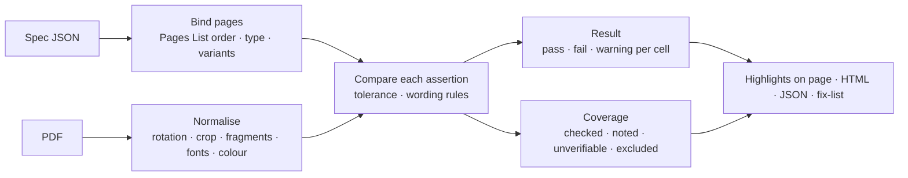

# SR-SPEC-CHECK — checking a PDF against spec JSON

## §1 — For humans

**The checker takes a spec JSON (SR-SPEC-INTAKE) and a PDF, and says, for every
assertion, whether the PDF matches.** It finds each page, measures what is on it, and
compares. Every finding names the Excel cell it came from.

**Problems are flagged, not hidden, and rarely stop the run.** Wrong page order or extra
pages are warnings; a missing **Required** page is an error. Anything the checker cannot
verify lands in **coverage**, never as a silent pass.



<details>
<summary><b>ASCII twin</b></summary>

```text
  spec JSON --> bind pages --\
                              >--> compare (tolerances, wording) --> result per cell --\
  PDF ------> normalise -----/                                  \--> coverage ---------->--> report
```

</details>

---

## §2 — For agents

### Context

Today the checker measures text, images, tables and paragraphs against positions, sizes,
font size and line spacing, with anchors. It groups text into lines across the whole page
width, so side-by-side content on one baseline merges and a correct PDF false-fails (the
fixture's README shows three). Tolerances are inch values whatever the spec's units; the
HTML export inserts `units` unescaped; images inside Form XObjects are mis-placed.

### Decision

**A · Pages**

1. **The Pages List decides which pages are expected.** An absent **Optional** page passes,
   noted. A **Conditional** page is checked when present and noted when absent, never
   failed for absence. A **variant group** must match exactly one variant; none or several
   is an error.
2. **Pages are identified by their identifying text and expected in Pages List order.** A
   page out of order is still compared and raises a **warning**. Extra PDF pages are a
   **warning** (uncovered). A **Required** page missing from the PDF is an **error**.
3. **A repeating page** must repeat within its Repeats range (blank = at least once). **A
   table marked as continuing** onto the next page needs no header there.

**B · Reading the PDF**

4. **Measure the visible page:** apply rotation and the crop box first. Positions are
   absolute inches as written. A page size different from Settings is a **warning**, or an
   **error** when the size is pinned.
5. **Text fragments are merged into lines within a column**, never across the full page
   width. Soft hyphens are ignored, ligatures expanded (`fi` → `fi`), line-end hyphenation
   rejoined; genuine hyphenated words are kept.
6. **No text layer** (outlined text, a scan, labels baked into an image) is detected and
   reported; those elements go to coverage as **unverifiable**, with a warning. No OCR.
7. **Fonts:** the subset prefix (`ABCDEF+`) is stripped and family and style normalised, so
   "Roboto-Light", "Roboto Light" and "RobotoLight" match. Weight words map to numbers
   (Thin 100 … Regular 400 … Semibold 600 … Black 900). A wrong family or style **fails**;
   a neighbouring weight is a **warning**.
8. **Colour:** CMYK, grayscale and ICC colours are converted to RGB and compared by
   perceptual distance (CIEDE2000 ΔE) against the threshold; the actual colour is reported
   beside the expected one. Applies to text colour and container fills.
9. **Images** carry no file name inside a PDF, so they are matched by **position and size**.
   Comparing the image content with the supplied asset is **opt-in per element**, with
   tolerance for scaling and compression.

**C · Comparing**

10. **Wording:** both sides are normalised (whitespace, smart quotes, dashes, trailing
    spaces) before comparison; a match found only after normalising passes **with a note**.
    An element with Exact text = Yes is compared character for character. ®, ™ and
    superscripts are always compared exactly. A line break inside a cell means separate
    lines; the exact break point is not pinned.
11. **Tolerances resolve per assertion:** the row's range or Tolerance → the workbook's
    Settings → SR-CONSTANTS. They apply **in the spec's units**.
12. **Every result carries its source cell.** A finding states expected (from the
    workbook), actual (from the PDF), the delta and the cell.
13. **Coverage is part of the result.** Every spec row ends as checked, noted,
    unverifiable or excluded, with its cell; the report header reads "N of M rows checked".
    Nothing passes silently.
14. **The report records the pair it tested:** the workbook's SHA-256 and template version,
    and the PDF's file name and SHA-256.
15. **Outputs:** findings highlighted on the page; an HTML report (every inserted value
    escaped); JSON results; a Markdown fix-list written for the template developer. The CLI
    runs the same check as `pdfsuite spec`, with the CLI's exit codes and one JUnit
    testsuite per page.

### Consequences

- **Built today:** position, size, font size, line spacing, table rows and columns,
  anchors, on-page highlights, HTML and JSON export. Everything else here is unbuilt —
  **W-04** builds it, after **W-05**.
- **First in W-04:** decision 5 (column-aware lines), unit-aware tolerances (decision 11),
  escaping (decision 15) and Form XObject images — the defects that make a correct PDF fail.
- **Acceptance:** the fictional fixture's matching PDF reports no failure; its deviations
  PDF reports what its README tables.
- **Enforced today:** nothing; W-04's fixtures make the acceptance a gate.

### Alternatives considered

| option | why it lost |
|---|---|
| Stop the run when pages are out of order | Arpit ruled: warn and keep comparing |
| Strict one-to-one page sequence | fails every PDF that legitimately omits an Optional page |
| Bind pages by position only | a reordered PDF would compare the wrong pages |
| Proportional measurements when page size differs | spec values are physical measurements |
| OCR for text without a text layer | heavy dependency, misreads; a human decides instead |
| Match images by file name | a PDF stores no image names |
| Strict image-content comparison by default | re-encoding changes pixels and false-fails |
| Compare raw RGB numbers for colour | CMYK round-trips are never exact; perceptual distance matches what the eye sees |

### Reference (required)

- [`src/features/spec/specCheck.ts`](../src/features/spec/specCheck.ts) — today's `runSpec`, `groupLines`, `extractImages`
- [`src/features/spec/SpecTestView.tsx`](../src/features/spec/SpecTestView.tsx) — today's upload and report view
- [`tools/samples/excel-spec-hierarchical/README.md`](../tools/samples/excel-spec-hierarchical/README.md) — expected results, including today's false failures

### Veto condition

**Reopen this decision if:** the fixture's matching PDF, checked against its spec, reports
any failure once W-04 has landed.

**How to check it:** run the spec check on `tools/samples/excel-spec-hierarchical/report.pdf` with its compiled spec JSON and compare with the README's *Expected results*

---

## References

**Records** — [SR-SPEC-INTAKE](0101_SPEC-intake.md) · [SR-CONSTANTS](0103_CONSTANTS.md) · [SR-LAW-0](0002_LAW-0-authority.md)

**Code**

- [`src/features/spec/specCheck.ts`](../src/features/spec/specCheck.ts) · [`src/features/spec/specExport.ts`](../src/features/spec/specExport.ts) · [`src/features/spec/specStore.ts`](../src/features/spec/specStore.ts) · [`src/features/spec/SpecTestView.tsx`, `src/features/spec/SpecExportMenu.tsx`](../src/features/spec/SpecTestView.tsx, src/features/spec/SpecExportMenu.tsx)

**Project docs**

- [`tools/samples/excel-spec-hierarchical/README.md`](../tools/samples/excel-spec-hierarchical/README.md) · [`docs/ARCHITECTURE.md`](../docs/ARCHITECTURE.md)
