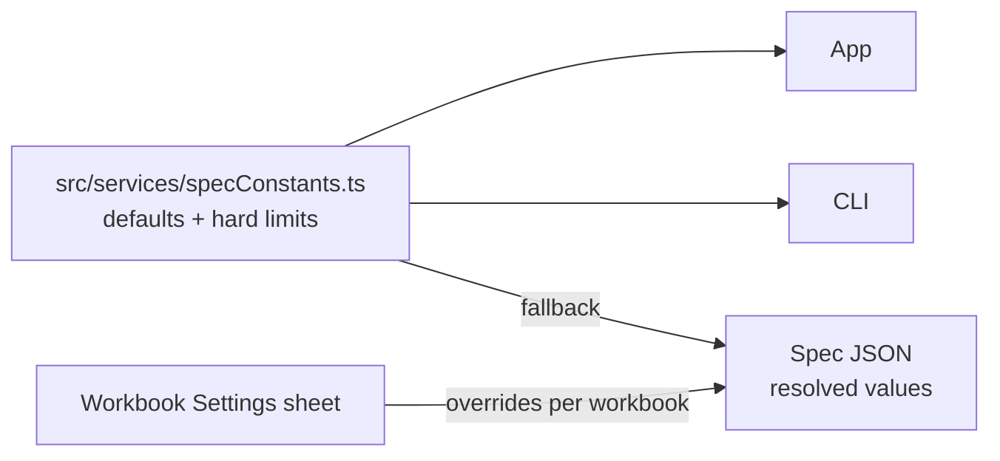

# SR-CONSTANTS — one constants file for every default and limit

## §1 — For humans

**Every number the tool tunes by lives in one file**, `src/services/specConstants.ts`.
Tolerances, size limits and thresholds are changed there and nowhere else. A spec
workbook's **Settings** sheet can override the defaults for that workbook only.



<details>
<summary><b>ASCII twin</b></summary>

```text
  specConstants.ts --> app, CLI
  specConstants.ts --(fallback)--> spec JSON <--(override)-- Settings sheet
```

</details>

---

## §2 — For agents

### Context

Today tunables are scattered as literals: `DEFAULT_TOL` and `DEFAULT_ANCHOR_WITHIN` in
`specCheck.ts`, `BASE_SCALE` (copied in `pdfCompare.ts`, `pdfElements.ts` and
`specCheck.ts`) and `MAX_PAGE_WIDTH` in `pdfCompare.ts`, the page-verdict
limits in `changes.ts`, `MOVED_OFFSET_IN` in `exportReport.ts`, `AUTO_SCAN_MAX_PAGES` in
`App.tsx`, `DEFAULT_THRESHOLDS` in the CLI. The same idea has different values in
different places.

### Decision

1. **One file, `src/services/specConstants.ts`, holds every default and hard limit the tool
   uses.** It is plain TypeScript with no dependency, imported by the app and by the CLI.
   Any new tunable anywhere in the project is added here.
2. **The defaults:**

   | key | value |
   |---|---|
   | position tolerance | 0.06 in |
   | size tolerance | 0.06 in |
   | line-spacing tolerance | 0.03 in |
   | font-size tolerance | 2 pt |
   | colour threshold | 2.0 ΔE (CIEDE2000) |
   | anchor search distance | 2 in |
   | upload size limit | 100 MB |
   | unzipped size limit | 500 MB |
   | relative-reference depth cap | 8 |

3. **A workbook's Settings sheet overrides these for that workbook.** The spec JSON carries
   the resolved values, so the checker never needs the workbook.
4. **No tunable literal lives in engine code outside this file.** The existing literals
   listed in *Context* move here with their values unchanged.
5. **Every key is typed and required.** A missing key fails the type check; code never
   falls back to a literal of its own.

### Consequences

- **Built today:** nothing — **W-05** creates the file and moves the literals.
- **Debt:** nothing checks decision 4 — backlog **B-011**.
- Moving the literals does not unify the app's and the CLI's page verdict; it makes the
  two values sit side by side where the difference is visible.

### Alternatives considered

| option | why it lost |
|---|---|
| `constants.yaml` or `constants.toml` | needs a parser dependency; the whole product is TypeScript |
| Constants per module (today) | scattered; the same idea already has different values |
| Environment variables | invisible in review; untyped |

### Reference (required)

- [`src/features/spec/specCheck.ts`](../src/features/spec/specCheck.ts) `DEFAULT_TOL`, `DEFAULT_ANCHOR_WITHIN` · [`src/services/pdfCompare.ts`](../src/services/pdfCompare.ts) `BASE_SCALE`, `MAX_PAGE_WIDTH` · [`src/services/changes.ts`](../src/services/changes.ts) `summaryPageDiffers` · [`cli/src/core/pairs.ts`](../cli/src/core/pairs.ts) `DEFAULT_THRESHOLDS`

### Veto condition

**Reopen this decision if:** a second constants or config file for tunables appears in the
product.

**How to check it:** `git ls-files src cli/src | grep -iE 'constants|tunables|defaults'` lists only `src/services/specConstants.ts`

---

## References

**Records** — [SR-SPEC-INTAKE](0101_SPEC-intake.md) · [SR-SPEC-CHECK](0102_SPEC-check.md) · [SR-STACK-TYPESCRIPT](0104_STACK-typescript.md)

**Code**

- [`src/features/spec/specCheck.ts`](../src/features/spec/specCheck.ts) · [`src/services/pdfCompare.ts`](../src/services/pdfCompare.ts) · [`src/services/changes.ts`](../src/services/changes.ts) · [`src/services/exportReport.ts`](../src/services/exportReport.ts) · [`src/App.tsx`](../src/App.tsx) · [`cli/src/core/pairs.ts`](../cli/src/core/pairs.ts)
