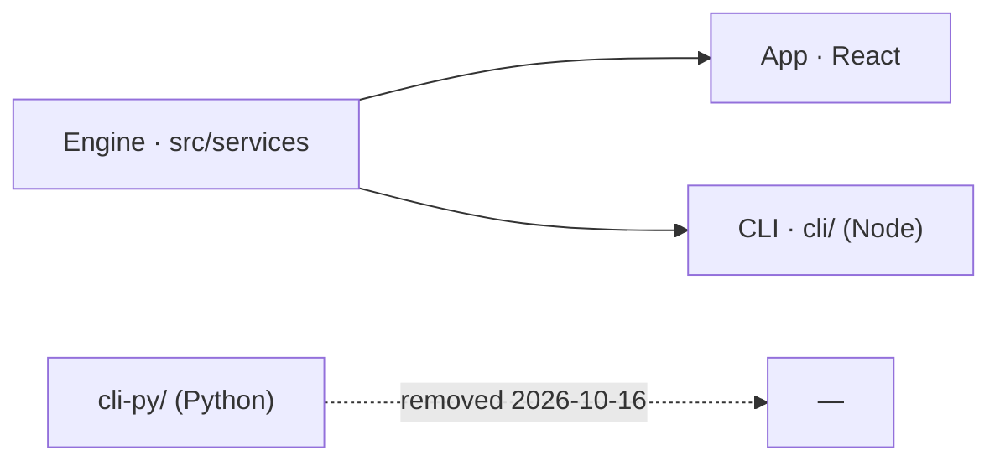

# SR-STACK-TYPESCRIPT — the product is TypeScript

## §1 — For humans

**One language for the whole product.** The React app, the comparison engine, the spec
pipeline and the `pdfsuite` CLI are TypeScript. The Python CLI (`cli-py/`) is removed: the
Node CLI already did everything it did. Removed 2026-10-16 (W-03).



<details>
<summary><b>ASCII twin</b></summary>

```text
  engine (TS) --> app (TS)
             \--> CLI (TS, Node)
  cli-py (Python)  ..removed 2026-10-16..
```

</details>

---

## §2 — For agents

### Context

`cli-py/` held a Python `generate` (a full port of the Node one) and `compare`/`pairs`
commands that ran the Node CLI. The two `generate` implementations had already diverged, in
proxy support, timeout meaning and header handling. Two implementations of one thing
drift.

### Decision

1. **The product is TypeScript:** `src/` (app and engine), `cli/` (the Node CLI) and the spec
   pipeline (SR-SPEC-INTAKE). No Python in the product.
2. **`cli-py/` is removed**, with every live reference to it. The Node CLI is the only CLI.
3. **New product code is TypeScript.**
4. **Development-only scripts are TypeScript too** (Arpit, 2026-10-18 — the ruling SR-TESTING
   decision 3 already implied for fixtures). `cli/verify/make-cases.py` is replaced by a
   TypeScript generator that reproduces its output byte for byte (W-36) and deleted in that
   change; until then it runs as it is and is never shipped. The spec sample's Python
   generator was deleted with the legacy sample on 2026-10-18; its PDFs are frozen in
   `work/samples/excel-spec-template-v2/` until W-37's TypeScript generator rebuilds them. The work system's own `scripts/check-open-work-inbox.py`
   is not a product script and is governed by SR-WORK-OPEN-QUEUE, not by this record.

### Consequences

- **Built:** decisions 1–3. `cli-py/` and every live reference to it were removed on
  2026-10-16 by W-03 (archived). Decision 4 is built by W-36 (`make-cases.py`); the spec sample's generator is already gone.
- **Debt:** nothing checks decision 1 — backlog **B-012**.
- Python users of `pip install pdfsuite` lose that entry point; the Node CLI replaces it.

### Alternatives considered

| option | why it lost |
|---|---|
| Keep `cli-py/` as a thin wrapper | it is not thin — its `generate` is a second implementation that has already drifted |
| Port the Node CLI to Python | doubles the engine; the engine is TypeScript and shared with the app |

### Reference (required)

- [`cli/src/commands/generate.ts`](../cli/src/commands/generate.ts) — the one `generate`; the removed Python port is in git history before W-03's commit
- [`archive/open/W-03-remove-cli-py.md`](../archive/open/W-03-remove-cli-py.md) — the removal

### Veto condition

**Reopen this decision if:** a Python file appears under a product path or `work/samples/`, or — once W-36 has landed — under `cli/`.

**How to check it:** `git ls-files 'src/*.py' 'src/**/*.py' 'cli/src/**/*.py' 'cli-py/**'` returns nothing; `git ls-files 'work/samples/**/*.py'` returns nothing; after W-36, `git ls-files 'cli/**/*.py'` returns nothing

---

## References

**Records** — [SR-SPEC-INTAKE](0101_SPEC-intake.md) · [SR-CONSTANTS](0103_CONSTANTS.md)

**Code**

- [`cli/src/index.ts`](../cli/src/index.ts) · [`cli/src/platform/engine.ts`](../cli/src/platform/engine.ts)

**Project docs**

- [`docs/ARCHITECTURE.md`](../docs/ARCHITECTURE.md)
