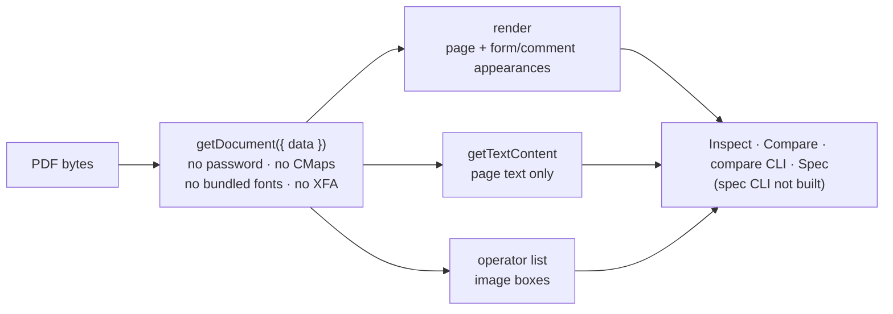

# SR-PDF-SUPPORT — which kinds of PDF each tab and CLI can read

## §1 — For humans

**PDFs come in many kinds, and today the product reads the plain kind well and the rest
partly — often without saying so.** All five surfaces open a PDF the same bare way, so the
same gaps show up everywhere. This record is the honest table of what works today. Each
gap names the work item that closes it, and the cell changes **in the same change** as
that item lands.



<details>
<summary><b>ASCII twin</b></summary>

```text
  PDF bytes --> getDocument({data}) --+--> render (page + form/comment appearances) --\
                (bare options)        +--> getTextContent (page text only) ------------>--> Inspect · Compare · CLI · Spec
                                      +--> operator list (image boxes) ----------------/
```

</details>

### The kinds of PDF

| kind | what it is |
|---|---|
| **Native, fonts embedded** | made by software; real text, fonts inside the file |
| **Native, fonts not embedded** | real text; the fonts it names (e.g. Helvetica) are not in the file |
| **Stripped font names** | fonts embedded but names scrambled (`g_d0_f1`), or glyphs drawn as shapes (Type3) |
| **Flattened** | form fields and comments merged into the page; behaves like native |
| **Fillable form (AcroForm)** | fields sit on top of the page as a separate layer |
| **Dynamic form (XFA)** | an Adobe XML form, built when opened |
| **Annotated** | comments, stamps, highlights on top of the page |
| **Outlined text** | text converted to vector shapes — looks like text, has none |
| **Scanned** | every page is one photo |
| **Scanned + OCR** | a photo with invisible, machine-read text behind it |
| **Tagged / accessible (PDF/UA)** | headings, paragraphs and tables marked up |
| **Archival (PDF/A)** | fonts embedded, metadata required |
| **Print (PDF/X)** | CMYK colour, colour profiles, trim and bleed boxes |
| **Password to open** | cannot be read without the password |
| **Permissions-only password** | opens freely; printing or copying restricted |
| **Rotated or cropped pages** | `/Rotate` set, or the visible area differs from the full page |
| **Images in Form XObjects** | images placed inside reusable groups of drawing commands |
| **Mixed page sizes** | e.g. Letter and A4 in one file |
| **CJK / CID fonts** | Chinese, Japanese or Korean text that needs character-map files |
| **Signed, or edited in place** | a digital signature, or earlier versions kept inside the file |

### What each surface can handle today

✅ works · ⚠️ partly, or wrong without saying so · ❌ does not work · — the command does not exist yet ([W-11](../work/open/W-11-pdfsuite-spec-cli.md))

| kind | Inspect | Compare | Compare CLI | Spec | Spec CLI | closed by |
|---|---|---|---|---|---|---|
| Native, fonts embedded | ✅ | ✅ | ✅ | ✅ | — | — |
| Fonts not embedded | ⚠️ drawn with a system substitute, not flagged | ⚠️ substitute, not flagged | ⚠️ text may not be drawn at all | ⚠️ substitute, not flagged | — | W-13, W-14 |
| Stripped font names | ⚠️ font "unknown"; bold shown as Regular | ⚠️ style changes missed | ⚠️ as Compare | ⚠️ font checks unreliable | — | W-15 |
| Flattened | ✅ | ✅ | ✅ | ✅ | — | — |
| Fillable form | ⚠️ values visible, not selectable | ⚠️ value changes caught by pixel diff only | ⚠️ as Compare | ❌ field text not found | — | W-17 |
| Dynamic form (XFA) | ❌ fallback page, no message | ❌ | ❌ | ❌ | — | W-18 |
| Annotated | ⚠️ drawn, not inspectable | ⚠️ pixel diff only | ⚠️ as Compare | ⚠️ ignored | — | W-19 |
| Outlined text | ❌ no text, no message | ⚠️ text diff blind; pixel diff only | ⚠️ as Compare | ❌ fails instead of "unverifiable" | — | W-20 |
| Scanned | ⚠️ one big image | ⚠️ pixel diff only | ⚠️ as Compare | ❌ | — | W-20 |
| Scanned + OCR | ⚠️ positions rough, font meaningless, not flagged | ⚠️ OCR text differs between scans | ⚠️ as Compare | ⚠️ | — | W-20 |
| Tagged | ✅ tags ignored | ✅ tags ignored | ✅ tags ignored | ✅ tags ignored | — | W-21 |
| Archival (PDF/A) | ✅ | ✅ | ✅ | ✅ | — | — |
| Print (PDF/X, CMYK) | ✅ no colour readout | ✅ colour change unnamed (pixel only) | ✅ as Compare | ⚠️ colour not checked | — | W-22 |
| Password to open | ❌ error, no prompt | ❌ | ❌ exits 2 | ❌ | — | W-16 |
| Permissions-only password | ✅ | ✅ | ✅ | ✅ | — | — |
| Rotated or cropped pages | ⚠️ text right, images off | ⚠️ image boxes off | ⚠️ as Compare | ⚠️ page geometry not handled | — | W-23 |
| Images in Form XObjects | ⚠️ misplaced | ⚠️ misplaced | ⚠️ misplaced | ⚠️ misplaced | — | W-23 |
| Mixed page sizes | ✅ | ⚠️ letterboxed; size difference unnamed | ⚠️ as Compare | ⚠️ page-size check not built | — | W-24 |
| CJK / CID fonts | ⚠️ text may not appear | ⚠️ | ⚠️ | ⚠️ | — | W-13 |
| Signed, or edited in place | ✅ latest version; signature not shown | ✅ signature and revision changes unreported | ✅ as Compare | ✅ | — | W-25 |

**Not a kind, but missing everywhere:** document properties — title, author, producer,
PDF version, PDF/A or PDF/X claims, layers, attachments — are read by no surface. Closed by
**W-26**. Proving every cell above by running files, not by reading code, is **W-12**.

---

## §2 — For agents

### Context

Read from the code on 2026-10-18, not from running files. Every surface opens PDFs with
`pdfjsLib.getDocument({ data })` and nothing else — `src/services/pdfCompare.ts` (Compare,
Inspect, the compare CLI through `cli/src/platform/engine.ts`) and
`src/features/spec/pdfjs.ts` (Spec). Text comes from `getTextContent()`, which excludes
form fields and annotations; images come from walking the operator list with a
transformation matrix that ignores Form XObject matrices, `/Rotate` and the crop-box
offset. Font style comes from pdf.js font objects, whose `bold` / `italic` are inferred
from the font **name** only.

### Decision

1. **The §1 tables are the product's PDF support, stated as of the date above.** A cell
   says ✅ only if that surface gives a correct result for that kind **and** says so when it
   cannot.
2. **A cell changes in the same change as the code that changes it.** The work item that
   closes a gap updates its row; an item is not done while its row is stale.
3. **No surface may fail silently.** Where a kind cannot be handled, the target state is
   an explicit message (app), finding (report) or exit code (CLI) — never a pass and never
   an empty result without a reason.
4. **The Spec and Spec CLI columns describe this repository's mirror** of
   `src/features/spec/`. The live spec feature is on the spec machine and may differ; that
   machine is asked for each Spec-side change in the item's *Spec machine* section.
5. **Confidential inputs:** every fixture behind this table is fictional (W-12).

### Consequences

- **Open:** W-12 (fixtures and a harness that regenerates this table) through W-26 — one
  per gap, listed in the *closed by* column.
- **Enforced today:** nothing. W-12 turns decision 1 into a check.
- The `describes` rows in the register tie this record to every file that decides a cell,
  so the commit guard asks for this record when one of them changes.

### Alternatives considered

| option | why it lost |
|---|---|
| One record per tab | the gaps share one loader and one extractor; four records would repeat the same row |
| Fold this into SR-SPEC-CHECK | three of the five surfaces are not the spec checker |
| Mark a cell ✅ when the output merely looks right | a silent substitute is the failure this record exists to name |

### Reference (required)

- [`src/services/pdfCompare.ts`](../src/services/pdfCompare.ts) — `loadPdf`, `resolveStyle`, image boxes
- [`src/services/pdfElements.ts`](../src/services/pdfElements.ts) — Inspect's text, font and image extraction
- [`src/features/spec/pdfjs.ts`](../src/features/spec/pdfjs.ts) · [`src/features/spec/specCheck.ts`](../src/features/spec/specCheck.ts)
- `node_modules/pdfjs-dist` 4.10.38 — ships `cmaps/` (1.7 MB) and `standard_fonts/` (804 KB), unused today

### Veto condition

**Reopen this decision if:** a surface handles a kind differently from its cell — shown by
W-12's harness once it exists, by a fixture until then.

**How to check it:** `grep -n "getDocument(" src/services/pdfCompare.ts src/features/spec/pdfjs.ts` still shows `{ data }` alone while the table says ⚠️/❌ for fonts, CJK, password and XFA; after W-12, run its harness and diff its table against §1.

---

## References

**The feature records** — [SR-COMPARE](0111_COMPARE.md) · [SR-BULK-COMPARE](0113_BULK-compare.md) · [SR-SPEC](0112_SPEC.md) · [SR-INSPECT](0114_INSPECT.md) · [SR-CLI](0115_CLI.md) · [SR-REPORT-HTML](0108_REPORT-html.md) · [SR-REPORT-JSON](0109_REPORT-json.md) · [SR-MANIFEST](0110_MANIFEST.md)

**Records** — [SR-SPEC-CHECK](0102_SPEC-check.md) · [SR-SPEC-INTAKE](0101_SPEC-intake.md) · [SR-CONSTANTS](0103_CONSTANTS.md) · [SR-LAW-0](0002_LAW-0-authority.md)

**Code**

- [`src/services/pdfCompare.ts`](../src/services/pdfCompare.ts) · [`src/services/pdfElements.ts`](../src/services/pdfElements.ts) · [`src/services/changes.ts`](../src/services/changes.ts)
- [`src/features/spec/pdfjs.ts`](../src/features/spec/pdfjs.ts) · [`src/features/spec/specCheck.ts`](../src/features/spec/specCheck.ts)
- [`cli/src/platform/engine.ts`](../cli/src/platform/engine.ts) · [`cli/src/platform/dom-shim.ts`](../cli/src/platform/dom-shim.ts)

**Project docs**

- [`docs/ARCHITECTURE.md`](../docs/ARCHITECTURE.md) — the *Watch* notes on fonts under Node and spec tolerances
