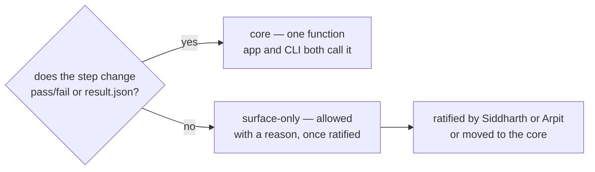

# SR-SURFACE-PARITY — every step, and where it lives

## §1 — For humans

**L3 says the app and the command line run the same functions.** This record is the
list that makes that checkable: every step either surface performs, whether it is shared
today, where it should live, and — when it stays on one side — why, and who agreed.

**The dividing line:** if a step changes pass/fail or what `result.json` says, it lives
in the **core** and both surfaces call it. If it only changes what a person sees, clicks
or holds — or how a file is delivered — it may stay on one surface, **once Siddharth or
Arpit ratifies it**.



<details>
<summary><b>ASCII twin</b></summary>

```text
   does the step change pass/fail or result.json?
     yes --> core: one function, app and CLI both call it
     no  --> surface-only: allowed with a reason, once ratified --> ratified, or moved to the core
```

</details>

### The table

**shared today:** ✅ one function · ⚠️ partly · ❌ separate or missing · — not applicable.
**ratified:** a name and date, or **owed** — the decision sits in the inbox. No row is owed today.

#### Compare and Bulk compare

| step | app today | CLI today | shared today | where it lives | reason | ratified | closed by |
|---|---|---|---|---|---|---|---|
| Open a PDF | `loadPdf` | `loadPdf` | ✅ | core | — | — | W-13 (one opener) |
| Compare one page | `comparePage` | `comparePage` | ✅ | core | — | — | — |
| List the changes | `buildChanges` | `buildChanges` | ✅ | core | — | — | — |
| Page pass/fail | `summaryPageDiffers` | `summaryPageDiffers` | ✅ | core | — | — | W-27 (one rule) |
| Loop pages → pair result | Compare store and Bulk store, two loops | its own loop | ❌ three copies | core, `comparePair` | — | — | W-27 |
| "Page changed" rule | `pageHasChange` (moved > 0.02″) | — | ❌ disagrees with pass/fail (> 2 px) | core, `pageVerdict` | — | — | W-27 |
| Page pairing data | manual pairing | none | ❌ | core input | — | — | W-27, W-09 |
| Pixel sensitivity, anti-aliasing | settings | flags | ⚠️ same defaults, separate controls | core value, recorded in `result.json` | each surface keeps its own control | — | W-27 |
| Loop over many pairs | Bulk compare (its own loop) | none — `pdfsuite compare --each` coming | ❌ | core, `compareMany` — Bulk compare and `--each` both call it | — | — | W-27, W-09 |

#### Reports and exports

| step | app today | CLI today | shared today | where it lives | reason | ratified | closed by |
|---|---|---|---|---|---|---|---|
| `result.json` | JSON export, its own shape | its own JSON writer | ❌ | core builder; both emit it | — | — | W-27 |
| `report.html` | `buildHtmlReport` | own writer, reuses the app's CSS and page detail | ⚠️ | core builder; both emit it | — | — | W-27 |
| `manifest.json` | — | coming in W-09 | ❌ | core builder; both emit it | — | — | W-27, W-09 |
| Markdown fix-list | export (flag off) | dropped by W-09 | app only | UI only | the CLI writes three files only | Arpit, 2026-10-18 | — |
| CSV | export (flag off) | dropped by W-09 | app only | UI only, a view of `result.json` | spreadsheet convenience | Arpit, 2026-10-18 | — |
| JUnit | — | writer, dropped by W-09 | CLI only today | neither | ruled out with the three files | Arpit, 2026-10-18 | W-09 |
| ZIP bundle, export and import | app | — | app only | UI only | a review hand-off carrying both PDFs and comment pins | Arpit, 2026-10-18 | — |

#### Presentation and interaction

| step | app today | CLI today | shared today | where it lives | reason | ratified | closed by |
|---|---|---|---|---|---|---|---|
| Page strip, Next change, summary chip | app | — | — | UI only | navigation over the core's verdicts | Arpit, 2026-10-18 | — |
| Pairing editor | app | — | — | UI only | it produces the core's pairing input | Arpit, 2026-10-18 | — |
| Mark expected | app | — | — | UI only for now | hides a change on screen, never changes pass/fail; if W-07's `expected.json` ledger is adopted the step moves to the core and an item is filed | Arpit, 2026-10-18 · until W-07 rules on the ledger | — |
| Ignored regions | app (`regionStore`, `DataRegionLayer`) | — | — | UI only for now | an area whose changes are expected, decided once and kept against the golden; hides changes on screen and lists them in the report, never changes pass/fail; follows *Mark expected* if W-07's ledger is adopted | Arpit, 2026-10-18 · until W-07 rules on the ledger | — |
| Comment pins | app | — | — | UI only | reviewers' notes, not results | Arpit, 2026-10-18 | — |
| Side by side, Overlapping, report viewer, zoom, hover | app | — | — | UI only | presentation | Arpit, 2026-10-18 | — |
| Thumbnails | `renderThumb` | — | — | UI only | presentation | Arpit, 2026-10-18 | — |
| Bulk "Open in Compare" | app | — | — | UI only | navigation | Arpit, 2026-10-18 | — |
| PDF viewer pop-up | not built | — | — | UI only | reading a PDF on screen is presentation; it computes nothing | Arpit, 2026-10-18 | W-42 |
| Feature flags (`flag.env`) | app | — | — | UI only | they hide UI features and never change a result | Arpit, 2026-10-18 | — |

#### Inspect

| step | app today | CLI today | shared today | where it lives | reason | ratified | closed by |
|---|---|---|---|---|---|---|---|
| Extract text, images, fonts with positions | `renderElements` | none | ❌ | core; `pdfsuite inspect` | — | — | W-28 |
| Edge distances, line height | computed inside `MeasureView.tsx` | none | ❌ | core functions | — | — | W-28 |
| Document properties | none | none | ❌ | core; both | — | — | W-26 |
| Hover, guides, selection | app | — | — | UI only | presentation | Arpit, 2026-10-18 | — |

#### Spec driven comparison

| step | app today | CLI today | shared today | where it lives | reason | ratified | closed by |
|---|---|---|---|---|---|---|---|
| Read the spec (`.xlsx` / `.json`) and validate it | `readWorkbook`, `sheetToSpec`, `validateSpec` | not built | ❌ | core, through `engine.ts` | — | — | W-11, W-02 |
| Run the check | `runSpec` | not built | ❌ | core, through `engine.ts` | — | — | W-11 |
| Spec page → PDF page mapping | one-page mode, sheet ↔ page lists | not built | ❌ | core input (`--pages`) | — | — | W-11 |
| Spec report, HTML and JSON | `exportSpecHtml` / `exportSpecJson`, tied to a download | not built | ❌ | a pure builder exported from `engine.ts` | — | — | W-11 (spec machine) |
| Upload screen, highlights on the page | app | — | — | UI only | presentation | Arpit, 2026-10-18 | — |

#### Opening files and delivering results

| step | app today | CLI today | shared today | where it lives | reason | ratified | closed by |
|---|---|---|---|---|---|---|---|
| Password-protected PDFs | none | none | — | core loader; a prompt (app), `--password-env` (CLI) | asking for a secret is surface I/O | — | W-16 |
| Generate PDFs from a render API | — | `pdfsuite generate` | CLI only | CLI only | runs in CI against an API with credentials; a browser would expose them and meet CORS | Arpit, 2026-10-18 | — |
| Config file | — | `pdfsuite.config.json` | CLI only | CLI only | the app's equivalent is its settings | Arpit, 2026-10-18 | — |
| Console output, exit codes | — | CLI | CLI only | CLI only | delivery to CI | Arpit, 2026-10-18 | — |
| Download vs write to disk | download | files on disk | each its own | each surface | delivery only; the bytes come from the core builders | Arpit, 2026-10-18 | — |

---

## §2 — For agents

### Context

L3 ([SR-LAW-3](0005_LAW-3-one-function-ui-and-cli.md)) requires one function per step and
a ratified row for every difference. On 2026-10-18 the engine was shared but the page loop
existed three times, "page changed" had two definitions, the reports had two writers per
format, and Inspect and the spec check had no CLI at all — read from
`cli/src/platform/engine.ts`, `cli/src/commands/compare.ts`, `cli/src/report/`,
`src/store/compareStore.ts`, `src/store/batchStore.ts`, `src/services/exportReport.ts`,
`src/components/measure/MeasureView.tsx` and `src/features/spec/`.

### Decision

1. **The §1 table is the parity state.** Every step either surface performs has one row.
2. **What can be the same — and must be:** every step that changes pass/fail or
   `result.json`: opening, comparing, listing changes, judging, the page loop, pairing,
   the verdict knobs, the report builders, element extraction and measurements, document
   properties, reading and checking a spec. Their rows say **core**.
3. **What cannot be the same:** presentation, interaction and delivery — navigation,
   editors, overlays, notes, flags, downloads, console output, exit codes, config files,
   and secrets entry. Their rows say **UI only** or **CLI only** with a reason.
4. **A surface-only row is proposed until ratified.** Its *ratified* cell reads **owed**
   and the decision sits in the inbox; Siddharth or Arpit either ratifies it (name and
   date go in the cell) or rules it shared, and a work item is filed to move it to the core.
5. **A work item that closes a row rewrites that row in the same change.**
6. **A new step gets its row in the change that adds it** (SR-LAW-3 decision 4).

### Consequences

- **Ratified:** every surface-only row, by Arpit on 2026-10-18 — through the Cowork session acting on his instruction to ratify what follows from L3's own test (`work/WORKLOG.md`, 2026-10-18). *Mark expected* holds only until W-07 rules on the `expected.json` ledger.
- **Open:** W-27 (compare core and builders), W-28 (`pdfsuite inspect`), W-11
  (`pdfsuite spec`), W-09, W-13, W-16, W-26 — named in the *closed by* column.
- **Enforced today:** nothing mechanical; `B-013` names the missing check.

### Alternatives considered

| option | why it lost |
|---|---|
| One row per function name | a step is what a user can name; function names move |
| Put this table in SR-LAW-3 | a law must not change when a row does |

### Reference (required)

- [`cli/src/platform/engine.ts`](../cli/src/platform/engine.ts) — everything the CLI takes from the app
- [`src/store/compareStore.ts`](../src/store/compareStore.ts) `computeAll`, `jump` · [`src/services/changes.ts`](../src/services/changes.ts) `pageHasChange`, `summaryPageDiffers`

### Veto condition

**Reopen this decision if:** a step either surface performs has no row, or a row's
*shared today* cell is wrong.

**How to check it:** `grep -n "export" cli/src/platform/engine.ts src/features/spec/engine.ts` against the core rows; `grep -rn "comparePage(" src/store cli/src` against the page-loop row.

---

## References

**The feature records** — [SR-COMPARE](0111_COMPARE.md) · [SR-BULK-COMPARE](0113_BULK-compare.md) · [SR-SPEC](0112_SPEC.md) · [SR-INSPECT](0114_INSPECT.md) · [SR-CLI](0115_CLI.md) · [SR-REPORT-HTML](0108_REPORT-html.md) · [SR-REPORT-JSON](0109_REPORT-json.md) · [SR-MANIFEST](0110_MANIFEST.md)

**Records** — [SR-LAW-3](0005_LAW-3-one-function-ui-and-cli.md) · [SR-PDF-SUPPORT](0105_PDF-support.md) · [SR-SPEC-CHECK](0102_SPEC-check.md) · [SR-LAW-0](0002_LAW-0-authority.md)

**Code**

- [`cli/src/platform/engine.ts`](../cli/src/platform/engine.ts) · [`cli/src/commands/compare.ts`](../cli/src/commands/compare.ts) · [`cli/src/report/`](../cli/src/report/)
- [`src/store/compareStore.ts`](../src/store/compareStore.ts) · [`src/store/batchStore.ts`](../src/store/batchStore.ts) · [`src/services/exportReport.ts`](../src/services/exportReport.ts)
- [`src/components/measure/MeasureView.tsx`](../src/components/measure/MeasureView.tsx) · [`src/features/spec/engine.ts`](../src/features/spec/engine.ts)

**Project docs**

- [`work/proposals/pdfsuite-compare-cli.md`](../work/proposals/pdfsuite-compare-cli.md) — Option A and the three files
