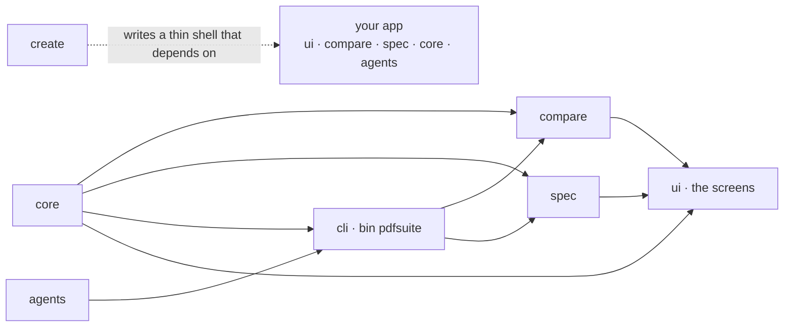

# SR-NPM-PACKAGES — the seven npm packages

## §1 — For humans

**Run `npm create @pdfsuite` and you have all of pdfsuite** — a web app with Compare, Bulk
compare, Spec and Inspect, hostable at any URL, plus the command line — in a new app or
added to an existing one. Run it again after an upgrade and it syncs, without touching
what you changed. **Install only `@pdfsuite/compare` or `@pdfsuite/spec`** in another
repository and you get that command line — for Jenkins, or any test suite. The rules this
implements are law [L4](0006_LAW-4-how-packages-work.md).



<details>
<summary><b>ASCII twin</b></summary>

```text
  core ---> compare <--- cli <--- agents
  core ---> spec    <--- cli
  core ---> cli
  core, compare, spec ---> ui (the screens)
  create ..writes a thin shell..> your app (ui, compare, spec, core, agents)
```

</details>

### The packages

| package | what it does | depends on | gives you |
|---|---|---|---|
| `@pdfsuite/core` | open a PDF (fonts, character maps, password); extract text, images, fonts, positions; Inspect's measurements; document properties; the three report builders; the JSON schemas | `pdfjs-dist`, `pdf-lib` (exact) | a library |
| `@pdfsuite/compare` | golden vs candidate: `comparePair`, `compareMany` (many pairs, orphans reported), pairing, changes, the page-changed rule, pass/fail; its CLI command | `core`, `cli` | `pdfsuite compare`, `pdfsuite compare --each`, `pdfsuite-compare` |
| `@pdfsuite/spec` | the rulebook check: read `.xlsx` / `.json`, validate, check, coverage; its CLI command | `core`, `cli` | `pdfsuite spec`, `pdfsuite-spec` |
| `@pdfsuite/cli` | the `pdfsuite` host: arguments, console, exit codes, files; built-in `inspect`, `generate`, `agents init`; loads `compare` and `spec` | `core`, `agents` | `pdfsuite` |
| `@pdfsuite/agents` | agent files for Claude, Kiro, Codex and Copilot, from one source | — | used by `agents init` |
| `@pdfsuite/ui` | the screens: Compare, Compare · Many, Spec, Inspect, as React components and one `<PdfSuiteApp/>` | `core`, `compare`, `spec`; React as a peer | a component library |
| `@pdfsuite/create` | creates the app (new or existing), and syncs it on upgrade | — | `npm create @pdfsuite` |

### What you get

| you run | you get |
|---|---|
| `npm create @pdfsuite my-app` | **a new app:** the web app with all four tabs, and `npx pdfsuite …` inside it |
| `npm create @pdfsuite .` in an existing React app | **added, not merged:** the packages and one new folder, `src/pdfsuite/`, mounting `<PdfSuiteApp/>`; the one line to add to your router is printed — no existing file is edited |
| `npm create @pdfsuite@latest -- --sync` | **an upgrade:** `@pdfsuite/*` versions bumped together; untouched shell files replaced; files you edited left alone and listed, the new version written beside them as `*.pdfsuite-new` |
| `npm create @pdfsuite@latest -- --sync --check` | exit 1 if the app is behind — for CI |
| `npm i @pdfsuite/compare` | CLI only: `pdfsuite compare a.pdf b.pdf`, `pdfsuite compare --each golden/ candidate/`; `pdfsuite-compare` when installed with `-g` |
| `npm i @pdfsuite/spec` | CLI only: `pdfsuite spec spec.xlsx report.pdf`; `pdfsuite-spec` when installed with `-g` |

### Which tab uses which package

| tab | package |
|---|---|
| Compare | `@pdfsuite/compare` (`comparePair`) |
| Compare · Many | `@pdfsuite/compare` (`compareMany` — the function `--each` calls) |
| Specification | `@pdfsuite/spec` |
| Inspect | `@pdfsuite/core` |

---

## §2 — For agents

### Context

On 2026-10-18 the product was one app (`src/`) and one unpublished CLI package (`packages/cli/`).
**Measured that day:** a local install links a dependency's `bin` into `node_modules/.bin`;
a global install links only the installed package's own `bin`. All `@pdfsuite/*` names and
the scope were unclaimed. `npm create @usr` runs `@usr/create` (npm docs).

### Decision

1. **Seven packages under `@pdfsuite`** (§1). JSON schemas live in `core`; there is no
   umbrella package — `create` is how a team gets everything (L4 decision 1).
2. **No dependency cycle:** `core` depends on no `@pdfsuite` package; `cli` on `core` and
   `agents`; `compare` and `spec` on `core` and `cli`; `ui` on `core`, `compare`, `spec`;
   `create` on nothing at run time.
3. **`cli` hosts commands and does not depend on `compare` or `spec`.** `pdfsuite <name>`
   loads `@pdfsuite/<name>`'s command module when installed; missing → exit 2 with the
   `npm i` to run; a different version → exit 2.
4. **`compare` and `spec` each own a bin** — `pdfsuite-compare`, `pdfsuite-spec` — so a
   global install reaches the PATH; only `cli` owns `pdfsuite`.
5. **Many pairs:** `pdfsuite compare --each <golden-dir> <candidate-dir>` pairs by relative
   path and calls `compareMany` in one process — the same function Compare · Many calls; a
   golden or a candidate without a partner fails the run.
6. **Each tab imports its package** (table above), and nothing else of another package
   than its public exports.
7. **`create` has two modes and writes a thin shell.** A new directory gets a Vite + React
   app; an existing app gets `src/pdfsuite/` and the dependencies, and no existing file is
   edited. The shell holds only entry, configuration and theme; every screen comes from
   `@pdfsuite/ui`, so `npm update` delivers new screens.
8. **Sync is deterministic.** `create` records every file it writes, with its SHA-256 and
   the pdfsuite version, in `.pdfsuite/installed.json`. `--sync` replaces a file only if its
   hash still matches the record; otherwise it writes `<file>.pdfsuite-new` and lists it; a
   file the consumer deleted stays deleted. In `package.json` only `@pdfsuite/*` entries
   change. `--check` exits 1 when behind.
9. **The app is a static single-page app, hostable at any URL.** Relative asset paths, hash
   routing by default (a base path when the host rewrites), pdf.js's worker, fonts and
   character maps served beside the app. No server; PDFs never leave the browser.
10. **One version for all seven, released together** (L4 decision 4); `pdfjs-dist` pinned
    exactly in `core`.
11. **One repository, npm workspaces** — `packages/core`, `compare`, `spec`, `cli`,
    `agents`, `ui`, `create`; this repository's own app is a `create` shell over `ui`.
12. **No package sends a PDF, a spec or a result over the network**; only `generate` calls
    the API its user configures.
13. **Publishing is a human step** — from CI with npm provenance, by Siddharth or Arpit,
    after the `pdfsuite` organisation is claimed; fictional fixtures only.
14. **`@pdfsuite/spec` is `packages/spec/` in this repository.** Siddharth ruled on
    2026-11-03 (W-32, option B) that it may be developed on any machine, so this repository
    holds the live version; on 2026-11-06 the folder moved out of `src/features/spec/` and
    became the package. Real spec workbooks still never leave the spec machine — a rule
    about data, not code.
15. **Licence: MIT,** for the repository (`LICENSE` at the root) and for every package (its
    own `LICENSE`, listed in `files`); a package bundling Apache-2.0 code (pdf.js) also ships
    that code's `NOTICE`. Every dependency obeys [L2](0004_LAW-2-open-source-only.md).

### Consequences

- **Open:** **W-10** (the agent files and publishing) and **W-35** (hosting at any URL).
  Everything else this record named has landed — W-09, W-27, W-29, W-30, W-31, W-32,
  W-33, W-34 and W-52 — and what now stands between the suite and a first publish is
  the **Node-floor ruling** alone.
- **The workspace is real (2026-11-06, W-29):** `packages/core`, `compare`, `cli`, `agents`,
  `ui` and `create` are npm workspaces at one version, linked by npm and nothing else. The
  app, the spec feature and the CLI import `@pdfsuite/core` and `@pdfsuite/compare` **by
  name**; `scripts/check-packages.sh` fails a build that reaches into a package by path,
  that lets a package import the app, that leaves a package at a different version, or that
  un-pins `pdfjs-dist`. `agents`, `ui` and `create` are named shells for W-10, W-33 and W-31.
- **Decisions 3 and 4 are built (2026-11-06, W-30).** `@pdfsuite/cli` owns `pdfsuite` and
  depends on `core` and `agents` only. `compare` is **not** in the binary: the host
  resolves `@pdfsuite/compare/cli` with `createRequire`, from the working directory first
  and from its own location second, and registers the command module it finds. A missing
  package is exit 2 with the `npm i` to run — and is still *listed* by `--help`, with what
  to install, because "unknown command" would be a lie. A version that is not the host's is
  exit 2 with both numbers. `compare` owns `pdfsuite-compare`, a forwarder, so a global
  install reaches the PATH. Proved twice: `packages/cli/verify/cli-discovery.ts` runs the
  built binary against stand-in installs, and `scripts/check-install.sh` packs the tarballs
  and installs them into a fresh project and a fresh global prefix.
- **Two things that design settled, both worth keeping in view.** A command module is a
  *separate bundle* from the host, so a class exported by the host and `instanceof`-checked
  there would be two different classes: `EXIT`, `ToolError` and `fileFromPath` moved into
  `@pdfsuite/core/node`, which both bundles share, and the host recognises a tool error by
  a brand string. And `createRequire` cannot resolve a TypeScript source, so
  `@pdfsuite/compare` builds `dist/cli.js` — shipped in the tarball, checked by the
  install test.
- **`@pdfsuite/spec` exists (2026-11-06, W-32).** `src/features/spec/` became
  `packages/spec/`, depending on `core` (one `loadPdf`, not two) and on `cli` for its
  command module's types and its bin. Three barrels: `@pdfsuite/spec` for the app,
  `/engine` for a headless caller, `/cli` for the host. The Specification tab imports the
  package name; `pdfsuite spec` is now **discovered** like `compare`, so W-30's one
  departure is closed — it stayed compiled in for one day because turning a working
  command into "not installed" would have been a regression, not a step towards one.
  `pdfsuite-spec` covers a global install. `scripts/check-boundary.sh`
  retargeted to the package and `scripts/check-install.sh` extended — 21 checks, both
  commands, a fresh project and a fresh global prefix.
- **B-019 narrowed by W-33.** The shared classes now ship in `@pdfsuite/ui`'s stylesheet,
  so anyone rendering `<PdfSuiteApp/>` gets a styled Spec tab. It still bites one case:
  installing `@pdfsuite/spec` alone and rendering `SpecTestView` yourself, because `spec`
  does not depend on `ui` (the dependency runs the other way). **B-020** — the stores
  fetching their examples from the consumer's `public/` — is unchanged and now applies to
  all four screens, not just Spec. **B-021** is new: `@pdfsuite/ui`'s stylesheet defines
  `.card`, `.btn`, `.tabs` and friends as **global** class names, which will collide with
  a host application's own CSS.
- **`@pdfsuite/ui` holds the screens (2026-11-06, W-33).** `src/components`, `src/store`,
  `src/services`, `App.tsx`, `styles.css` and the flag list moved into `packages/ui`; this
  repository's `src/` is now `main.tsx` and nothing else. `<PdfSuiteApp config={…}/>` takes
  the tabs, the first tab and the feature flags as **configuration**, so a created app
  never edits a component — decision 7's reason, and L4 decision 5's. `flag.env` survives
  as *this app's* config: the shell reads it and parses it with the package's own
  `parseFlagEnv`.
- **Nothing depends on the app any more.** `check-packages.sh` rule 2 has **no allowances
  left**: `src/features/spec/engine` went with W-32 and `packages/ui/src/services/export*` with W-33.
  The last crossing was the CLI's spike, repointed at `@pdfsuite/compare`'s builders — and
  found broken since W-29, because its sample path still assumed `cli/` rather than
  `packages/cli/` and nobody had run it.
- **Decisions 7 and 8 are built (2026-11-09, W-31).** `npm create @pdfsuite` writes a thin
  shell over `@pdfsuite/ui`: in an empty directory a whole Vite + React app (seven files,
  one of them a `.tsx`), and in a React app `src/pdfsuite/` plus the dependencies. The
  mode is decided from **what is on disk**, never from a flag, and anything that is
  neither — files but no `package.json`, or a `package.json` without React — is refused
  with the reason. Every written file is recorded in `.pdfsuite/installed.json` with its
  SHA-256, hashed **off disk** rather than from the strings that were written, which is
  what makes W-34's sync able to tell an untouched file from an edited one.
- **"No existing file is changed" is measured, not asserted.**
  [`scripts/check-create.sh`](../scripts/check-create.sh) (39 checks) hashes the whole
  project before and after add mode: the only pre-existing file that differs is
  `package.json`, which gains `@pdfsuite/*` dependency entries and keeps its own keys,
  its own indentation and its own trailing newline. It also builds a created app from the
  packed tarballs and runs `npx pdfsuite compare` inside it.
- **Decision 8 is built (2026-11-09, W-34).** `--sync` reads the record and applies four
  rules: a file missing from it is **added**; one whose content hash matches is
  **replaced**; one that was edited is **kept**, with the new version written beside it as
  `.pdfsuite-new` and named in the report; one the consumer deleted **stays deleted**
  unless `--restore`. `package.json` is never replaced as a file — only its `@pdfsuite/*`
  entries move, all to one exact version. `--check` writes nothing and exits 1 only when
  *we* have something newer, never because somebody edited their own config.
- **Three things that only showed up by running it twice**, and all three are now checked
  twice in [`check-create.sh`](../scripts/check-create.sh) (63 checks):
  (1) the record was rebuilt by hashing the files **off disk**, which laundered a
  consumer's edit into "what pdfsuite wrote" and let the *next* upgrade overwrite it
  silently — the record is now built from what pdfsuite *intends* at each path;
  (2) a deleted file was dropped from the record, so "stays deleted" lasted exactly one
  upgrade; (3) in **new** mode `package.json` was a recorded file, so an upgrade would
  have replaced it wholesale and deleted every dependency and script the consumer had
  added — the loss L4 decision 5 exists to prevent, arriving through the command meant to
  prevent it.
- **Hashes are of content, not bytes** (W-34's hazard, applied back to W-31): line endings
  are normalised to `\n` first, because `core.autocrlf` is guaranteed to happen and
  guaranteed not to mean anything. Without it every file looks edited and an upgrade
  delivers nothing.
- **Every package publishes JavaScript with declarations (2026-11-09, W-52).** `exports`
  carries three conditions in this order: `development` → `src`, `types` → `dist/*.d.ts`,
  `default` → `dist/*.js`. Conditions match in key order, so `development` is first on
  purpose: this workspace, the CLI's esbuild and every `tsc` here set it and read
  **source**, which keeps `npm run dev` and HMR as they were and means a stale `dist` can
  never quietly become another package's types. A consumer sets no such condition and
  gets the built files.
- **`tsc` emits, not esbuild** — declarations are the whole point, and `tsc` is the only
  thing that writes them. `?url` and `.css` imports pass through untouched, because they
  are the consumer's bundler's to resolve; `ui` and `spec` copy their stylesheets into
  `dist` so the emitted barrel's `import './styles.css'` finds one. The three entries
  Node loads directly — `cli`'s binary and `compare`/`spec`'s command modules — stay
  **esbuild bundles**, so `tsc` emits declarations only for those.
- **What this buys, measured:** `scripts/check-create.sh` now runs `tsc --noEmit` inside
  the created app and it is clean, with **no error reported inside a `@pdfsuite`
  package**. Before it, eleven were — all of them ours, in somebody else's project. The
  created app's `build` is `tsc --noEmit && vite build` again, and the root build makes
  the packages first, so our own build exercises what a consumer gets rather than only
  the source.
- **Stated limit:** the emitted JavaScript uses extensionless relative imports
  (`moduleResolution: bundler`), so `@pdfsuite/core`, `compare`, `spec` and `ui` are
  **bundler-targeted** — Vite, esbuild, webpack. Everything Node loads directly is a
  bundle, so no consumer we have is affected; a plain `node -e "import('@pdfsuite/core')"`
  would need the extensions added at the source, which is a larger change than this item.
- ~~**The smoke test found a packaging defect: `tsc` does not work for a consumer.** Every
  package publishes TypeScript *source* as its entry, so a consumer's `tsc` compiles our
  source with their settings and reports our problems in their project. A created app's
  `build` is therefore `vite build` alone, which works and is said in the file. Filed as
  **B-022**, and it should land **before** anything is published.~~ — **done**, 2026-11-09
  (W-52).
- **Agent files are not written yet.** W-31's DoD 5 waits on **W-10**, which owns what a
  file for Claude, Kiro, Codex or Copilot contains and writes `pdfsuite agents init`.
  `create` parses `--no-agents` so the default does not change when W-10 lands, and says
  in its output that the files are not there yet rather than silently writing nothing.
- **Still owed:** the Compare tab's richer HTML report, which shows what `result.json`
  does not carry — **B-018**. It lives in `@pdfsuite/ui`'s `services/exportReport.ts` now,
  which is the right place for a presentation-only report but still a second builder.
- **Two third-party runtime dependencies, both Arpit's and both MIT** (2026-11-09, W-46):
  `@sheetpane/import` reads the workbook (SR-SPEC-INTAKE decision 3) and `@sheetpane/grid`
  shows it (W-46). Both are pinned **exactly to 0.5.1** in `@pdfsuite/spec` and bump
  together: two versions of the same reader in one install is the `pdfjs-dist` mistake
  again, in a package that parses the file a check is run against. Neither uploads
  anything — the file is read in the browser tab — which is what lets the Specification
  tab show a real workbook without breaking *real spec workbooks never leave the spec
  machine*.
- **Blocking publication:** `@sheetpane/import` declares `engines: node >=22` and this
  package publishes `>=20`. `spec` is the first command that depends on it, so the floor
  must rise to 22 or Arpit must lower sheetpane's — a ruling is in the queue (W-02 §Hazards).
- **Enforced today:** `scripts/check-packages.sh` — no package reached into by path, no
  package importing the app, one version, `pdfjs-dist` pinned, and (W-30) the host not
  importing a command package; `packages/cli/verify/cli-discovery.ts` for the version
  check; `scripts/check-boundary.sh` for the one package whose surface is a UI barrel, a
  headless barrel and a stylesheet; `scripts/check-install.sh` for what an install gives
  you, both commands, locally and globally. W-34's sync test is still owed.

### Alternatives considered

| option | why it lost |
|---|---|
| One `pdfsuite` package with subpaths | Arpit: a single package is a CLI; the whole product comes through `create` |
| Scaffold the screens as copies (`create-vite` style) | copies cannot be synced; screens live in `ui` instead |
| Sync by re-scaffolding | overwrites what teams changed (L4 decision 5) |
| Edit the consumer's router on add | a wrong edit to someone's app is worse than one printed line |
| Bulk as a README script | Arpit ruled `--each`: one function, orphans always caught |
| `compare` and `spec` both owning `pdfsuite` | two global installs collide |

### Reference (required)

- [npm docs — `npm init` / `npm create`](https://docs.npmjs.com/cli/v10/commands/npm-init)
- The bin measurement above — two packed packages, `npm i` and `npm i -g --prefix`;
  re-run as [`scripts/check-install.sh`](../scripts/check-install.sh) on 2026-11-06 and
  confirmed: a local install links a dependency's bin, a global install does not
- [`packages/cli/package.json`](../packages/cli/package.json) · [`package.json`](../package.json) · [`vite.config.ts`](../vite.config.ts)

### Veto condition

**Reopen this decision if:** a cycle appears between `@pdfsuite` packages, a tab imports a
package other than its row, the shell holds screen code, or a sync overwrites an edited file.

**How to check it:** after W-29, `npm ls --workspaces`; `grep -rn "@pdfsuite/[a-z]*/src" packages src` empty; W-34's sync test.

---

## References

**The feature records** — [SR-COMPARE](0111_COMPARE.md) · [SR-BULK-COMPARE](0113_BULK-compare.md) · [SR-SPEC](0112_SPEC.md) · [SR-INSPECT](0114_INSPECT.md) · [SR-CLI](0115_CLI.md) · [SR-REPORT-HTML](0108_REPORT-html.md) · [SR-REPORT-JSON](0109_REPORT-json.md) · [SR-MANIFEST](0110_MANIFEST.md)

**Records** — [SR-LAW-4](0006_LAW-4-how-packages-work.md) · [SR-LAW-3](0005_LAW-3-one-function-ui-and-cli.md) · [SR-SURFACE-PARITY](0106_SURFACE-parity.md) · [SR-PDF-SUPPORT](0105_PDF-support.md)

**Code**

- [`packages/cli/package.json`](../packages/cli/package.json) · [`package.json`](../package.json) · [`vite.config.ts`](../vite.config.ts)

**Project docs**

- [`work/proposals/pdfsuite-compare-cli.md`](../work/proposals/pdfsuite-compare-cli.md)
