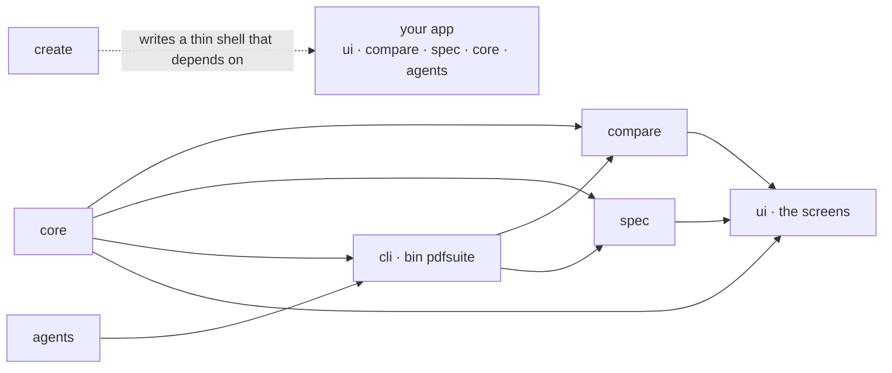

# SR-NPM-PACKAGES — the seven npm packages

## §1 — For humans

**Run `npm create @pdfsuite` and you have all of pdfsuite** — a web app with Compare, Bulk
compare, Spec and Inspect, hostable at any URL, plus the command line — in a new app or
added to an existing one. Run it again after an upgrade and it syncs, without touching
what you changed. **Install only `@pdfsuite/compare` or `@pdfsuite/spec`** in another
repository and you get that command line — for Jenkins, or any test suite. The rules this
implements are law [L4](0006_LAW-4-how-packages-work.md).



<details>
<summary><b>ASCII twin</b></summary>

```text
  core ---> compare <--- cli <--- agents
  core ---> spec    <--- cli
  core ---> cli
  core, compare, spec ---> ui (the screens)
  create ..writes a thin shell..> your app (ui, compare, spec, core, agents)
```

</details>

### The packages

| package | what it does | depends on | gives you |
|---|---|---|---|
| `@pdfsuite/core` | open a PDF (fonts, character maps, password); extract text, images, fonts, positions; Inspect's measurements; document properties; the three report builders; the JSON schemas | `pdfjs-dist`, `pdf-lib` (exact) | a library |
| `@pdfsuite/compare` | golden vs candidate: `comparePair`, `compareMany` (many pairs, orphans reported), pairing, changes, the page-changed rule, pass/fail; its CLI command | `core`, `cli` | `pdfsuite compare`, `pdfsuite compare --each`, `pdfsuite-compare` |
| `@pdfsuite/spec` | the rulebook check: read `.xlsx` / `.json`, validate, check, coverage; its CLI command | `core`, `cli` | `pdfsuite spec`, `pdfsuite-spec` |
| `@pdfsuite/cli` | the `pdfsuite` host: arguments, console, exit codes, files; built-in `inspect`, `generate`, `agents init`; loads `compare` and `spec` | `core`, `agents` | `pdfsuite` |
| `@pdfsuite/agents` | agent files for Claude, Kiro, Codex and Copilot, from one source | — | used by `agents init` |
| `@pdfsuite/ui` | the screens: Compare, Bulk compare, Spec, Inspect, as React components and one `<PdfSuiteApp/>` | `core`, `compare`, `spec`; React as a peer | a component library |
| `@pdfsuite/create` | creates the app (new or existing), and syncs it on upgrade | — | `npm create @pdfsuite` |

### What you get

| you run | you get |
|---|---|
| `npm create @pdfsuite my-app` | **a new app:** the web app with all four tabs, and `npx pdfsuite …` inside it |
| `npm create @pdfsuite .` in an existing React app | **added, not merged:** the packages and one new folder, `src/pdfsuite/`, mounting `<PdfSuiteApp/>`; the one line to add to your router is printed — no existing file is edited |
| `npm create @pdfsuite@latest -- --sync` | **an upgrade:** `@pdfsuite/*` versions bumped together; untouched shell files replaced; files you edited left alone and listed, the new version written beside them as `*.pdfsuite-new` |
| `npm create @pdfsuite@latest -- --sync --check` | exit 1 if the app is behind — for CI |
| `npm i @pdfsuite/compare` | CLI only: `pdfsuite compare a.pdf b.pdf`, `pdfsuite compare --each golden/ candidate/`; `pdfsuite-compare` when installed with `-g` |
| `npm i @pdfsuite/spec` | CLI only: `pdfsuite spec spec.xlsx report.pdf`; `pdfsuite-spec` when installed with `-g` |

### Which tab uses which package

| tab | package |
|---|---|
| Compare | `@pdfsuite/compare` (`comparePair`) |
| Bulk compare | `@pdfsuite/compare` (`compareMany` — the function `--each` calls) |
| Spec driven comparison | `@pdfsuite/spec` |
| Inspect | `@pdfsuite/core` |

---

## §2 — For agents

### Context

On 2026-10-18 the product was one app (`src/`) and one unpublished CLI package (`cli/`).
**Measured that day:** a local install links a dependency's `bin` into `node_modules/.bin`;
a global install links only the installed package's own `bin`. All `@pdfsuite/*` names and
the scope were unclaimed. `npm create @usr` runs `@usr/create` (npm docs).

### Decision

1. **Seven packages under `@pdfsuite`** (§1). JSON schemas live in `core`; there is no
   umbrella package — `create` is how a team gets everything (L4 decision 1).
2. **No dependency cycle:** `core` depends on no `@pdfsuite` package; `cli` on `core` and
   `agents`; `compare` and `spec` on `core` and `cli`; `ui` on `core`, `compare`, `spec`;
   `create` on nothing at run time.
3. **`cli` hosts commands and does not depend on `compare` or `spec`.** `pdfsuite <name>`
   loads `@pdfsuite/<name>`'s command module when installed; missing → exit 2 with the
   `npm i` to run; a different version → exit 2.
4. **`compare` and `spec` each own a bin** — `pdfsuite-compare`, `pdfsuite-spec` — so a
   global install reaches the PATH; only `cli` owns `pdfsuite`.
5. **Many pairs:** `pdfsuite compare --each <golden-dir> <candidate-dir>` pairs by relative
   path and calls `compareMany` in one process — the same function Bulk compare calls; a
   golden or a candidate without a partner fails the run.
6. **Each tab imports its package** (table above), and nothing else of another package
   than its public exports.
7. **`create` has two modes and writes a thin shell.** A new directory gets a Vite + React
   app; an existing app gets `src/pdfsuite/` and the dependencies, and no existing file is
   edited. The shell holds only entry, configuration and theme; every screen comes from
   `@pdfsuite/ui`, so `npm update` delivers new screens.
8. **Sync is deterministic.** `create` records every file it writes, with its SHA-256 and
   the pdfsuite version, in `.pdfsuite/installed.json`. `--sync` replaces a file only if its
   hash still matches the record; otherwise it writes `<file>.pdfsuite-new` and lists it; a
   file the consumer deleted stays deleted. In `package.json` only `@pdfsuite/*` entries
   change. `--check` exits 1 when behind.
9. **The app is a static single-page app, hostable at any URL.** Relative asset paths, hash
   routing by default (a base path when the host rewrites), pdf.js's worker, fonts and
   character maps served beside the app. No server; PDFs never leave the browser.
10. **One version for all seven, released together** (L4 decision 4); `pdfjs-dist` pinned
    exactly in `core`.
11. **One repository, npm workspaces** — `packages/core`, `compare`, `spec`, `cli`,
    `agents`, `ui`, `create`; this repository's own app is a `create` shell over `ui`.
12. **No package sends a PDF, a spec or a result over the network**; only `generate` calls
    the API its user configures.
13. **Publishing is a human step** — from CI with npm provenance, by Siddharth or Arpit,
    after the `pdfsuite` organisation is claimed; fictional fixtures only.
14. **`@pdfsuite/spec` is built from the live spec feature,** which lives only on the spec
    machine; where it is built is owed a ruling (W-32).
15. **Licence: MIT,** for the repository (`LICENSE` at the root) and for every package (its
    own `LICENSE`, listed in `files`); a package bundling Apache-2.0 code (pdf.js) also ships
    that code's `NOTICE`. Every dependency obeys [L2](0004_LAW-2-open-source-only.md).

### Consequences

- **Open:** W-29 (workspaces), W-30 (CLI host), W-31 (`create`, both modes), W-32 (`spec`,
  🔴), W-33 (`ui`), W-34 (`--sync`), W-35 (hosting at any URL), W-10 (agents, publishing),
  W-09 (`compare`, `--each`), W-27 (`comparePair`, `compareMany`).
- **Enforced today:** nothing; W-29's import check, W-30's version check and W-34's sync
  test become the gates.

### Alternatives considered

| option | why it lost |
|---|---|
| One `pdfsuite` package with subpaths | Arpit: a single package is a CLI; the whole product comes through `create` |
| Scaffold the screens as copies (`create-vite` style) | copies cannot be synced; screens live in `ui` instead |
| Sync by re-scaffolding | overwrites what teams changed (L4 decision 5) |
| Edit the consumer's router on add | a wrong edit to someone's app is worse than one printed line |
| Bulk as a README script | Arpit ruled `--each`: one function, orphans always caught |
| `compare` and `spec` both owning `pdfsuite` | two global installs collide |

### Reference (required)

- [npm docs — `npm init` / `npm create`](https://docs.npmjs.com/cli/v10/commands/npm-init)
- The bin measurement above — two packed packages, `npm i` and `npm i -g --prefix`
- [`cli/package.json`](../cli/package.json) · [`package.json`](../package.json) · [`vite.config.ts`](../vite.config.ts)

### Veto condition

**Reopen this decision if:** a cycle appears between `@pdfsuite` packages, a tab imports a
package other than its row, the shell holds screen code, or a sync overwrites an edited file.

**How to check it:** after W-29, `npm ls --workspaces`; `grep -rn "@pdfsuite/[a-z]*/src" packages src` empty; W-34's sync test.

---

## References

**The feature records** — [SR-COMPARE](0111_COMPARE.md) · [SR-BULK-COMPARE](0113_BULK-compare.md) · [SR-SPEC](0112_SPEC.md) · [SR-INSPECT](0114_INSPECT.md) · [SR-CLI](0115_CLI.md) · [SR-REPORT-HTML](0108_REPORT-html.md) · [SR-REPORT-JSON](0109_REPORT-json.md) · [SR-MANIFEST](0110_MANIFEST.md)

**Records** — [SR-LAW-4](0006_LAW-4-how-packages-work.md) · [SR-LAW-3](0005_LAW-3-one-function-ui-and-cli.md) · [SR-SURFACE-PARITY](0106_SURFACE-parity.md) · [SR-PDF-SUPPORT](0105_PDF-support.md)

**Code**

- [`cli/package.json`](../cli/package.json) · [`package.json`](../package.json) · [`vite.config.ts`](../vite.config.ts)

**Project docs**

- [`work/proposals/pdfsuite-compare-cli.md`](../work/proposals/pdfsuite-compare-cli.md)
