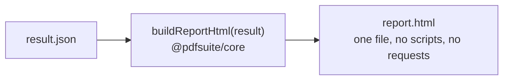

# SR-REPORT-HTML — report.html

## §1 — For humans

**`report.html` is the page a person reads.** It opens from disk, from a CI artifact or as
an e-mail attachment, needs no server and no internet, and shows the same thing whether the
app or the CLI wrote it — because both render it from `result.json` with one function.



<details>
<summary><b>ASCII twin</b></summary>

```text
  result.json --> buildReportHtml(result) (@pdfsuite/core) --> report.html (one file, no scripts, no requests)
```

</details>

### What it shows, top to bottom

| section | compare | many pairs (`--each`, Bulk) | spec | inspect |
|---|---|---|---|---|
| **Verdict banner** | PASS / FAIL, "k of n pages differ" | PASS / FAIL, "k of n pairs fail · m new · r removed" | PASS / FAIL, "N of M rows checked" | the file and its page count |
| **Identity strip** | both file names, short SHA-256, tool version, policy, run date | the two folders, counts | workbook and PDF names, short SHA-256, template version | file name, short SHA-256 |
| **Summary table** | one row per page pair: pages (g:c), verdict, content %, pixels %, max offset (in), findings | one row per pair: verdict, pages differing, link to its own `report.html` | one row per page: passes, fails, warnings, unverifiable | one row per page: page kind, elements |
| **Detail** | each **failing** page: golden and candidate side by side with coloured boxes, the diff image, the change list (type · text · from → to · Δ in inches) | — (each pair's own report) | each element: expected · actual · delta · status · **Excel cell** | each page: outlined elements; a table of kind · text · font · size · box (in) · edge distances |
| **Notes** | page kind, fonts not embedded, size differences — as their work items land | orphans named | coverage: noted · unverifiable · excluded, each with its cell | document properties |
| **Footer** | links to `result.json` and `manifest.json`; full SHA-256 of every input | same | same | same |

**Passing pages are counted, not drawn** — the file stays small and the failures stay visible.

### How it looks

- **Colour is never the only signal:** every box and row also carries its label — removed,
  added, moved, restyled, and the later field, annotation, font, recoloured, page-size.
- **Fixed palette:** the change colours of `src/services/changes.ts` (`CHANGE_COLOR`), one
  meaning each, the same in the app's views.
- **Prints cleanly** on A4 and Letter; one page pair per printed section.
- **Light theme only;** system fonts; no web fonts.

---

## §2 — For agents

### Context

On 2026-10-18 the app (`buildHtmlReport`) and the CLI (`writeHtmlReport`) wrote HTML
separately, sharing only CSS and page detail (SR-SURFACE-PARITY). Arpit ruled three output
files, one of them `report.html`.

### Decision

1. **One builder:** `buildReportHtml(result)` in `@pdfsuite/core` renders every variant;
   the app and the CLI call it (L3). It reads only `result.json`.
2. **Self-contained:** page images embedded as data URIs; no external request, font, script
   or stylesheet.
3. **No script:** the page works with JavaScript disabled; expanding uses `<details>`. The
   app shows it in a sandboxed iframe with scripts off.
4. **Every inserted value is escaped** — file names, PDF text, spec values, units.
5. **Deterministic:** the same `result.json` gives a byte-identical file.
6. **Images for failing pages only** by default; a size budget is checked in tests.
7. **Accessible:** semantic tables with headers, `alt` text on every image, labels beside
   colours.

### Consequences

- Built by W-27 (compare), W-09 (`--each`), W-11 (spec), W-28 (inspect). Until then, two
  writers exist and differ.

### Alternatives considered

| option | why it lost |
|---|---|
| An interactive report with scripts | blocked by sandboxes and mail clients; the app is the interactive view |
| Separate image files beside the HTML | breaks the three-file ruling and e-mailing one file |

### Reference (required)

- [`src/services/exportReport.ts`](../src/services/exportReport.ts) — today's app builder · [`cli/src/report/html.ts`](../cli/src/report/html.ts) — today's CLI writer
- [SR-REPORT-JSON](0109_REPORT-json.md) — the only input

### Veto condition

**Reopen this decision if:** the app and the CLI produce different `report.html` bytes for
the same `result.json`, or the file makes a network request.

**How to check it:** W-27's parity test; `grep -n "http" report.html` finds only text inside escaped values.

---

## References

**Records** — [SR-REPORT-JSON](0109_REPORT-json.md) · [SR-MANIFEST](0110_MANIFEST.md) · [SR-COMPARE](0111_COMPARE.md) · [SR-BULK-COMPARE](0113_BULK-compare.md) · [SR-SPEC](0112_SPEC.md) · [SR-INSPECT](0114_INSPECT.md) · [SR-LAW-3](0005_LAW-3-one-function-ui-and-cli.md)

**Code** — [`src/services/exportReport.ts`](../src/services/exportReport.ts) · [`cli/src/report/html.ts`](../cli/src/report/html.ts) · [`src/services/changes.ts`](../src/services/changes.ts)
