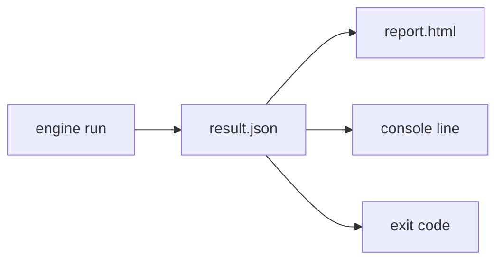

# SR-REPORT-JSON — result.json

## §1 — For humans

**`result.json` is the answer.** Every other output — the HTML report, the console line,
the exit code — is derived from it. A pipeline, an agent or a person can read it, and two
runs over the same files give the same answer in the same bytes, except the one block that
says when the run happened.



<details>
<summary><b>ASCII twin</b></summary>

```text
  engine run --> result.json --+--> report.html
                               +--> console line
                               +--> exit code
```

</details>

### The shape (schema `pdfsuite.result/1`)

| key | holds |
|---|---|
| `schema` | `"pdfsuite.result/1"` |
| `kind` | `compare` · `compare-many` · `spec` · `inspect` |
| `tool` | package versions — core, compare or spec, cli — and `pdfjs-dist` |
| `env` | runtime: Node or browser, platform, canvas backend, font set |
| `run` | **the only wall-clock:** started, duration, arguments (secrets redacted), resolved options with their source |
| `policy` | verdict rule id, version, and every knob that moves it (pixel sensitivity, anti-aliasing) |
| `inputs` | each input: name, bytes, SHA-256 (the same values as `manifest.json`) |
| `summary` | verdict, counts, exit code |
| `pairs` / `pages` / `elements` | the body, by `kind` — below |
| `findingsSha256` | hash of the body, so two runs compare at a glance |

| `kind` | body |
|---|---|
| `compare` | `pages[]`: golden and candidate page, verdict, metrics (content match, pixel ratio, max offset in inches), `findings[]` |
| `compare-many` | `pairs[]`: id, golden and candidate paths, verdict, summary, link to the pair's own folder; `orphans[]` |
| `spec` | `pages[]` → `elements[]`: expected, actual, delta, status, **source cell**; `coverage` (checked, noted, unverifiable, excluded) |
| `inspect` | `pages[]` → `elements[]`: kind, text, font, weight and its source, size, box (in), edge distances, line height; `document` properties |

**Every finding** has a stable `id` (hash of pair, page, type, text, coarse position), a
`type`, the text, a box in inches and its delta.

---

## §2 — For agents

### Context

On 2026-10-18 the app (`buildJsonReport`) and the CLI (`writeJsonReport`) wrote different
JSON (SR-SURFACE-PARITY). Arpit ruled three files with `result.json` as the source of truth.

### Decision

1. **One builder:** `buildResultJson` in `@pdfsuite/core`; app and CLI both emit it (L3).
2. **Schema shipped** as JSON Schema in `@pdfsuite/core` (`schema/result.v1.json`); every
   written file validates against it in tests.
3. **Byte-stable outside `run`:** keys in a fixed order, numbers rounded to fixed decimals
   (inches 4, ratios 6), arrays in document order.
4. **Units:** positions and sizes in inches from the page's top-left; font sizes in points.
5. **Versioning:** adding a key is a minor change; renaming, removing or changing a meaning
   is `pdfsuite.result/2`.
6. **No secret is ever written** — passwords and API headers are redacted in `run`.
7. **The verdict in `summary` is the exit code's source** — nothing else decides it.

### Consequences

- Built by W-27 (`compare`, `compare-many`), W-11 (`spec`), W-28 (`inspect`).
- Pipelines that read today's CLI JSON need the migration note (W-09).

### Alternatives considered

| option | why it lost |
|---|---|
| Timestamps throughout | two identical runs could never be compared byte for byte |
| Pixels as units | depend on render scale; inches are what a spec states |

### Reference (required)

- [`src/services/exportReport.ts`](../src/services/exportReport.ts) `buildJsonReport` · [`cli/src/report/machine.ts`](../cli/src/report/machine.ts) `writeJsonReport`

### Veto condition

**Reopen this decision if:** two runs over identical inputs differ outside `run`, or a
written file fails the schema.

**How to check it:** run twice, drop `run`, diff; validate against `schema/result.v1.json`.

---

## References

**Records** — [SR-REPORT-HTML](0108_REPORT-html.md) · [SR-MANIFEST](0110_MANIFEST.md) · [SR-COMPARE](0111_COMPARE.md) · [SR-BULK-COMPARE](0113_BULK-compare.md) · [SR-SPEC](0112_SPEC.md) · [SR-INSPECT](0114_INSPECT.md) · [SR-CLI](0115_CLI.md)

**Code** — [`src/services/exportReport.ts`](../src/services/exportReport.ts) · [`cli/src/report/machine.ts`](../cli/src/report/machine.ts)
