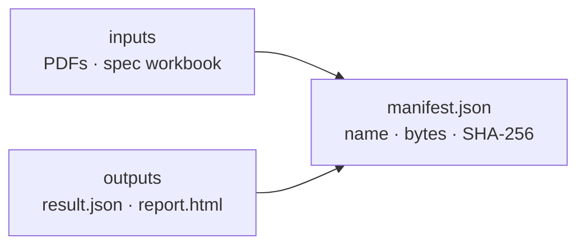

# SR-MANIFEST — manifest.json

## §1 — For humans

**The manifest is the receipt.** It says exactly which files went in and which came out,
by fingerprint, so months later anyone can prove that *this* report came from *these* PDFs.



<details>
<summary><b>ASCII twin</b></summary>

```text
  inputs (PDFs, spec workbook) ---\
                                   >--> manifest.json (name, bytes, SHA-256)
  outputs (result.json, report.html)/
```

</details>

### The shape (schema `pdfsuite.manifest/1`)

| key | holds |
|---|---|
| `schema` | `"pdfsuite.manifest/1"` |
| `kind` | the run's kind, as in `result.json` |
| `tool` | package versions |
| `inputs[]` | role (`golden`, `candidate`, `spec`, `pdf`), name as given, bytes, SHA-256 |
| `outputs[]` | `result.json`, `report.html`: bytes, SHA-256 |
| `pairs[]` | for many pairs: each pair's folder and the SHA-256 of its own `manifest.json` |

---

## §2 — For agents

### Context

Arpit ruled three output files on 2026-10-18 — report.html, result.json and a manifest "which
tells what all files are present" — with input hashes included (the refined option).

### Decision

1. **One builder:** `buildManifest` in `@pdfsuite/core`; the app's export and the CLI write
   the same file (L3).
2. **Written last,** after `result.json` and `report.html`, so it hashes their final bytes.
3. **Every input and output** is listed; nothing is omitted, nothing outside the run's folder
   is listed.
4. **SHA-256, hex, lower case;** sizes in bytes; names as the user gave them, never absolute
   paths of the machine.
5. **No timestamp** — the time lives in `result.json`'s `run` block.
6. **Not to be confused** with `.pdfsuite/installed.json`, the record `create` keeps of the
   files it wrote (SR-NPM-PACKAGES decision 8).

### Consequences

- Built by W-27 and W-09; the spec and inspect runs reuse it (W-11, W-28).

### Alternatives considered

| option | why it lost |
|---|---|
| Hashes inside `result.json` only | `result.json` cannot hash itself or the HTML |
| Absolute paths | leak machine layout and break on another machine |

### Reference (required)

- [`cli/src/core/manifest.ts`](../cli/src/core/manifest.ts) — today's `generate` manifest, the starting point

### Veto condition

**Reopen this decision if:** a listed hash does not match its file.

**How to check it:** `sha256sum` each listed file against `manifest.json`.

---

## References

**Records** — [SR-REPORT-JSON](0109_REPORT-json.md) · [SR-REPORT-HTML](0108_REPORT-html.md) · [SR-CLI](0115_CLI.md) · [SR-NPM-PACKAGES](0107_NPM-packages.md)

**Code** — [`cli/src/core/manifest.ts`](../cli/src/core/manifest.ts)
