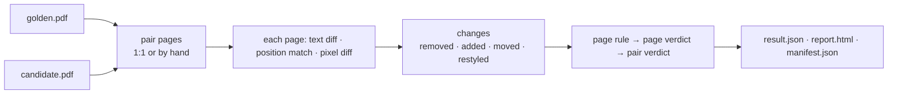

# SR-COMPARE — comparing one pair

## §1 — For humans

**Give it the golden PDF and the PDF under test; it tells you, page by page, what
changed and whether the pair passes.** The Compare tab and `pdfsuite compare` run the same
function, `comparePair`, from `@pdfsuite/compare`.



<details>
<summary><b>ASCII twin</b></summary>

```text
  golden + candidate --> pair pages --> per page: text, position, pixels --> changes --> verdict --> three files
```

</details>

| stage | what happens |
|---|---|
| **Pair pages** | page 1 with page 1 by default; pairs set by hand in the tab or with `--pages "1:1,2:-,3:2"`; nothing inferred |
| **Render** | both pages into one target box fixed by the golden page — 2 px per point (144 DPI), at most 1600 px wide |
| **Three signals** | word diff of the reading text; position match of text runs; pixel diff |
| **Changes** | removed · added · moved · restyled — and, as their items land, field, annotation, font, recoloured, page size |
| **Page rule** | a page fails if a side is missing, content match < 99.99 %, pixels changed > 0.2 %, or text moved > 2 px — one rule for the verdict, the page strip and Next change |
| **Not failing** | restyled text; changes marked expected; informational findings |
| **Pair verdict** | fails if any page fails |

**Where you see it:** Compare tab — Side by side, Overlapping, View report; CLI —
`pdfsuite compare golden.pdf candidate.pdf --out dir`, exit 0 pass, 1 fail, 2 broken.

---

## §2 — For agents

### Context

On 2026-10-18 the engine was shared but the page loop existed three times and the strip
and the verdict disagreed (2.9 px vs 2 px) — SR-SURFACE-PARITY.

### Decision

1. **`comparePair(golden, candidate, options)`** in `@pdfsuite/compare` is the only entry;
   the tab and the CLI call it.
2. **Pairing is an input** (`PagePair[]`); unpaired pages are reported as added or removed.
3. **One page rule, `pageVerdict`;** its limits live in `specConstants.ts` (SR-CONSTANTS).
4. **Every knob that moves the verdict** — pixel sensitivity (default 0.1), anti-aliasing
   (default off) — is recorded in `result.json`'s `policy`.
5. **Outputs** are SR-REPORT-JSON, SR-REPORT-HTML and SR-MANIFEST — nothing else.
6. **What the engine can read** is SR-PDF-SUPPORT; a kind it cannot handle is said, never
   passed silently.

### Consequences

- Built by W-27 (one core, one rule) and W-09 (the command); findings grow with W-14,
  W-17, W-19, W-20, W-22, W-24.

### Alternatives considered

| option | why it lost |
|---|---|
| Automatic page alignment | a subtly wrong pairing is worse than none; the aligner stays unwired |
| Tunable verdict thresholds per run | the app and CLI drifted when the CLI kept them |

### Reference (required)

- [`src/services/pdfCompare.ts`](../src/services/pdfCompare.ts) `comparePage` · [`src/services/changes.ts`](../src/services/changes.ts) `buildChanges`, `summaryPageDiffers`, `pageHasChange`

### Veto condition

**Reopen this decision if:** the tab and the CLI disagree on a page's verdict for the same pair.

**How to check it:** W-27's parity test over the regression samples.

---

## References

**Records** — [SR-BULK-COMPARE](0113_BULK-compare.md) · [SR-REPORT-JSON](0109_REPORT-json.md) · [SR-REPORT-HTML](0108_REPORT-html.md) · [SR-MANIFEST](0110_MANIFEST.md) · [SR-CLI](0115_CLI.md) · [SR-PDF-SUPPORT](0105_PDF-support.md) · [SR-CONSTANTS](0103_CONSTANTS.md) · [SR-SURFACE-PARITY](0106_SURFACE-parity.md)

**Code** — [`src/services/pdfCompare.ts`](../src/services/pdfCompare.ts) · [`src/services/changes.ts`](../src/services/changes.ts) · [`src/store/compareStore.ts`](../src/store/compareStore.ts)
