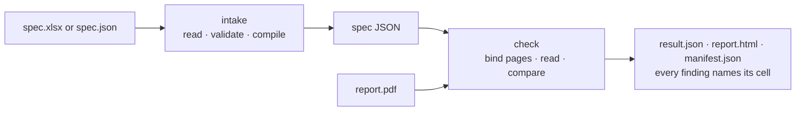

# SR-SPEC — spec-driven checking, end to end

## §1 — For humans

**Give it the spec workbook and the PDF; it checks every row of the spec against the page
and points at the Excel cell behind each result.** No golden PDF is needed — the workbook
is the truth. The Spec tab and `pdfsuite spec` run the same functions from `@pdfsuite/spec`.



<details>
<summary><b>ASCII twin</b></summary>

```text
  workbook --> intake (read, validate, compile) --> spec JSON --\
                                                                 >--> check --> three files, each finding with its cell
  PDF ----------------------------------------------------------/
```

</details>

| stage | rules live in |
|---|---|
| Read the workbook, validate it, compile spec JSON | [SR-SPEC-INTAKE](0101_SPEC-intake.md) |
| Bind pages, read the PDF, compare each assertion, coverage | [SR-SPEC-CHECK](0102_SPEC-check.md) |
| Tolerances and limits | [SR-CONSTANTS](0103_CONSTANTS.md) |
| Which PDFs can be read | [SR-PDF-SUPPORT](0105_PDF-support.md) |
| The three output files | [SR-REPORT-JSON](0109_REPORT-json.md) · [SR-REPORT-HTML](0108_REPORT-html.md) · [SR-MANIFEST](0110_MANIFEST.md) |

**Where you see it:** Spec tab — upload, validation report, results on the page; CLI —
`pdfsuite spec spec.xlsx report.pdf --out dir`, `--pages` to point a spec page at a PDF
page, `--validate-only` for spec authors.

---

## §2 — For agents

### Context

The rules of the spec feature already live in SR-SPEC-INTAKE and SR-SPEC-CHECK; this record
states the end-to-end feature and where each surface meets it, and restates none of their
decisions (L0). The live code is on the spec machine.

### Decision

1. **One entry per stage,** exported by `@pdfsuite/spec`: intake (`readWorkbook`,
   `sheetToSpec`, `validateSpec`) and check (`runSpec`); the tab and the CLI call them (L3).
2. **Spec JSON is the only thing the checker runs;** a workbook is compiled first.
3. **Every result names its source cell;** nothing passes silently — unreadable rows are
   coverage, not passes.
4. **Outputs** are the three files; the validation report is part of `result.json`.
5. **Confidential:** real workbooks never leave the spec machine; tests use fictional samples.
6. **Where `@pdfsuite/spec` is built** is owed a ruling (W-32).

### Consequences

- Built by W-02 (intake), W-04 (checker), W-11 (`pdfsuite spec`), W-32 (the package).

### Alternatives considered

| option | why it lost |
|---|---|
| Restate the intake and check rules here | two homes for one rule (L0) |

### Reference (required)

- [`src/features/spec/engine.ts`](../src/features/spec/engine.ts) — the headless surface · [`src/features/spec/README.md`](../src/features/spec/README.md) — the sealed boundary

### Veto condition

**Reopen this decision if:** the Spec tab and `pdfsuite spec` give different results for the
same spec and PDF.

**How to check it:** W-11's fixture test run through both paths.

---

## References

**Records** — [SR-SPEC-INTAKE](0101_SPEC-intake.md) · [SR-SPEC-CHECK](0102_SPEC-check.md) · [SR-CONSTANTS](0103_CONSTANTS.md) · [SR-PDF-SUPPORT](0105_PDF-support.md) · [SR-REPORT-JSON](0109_REPORT-json.md) · [SR-REPORT-HTML](0108_REPORT-html.md) · [SR-MANIFEST](0110_MANIFEST.md) · [SR-CLI](0115_CLI.md)

**Code** — [`src/features/spec/engine.ts`](../src/features/spec/engine.ts)
