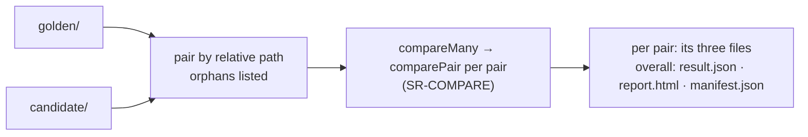

# SR-BULK-COMPARE — comparing many pairs

## §1 — For humans

**Point it at a folder of golden PDFs and a folder of candidates; it pairs them by name,
compares every pair exactly as Compare would, and fails if any pair fails or any file has
no partner.** The Bulk compare tab and `pdfsuite compare --each` run the same function,
`compareMany`.



<details>
<summary><b>ASCII twin</b></summary>

```text
  golden/ + candidate/ --> pair by path (orphans listed) --> compareMany -> comparePair each --> per-pair files + overall files
```

</details>

| aspect | how it works |
|---|---|
| **Pairing** | by relative path, sorted; in the tab also by order or row by row, which produces the same pair list |
| **Orphans** | a golden with no candidate is *removed*, a candidate with no golden is *new*; both fail the run |
| **Per pair** | SR-COMPARE, unchanged — same page rule, same changes |
| **Order** | pairs run one after another in sorted order; results never depend on timing |
| **Memory** | raw pixel buffers dropped once a page is scored; only encoded images kept |
| **Verdict** | the run fails if any pair fails or any orphan exists |
| **Outputs** | `<out>/<pair-id>/` with that pair's three files; at `<out>/`, a `compare-many` `result.json`, an index `report.html` linking every pair, a `manifest.json` covering all |
| **Exit code** | 0 all pass · 1 any fail or orphan · 2 broken |

**Where you see it:** Bulk compare tab (feature flag today; "Open in Compare" hands a pair
to the Compare tab); CLI — `pdfsuite compare --each golden/ candidate/ --out reports/`.

---

## §2 — For agents

### Context

On 2026-10-18 the Bulk tab looped in `batchStore`, the CLI looped over `pairs.json`, and
Arpit first ruled bulk as a README script, then — the same day — as `--each` in the package,
so the loop and the orphan check exist once.

### Decision

1. **`compareMany(pairs, options)`** in `@pdfsuite/compare` is the only loop; it calls
   `comparePair` per pair. The tab and `--each` call it (L3).
2. **Pairing produces one `PairList`** — from paths (CLI, tab default), order or manual rows
   (tab) — and `compareMany` takes that list.
3. **Orphans always fail** and are named in every output.
4. **Deterministic order:** sorted relative paths; parallelism, if added, never changes the
   output order or bytes.
5. **Outputs** follow SR-REPORT-JSON (`kind: compare-many`), SR-REPORT-HTML (index variant)
   and SR-MANIFEST.

### Consequences

- Built by W-27 (`compareMany`) and W-09 (`--each`); the tab's name is W-06.

### Alternatives considered

| option | why it lost |
|---|---|
| A README batch script | a loop and an orphan check written by every team; superseded by `--each` |
| `pairs.json` mapping files | removed with Option A; pairing by path covers it |

### Reference (required)

- [`src/store/batchStore.ts`](../src/store/batchStore.ts) · [`src/components/batch/BatchView.tsx`](../src/components/batch/BatchView.tsx) · [`src/services/batchExport.ts`](../src/services/batchExport.ts)

### Veto condition

**Reopen this decision if:** the tab and `--each` give a different verdict for the same two
folders, or an orphan does not fail the run.

**How to check it:** a `cli/verify` test with one orphan on each side, run through both paths.

---

## References

**Records** — [SR-COMPARE](0111_COMPARE.md) · [SR-REPORT-JSON](0109_REPORT-json.md) · [SR-REPORT-HTML](0108_REPORT-html.md) · [SR-MANIFEST](0110_MANIFEST.md) · [SR-CLI](0115_CLI.md) · [SR-SURFACE-PARITY](0106_SURFACE-parity.md)

**Code** — [`src/store/batchStore.ts`](../src/store/batchStore.ts) · [`src/services/batchExport.ts`](../src/services/batchExport.ts)
