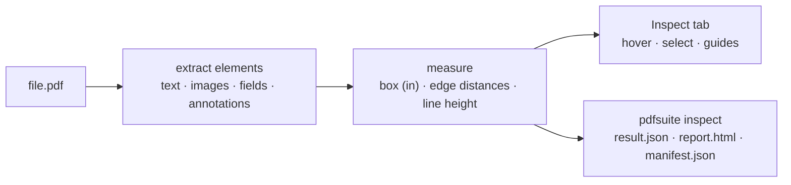

# SR-INSPECT — inspecting one PDF

## §1 — For humans

**Open one PDF and measure anything on it.** Every text run and image is found, with its
font, size, weight, colour and position — distances to the four page edges in inches, and
line height to the next line. The tab shows it under your mouse; `pdfsuite inspect` writes
it to files. Both call the same functions in `@pdfsuite/core`.



<details>
<summary><b>ASCII twin</b></summary>

```text
  file.pdf --> extract elements --> measure --+--> Inspect tab (hover, select, guides)
                                              +--> pdfsuite inspect (three files)
```

</details>

| per element | value |
|---|---|
| kind | text · image — and field, annotation as W-17 and W-19 land |
| text | the run's text (text only) |
| font | name, and whether it is embedded and what replaced it (W-14) |
| weight and italic | with their source: descriptor · name · unknown (W-15) |
| size | points |
| colour | fill colour (W-22) |
| box | left, top, width, height in inches from the page's top-left |
| edge distances | to left, right, top, bottom, in inches |
| line height | baseline to baseline to the nearest line in the block; leading ratio |
| page kind | text · outlined · scanned · OCR (W-20) |

**Document properties** — title, author, producer, PDF version, PDF/A or PDF/X, tagged,
encrypted, layers, attachments — in a Document panel (W-26), "not set" where absent.

---

## §2 — For agents

### Context

On 2026-10-18 extraction lived in `src/services/pdfElements.ts` but line height and edge
distances were computed inside `MeasureView.tsx`, and there was no CLI (SR-SURFACE-PARITY).

### Decision

1. **Extraction and measurement live in `@pdfsuite/core`** (`inspectCore`); the tab keeps
   only hit-testing and drawing (L3).
2. **`pdfsuite inspect <file.pdf> [--page n] --out dir`** writes the three files with
   `kind: inspect`.
3. **Units:** inches for positions and distances, points for font sizes; one conversion, in
   the core.
4. **Unknown is said:** a font without a name, a weight without a source, a page without a
   text layer — each is reported as such, never guessed.
5. **What can be read** follows SR-PDF-SUPPORT.

### Consequences

- Built by W-28; grows with W-14, W-15, W-17, W-19, W-20, W-22, W-23, W-26.

### Alternatives considered

| option | why it lost |
|---|---|
| Keep the maths in the component | the CLI could not give the same numbers (L3) |

### Reference (required)

- [`src/services/pdfElements.ts`](../src/services/pdfElements.ts) · [`src/components/measure/MeasureView.tsx`](../src/components/measure/MeasureView.tsx)

### Veto condition

**Reopen this decision if:** the tab and `pdfsuite inspect` report different values for the
same element.

**How to check it:** W-28's parity test.

---

## References

**Records** — [SR-PDF-SUPPORT](0105_PDF-support.md) · [SR-REPORT-JSON](0109_REPORT-json.md) · [SR-REPORT-HTML](0108_REPORT-html.md) · [SR-MANIFEST](0110_MANIFEST.md) · [SR-CLI](0115_CLI.md)

**Code** — [`src/services/pdfElements.ts`](../src/services/pdfElements.ts) · [`src/components/measure/MeasureView.tsx`](../src/components/measure/MeasureView.tsx)
