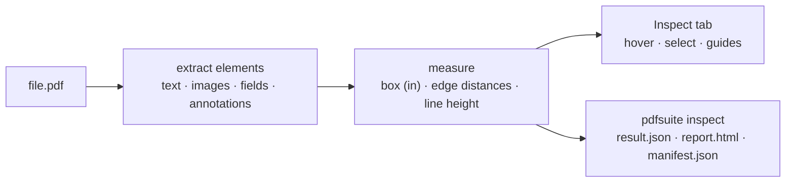

# SR-INSPECT — inspecting one PDF

## §1 — For humans

**Open one PDF and measure anything on it.** Every text run and image is found, with its
font, size, weight, colour and position — distances to the four page edges in inches, and
line height to the next line. The tab shows it under your mouse; `pdfsuite inspect` writes
it to files. Both call the same functions in `@pdfsuite/core`.



<details>
<summary><b>ASCII twin</b></summary>

```text
  file.pdf --> extract elements --> measure --+--> Inspect tab (hover, select, guides)
                                              +--> pdfsuite inspect (three files)
```

</details>

| per element | value |
|---|---|
| kind | text · image — and field, annotation as W-17 and W-19 land |
| text | the run's text (text only) |
| font | name, and whether it is embedded and what replaced it (W-14) |
| weight and italic | with their source: descriptor · name · unknown (W-15) |
| size | points |
| colour | fill colour (W-22) |
| box | left, top, width, height in inches from the page's top-left |
| edge distances | to left, right, top, bottom, in inches |
| line height | baseline to baseline to the nearest line in the block; leading ratio |
| page kind | text · outlined · scanned · OCR (W-20) |

**Document properties** — title, author, producer, PDF version, PDF/A or PDF/X, tagged,
encrypted, layers, attachments — in a Document panel (W-26), "not set" where absent.

---

## §2 — For agents

### Context

On 2026-10-18 extraction lived in `packages/core/src/pdfElements.ts` but line height and edge
distances were computed inside `MeasureView.tsx`, and there was no CLI (SR-SURFACE-PARITY).

### Decision

1. **Extraction and measurement live in `@pdfsuite/core`** (`inspectCore`); the tab keeps
   only hit-testing and drawing (L3).
2. **`pdfsuite inspect <file.pdf> [--page n] --out dir`** writes the three files with
   `kind: inspect`.
3. **Units:** inches for positions and distances, points for font sizes; one conversion, in
   the core.
4. **Unknown is said:** a font without a name, a weight without a source, a page without a
   text layer — each is reported as such, never guessed.
5. **What can be read** follows SR-PDF-SUPPORT.

### Consequences

- **Decisions 1–5 are built (2026-11-06, W-28).** `inspectCore` and `inspectPage` are in
  `@pdfsuite/core`; the Inspect tab calls them and keeps only hit-testing and drawing;
  `pdfsuite inspect <file.pdf> [--page n] --out <dir>` is a built-in command of the host
  and writes the three files with `kind: "inspect"`.
  [`packages/cli/verify/inspect-parity.ts`](../packages/cli/verify/inspect-parity.ts)
  (28 checks) measures one page both ways — the built binary as a process, and
  `renderElements` → `inspectPage` as `MeasureView.tsx` calls them — and the two
  documents are **identical outside `run`, 760 lines**.
- **An inspect has no verdict** (and the record does not give it one). It answers a
  question, so `exitCode` is 0 whenever the document opened and 2 when it did not.
  Inventing a failure — "no text layer", say — would make the command refuse documents it
  had read perfectly well; the pages without text are *named* in the summary instead.
- **Decision 4 is visible in the output:** a font pdf.js cannot resolve is `name: null`
  with a reason, and its weight is `"undeclared"` rather than `"regular"` — because bold
  is read off the font *name*, so a nameless font says nothing about weight either. The
  tab prints *not stated* for both.
- **A defect found on the way:** the image walker in `pdfElements.ts` ignored a Form
  XObject's own `/Matrix`, which is delivered as an argument to
  `paintFormXObjectBegin` and not as a `transform` op — so every image inside a form was
  measured at the wrong place. The same defect had been found and fixed twice in the spec
  walkers (W-04); this third copy was found by reading them side by side.
- **Still owed:** document properties in the output (**W-26**), and the images-in-report
  cap (20 pages, `--images` to override) is a judgment nobody has ruled on.


- **Since W-29 (2026-11-06)** Inspect's reading comes from `@pdfsuite/core` by name, and
  since **W-28** (the same day) so do its measurements: `MeasureView.tsx` holds no
  arithmetic at all.
- Built by W-28; grows with W-14, W-15, W-17, W-19, W-20, W-22, W-23, W-26.

### Alternatives considered

| option | why it lost |
|---|---|
| Keep the maths in the component | the CLI could not give the same numbers (L3) |

### Reference (required)

- [`packages/core/src/pdfElements.ts`](../packages/core/src/pdfElements.ts) · [`packages/ui/src/components/measure/MeasureView.tsx`](../packages/ui/src/components/measure/MeasureView.tsx)

### Veto condition

**Reopen this decision if:** the tab and `pdfsuite inspect` report different values for the
same element.

**How to check it:** W-28's parity test.

---

## References

**Records** — [SR-PDF-SUPPORT](0105_PDF-support.md) · [SR-REPORT-JSON](0109_REPORT-json.md) · [SR-REPORT-HTML](0108_REPORT-html.md) · [SR-MANIFEST](0110_MANIFEST.md) · [SR-CLI](0115_CLI.md)

**Code** — [`packages/core/src/pdfElements.ts`](../packages/core/src/pdfElements.ts) · [`packages/ui/src/components/measure/MeasureView.tsx`](../packages/ui/src/components/measure/MeasureView.tsx)
