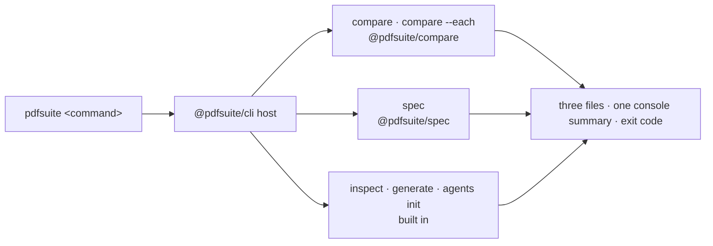

# SR-CLI — the pdfsuite command line

## §1 — For humans

**`pdfsuite` is how pipelines, scripts and agents use the tool.** One pair, many pairs, a
spec check or an inspection — each writes the same three files and returns an exit code CI
can trust.



<details>
<summary><b>ASCII twin</b></summary>

```text
  pdfsuite <command> --> cli host --+--> compare, compare --each (@pdfsuite/compare)
                                    +--> spec (@pdfsuite/spec)
                                    +--> inspect, generate, agents init (built in)
                     --> three files, one console summary, exit code
```

</details>

### Commands

| command | does | record |
|---|---|---|
| `pdfsuite compare <golden.pdf> <candidate.pdf> --out <dir> [--pages …]` | one pair | SR-COMPARE |
| `pdfsuite compare --each <golden-dir> <candidate-dir> --out <dir>` | many pairs, orphans fail | SR-BULK-COMPARE |
| `pdfsuite spec <spec.xlsx\|json> <file.pdf> --out <dir> [--pages …]` · `--validate-only` | spec check | SR-SPEC |
| `pdfsuite inspect <file.pdf> --out <dir> [--page n]` | elements and measurements | SR-INSPECT |
| `pdfsuite generate --payloads <dir> --out <dir> --api <url>` | render PDFs from JSON payloads | this record |
| `pdfsuite agents init [--tool …]` | write agent files into a project | SR-NPM-PACKAGES |
| `pdfsuite-compare …` · `pdfsuite-spec …` | the same as `pdfsuite compare` / `spec`, for global installs | SR-NPM-PACKAGES |

### Exit codes

| code | meaning | who acts |
|---|---|---|
| 0 | every check passes | nobody |
| 1 | a page, pair, assertion or orphan fails | the document owner |
| 2 | the command, its inputs or the tool are broken — bad arguments, unreadable file, wrong password, missing package, version mismatch | the pipeline owner |

### Console

```
pdfsuite 2.0.0 · 3 pairs
✗ invoice-standard    3 of 6 pages differ · 12 findings
✓ statement-summary   4 of 4
! broken-letter       error — unreadable PDF
FAIL · 1 differs · 1 error · 1 pass · report: reports/index.html · exit 1
```

---

## §2 — For agents

### Context

On 2026-10-18 the CLI was one package with `generate`, `compare` (folders and `pairs.json`)
and `pairs`. Arpit ruled one pair per command, `--each` for many, three output files, the
console above, and the package split.

### Decision

1. **One host, `@pdfsuite/cli`,** owns `pdfsuite`; `compare` and `spec` come from their
   packages (SR-NPM-PACKAGES decisions 3–4). No command re-implements an engine function (L3).
2. **Inputs are positional;** options are long flags; `--out` names the output folder.
3. **Outputs:** every result-producing command writes `result.json`, `report.html` and
   `manifest.json` (SR-REPORT-JSON, SR-REPORT-HTML, SR-MANIFEST) — nothing else.
4. **stdout carries only the console shape above;** progress, tables and warnings go to
   stderr; `--verbose` adds detail there.
5. **Exit codes 0 · 1 · 2** as above; whether to split 2 into usage (2) and runtime (3) is
   open on W-07.
6. **Secrets never on the command line:** passwords and API headers come from
   `--password-env`, `--password-file` or the environment, and are redacted everywhere.
7. **Configuration** resolves flag › `PDFSUITE_*` environment › config file › default;
   whatever moves a verdict is recorded in `result.json`.
8. **No network** except `generate`, which calls only the API it is given.
9. **Removed:** `pairs.json`, folder-to-folder compare without `--each`, the `pairs` dry run,
   JUnit, CSV and Markdown output.

### Consequences

- Built by W-08 (console), W-09 (compare, `--each`), W-11 (spec), W-16 (passwords), W-28
  (inspect), W-30 (host), W-10 (agents, publishing).

### Alternatives considered

| option | why it lost |
|---|---|
| Folders and `pairs.json` (today) | Arpit chose one pair per command; `--each` covers folders |
| JUnit for Jenkins | ruled out with the three files; `result.json` converts |

### Reference (required)

- [`cli/src/index.ts`](../cli/src/index.ts) · [`cli/src/core/exit.ts`](../cli/src/core/exit.ts) · [`cli/src/commands/`](../cli/src/commands/)

### Veto condition

**Reopen this decision if:** a command writes a file other than the three, prints anything
else on stdout, or returns an exit code outside 0–2.

**How to check it:** run each command on a fixture; list the output folder; capture stdout; check `$?`.

---

## References

**Records** — [SR-COMPARE](0111_COMPARE.md) · [SR-BULK-COMPARE](0113_BULK-compare.md) · [SR-SPEC](0112_SPEC.md) · [SR-INSPECT](0114_INSPECT.md) · [SR-REPORT-JSON](0109_REPORT-json.md) · [SR-REPORT-HTML](0108_REPORT-html.md) · [SR-MANIFEST](0110_MANIFEST.md) · [SR-NPM-PACKAGES](0107_NPM-packages.md) · [SR-LAW-3](0005_LAW-3-one-function-ui-and-cli.md) · [SR-LAW-4](0006_LAW-4-how-packages-work.md)

**Code** — [`cli/src/index.ts`](../cli/src/index.ts) · [`cli/src/core/exit.ts`](../cli/src/core/exit.ts)
