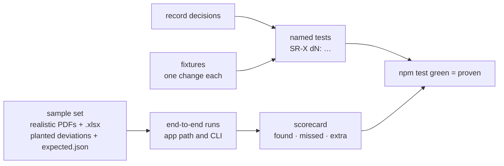

# SR-TESTING — how pdfsuite is tested

## §1 — For humans

**A feature works when every rule in its record has a test that proves it.** Each
record's decisions become named tests, and its veto condition runs as one. On top of that,
a realistic sample set — PDFs and Excel workbooks we generate ourselves, with deviations
planted on purpose — is run through the real tool, and the run is scored: every planted
deviation found, nothing else reported.

**Arpit, 2026-10-18:** *"How do we test whether a feature is working properly or not? … Can
we run testing on actual PDFs and Excel file? We can create some sample test data and then
we can go ahead and test it out."* — the approach was agreed in chat the same day.



<details>
<summary><b>ASCII twin</b></summary>

```text
  record decisions --> named tests <-- fixtures (one change each)
  sample set (PDFs + .xlsx, planted deviations, expected.json) --> end-to-end runs --> scorecard
  named tests + scorecard --> npm test green = proven
```

</details>

### Kinds of test

| kind | proves | example |
|---|---|---|
| **Unit** | a function at its edges | page rule at 1.9 / 2.0 / 2.1 px; `2 1/8` → 2.125 |
| **Reference outputs** | same input, same bytes | `result.json` (outside `run`) and `report.html` equal reviewed copies |
| **Known-answer fixtures** | finds what is there, nothing else | one planted change per pair; identical pairs pass |
| **Property checks** | rules that always hold | compare(X, X) passes; swapping sides swaps added ↔ removed; two runs, same bytes |
| **Parity (L3)** | one function, two surfaces | app path and CLI give identical `result.json` |
| **Contracts** | the three files are right | schema-valid `result.json`; manifest hashes verify; exit codes; console shape |
| **Packages (L4)** | installs behave as recorded | packed tarballs in a fresh project and a global prefix; version mismatch refused |
| **Browser** | tabs and hosting work | Playwright: each tab's main flow; any URL and sub-path |
| **Security** | nothing leaks or runs | hostile text escaped; **any network request fails the test**; no secret in any output |
| **Sample-set runs** | the tool works on realistic documents | scorecard per set: planted deviations found, missed, extra |
| **Performance** | no silent slow-down | ms per page; memory over 100 pairs; generous budgets, recorded |

### The sample set

| set | contents | expected |
|---|---|---|
| **compare** | multi-page fictional documents (statement, invoice, letter) as golden, plus variants each with listed deviations — text, moved block, font, colour, image swap, missing and extra page | `expected.json`: every deviation by page, type and position |
| **bulk** | two folders of those documents, one orphan on each side | per-pair verdicts and both orphans |
| **spec** | an Excel workbook in the spec template, a PDF that matches it, a PDF with planted deviations | every assertion's result with its cell; coverage |
| **inspect** | the same documents | positions, fonts and sizes of named elements, to 0.01 in |
| **kinds** | one PDF per kind in SR-PDF-SUPPORT (W-12) | that record's table |

### Blind batches — an independent exam

**The answers are written by an AI that has never seen this project.** A prompt from this
repository is pasted into a fresh chat; it returns a batch of 10–20 cases — PDFs, or a
workbook and a PDF — plus the answer key. The inputs go into the repository; the answer key
goes into a folder no AI agent may read. Our tool runs on the inputs, and a script, run by
a person, marks it against the key.

| step | who | command |
|---|---|---|
| copy a prompt into an independent chat | person | `testing/blind/PROMPT-compare.md` · `PROMPT-spec.md` |
| place the inputs | person | `npm run blind:place -- <inputs.zip>` |
| place the answer key | person, by hand | the sealed folder (below) |
| run the tool | person or agent | `npm run blind:run -- <batch>` |
| mark it | **person only** | `npm run blind:judge -- <batch>` |

### Commands

| command | runs | when |
|---|---|---|
| `npm test` | unit, reference, known-answer, property, parity, contracts, decision coverage | every commit; under two minutes |
| `npm run test:samples` | the sample-set runs and scorecard | every commit to `main`; before a release |
| `npm run test:pack` | packages, `create`, `--sync` | before a release |
| `npm run test:e2e` | Playwright | before merging to `main` |
| `npm run test:approve` | rewrites reference outputs and `expected.json` scores, showing the diff | only when a change is intended |

---

## §2 — For agents

### Context

On 2026-10-18 the product had no test runner; `cli/verify/` held four scripts run by hand,
one of them needing Python. The design records (SR-COMPARE … SR-CLI) and laws L3 and L4 had
no executable proof.

### Decision

1. **Every numbered decision in a record has at least one test named after it**
   (`SR-COMPARE d3: …`), and every record's veto condition runs as a test. A check lists
   decisions with no test; that list is the unproven backlog.
2. **Runner: Node's built-in `node:test`**, bundled with the esbuild already in use; tests
   live in each package's `test/` folder. No Jest, no Vitest.
3. **Fixtures and the sample set are fictional and generated in TypeScript** — PDFs with
   pdf-lib, workbooks with jszip (both already dependencies) — deterministically, so a
   regeneration gives the same bytes. Nothing real or confidential is committed.
4. **Every sample carries its answers:** an `expected.json` listing each planted deviation
   (page, type, position, Excel cell where relevant) and a README table a person can read.
5. **A sample-set run is scored:** found, missed, extra — per set and per deviation type.
   A missed planted deviation, or an extra finding on a matching document, fails the run.
6. **Reference outputs change only through `npm run test:approve`,** and the diff is part of
   the change; approving a scorecard drop needs Siddharth or Arpit.
7. **Determinism:** every test that runs the engine runs twice and compares bytes; any
   network request fails the test.
8. **Linux is the reference platform;** macOS and Windows runs report rendering differences
   and do not fail on them.
9. **Real workbooks and PDFs are tested only on the spec machine;** its results cannot come
   back, so this repository's tests use the sample set alone.
10. **Tools (Arpit, 2026-10-18):** the schema validator is **Ajv**, a dev dependency only — the
    schemas are a public contract, so they are checked by a standards-conforming validator,
    and no shipped package imports it. **Playwright** is a dev dependency only. **CI is GitHub
    Actions** for this repository: it is hosted on GitHub, and npm provenance (SR-NPM-PACKAGES
    decision 13) is issued only from GitHub Actions or GitLab CI. Jenkins is the *consumers'*
    CI — where `@pdfsuite/compare` and `@pdfsuite/spec` run by their exit codes and three
    files — and no Jenkins job is part of this repository.

11. **Blind batches are generated outside this project.** The prompts in `testing/blind/`
    carry only public contracts — the deviation catalogue, the answer format, the page rule
    and the spec template — never code, records or answers. The generator verifies every
    deviation it lists before listing it.
12. **Inputs and answers travel apart:** the generator returns `inputs.zip` and
    `answers.zip`; `blind:place` refuses any answer file inside the inputs.
13. **The sealed folder** is `testing/blind/answers/` unless `PDFSUITE_BLIND_ANSWERS` names
    another path, inside or outside the repository. It is git-ignored; Claude Code denies and
    hooks block any tool touching it; `AGENTS.md`, Kiro steering and Copilot instructions
    forbid reading it; a commit containing an answer file is refused. **Only a folder outside
    the repository and never connected to an agent is a guarantee;** the rest deters.
14. **The judge compares findings, not report bytes:** a planted deviation is found when an
    output finding has the same page and type, matching text, and a position within 0.25 in
    (and the same cell, for spec); each finding matches at most one deviation. It reports
    found, missed, extra and verdict agreement per case and in total.
15. **The judge is run by a person:** it refuses to run non-interactively or inside a
    known agent session, and asks for the batch id to be typed.
16. **A batch is single-use.** Once its marked results are shown to an agent it is *spent*,
    recorded in `testing/blind/batches.json`, and may join the regression sample set; a new
    batch replaces it as the exam.

### Consequences

- **Open:** W-36 (runner, decision coverage, reference outputs, first tests), W-37 (sample
  set), W-41 (blind batches), W-38 (sample-set runs and scorecard), W-39 (contracts and security), W-40 (browser);
  W-12 (kinds corpus), and the test DoDs already inside W-27, W-28, W-30, W-31, W-34, W-35.
- **Enforced today:** nothing; W-36 makes `npm test` the gate.

### Alternatives considered

| option | why it lost |
|---|---|
| Vitest or Jest | a dependency for what `node:test` already does |
| Real client documents as samples | confidential; they stay on the spec machine |
| Snapshot updates on every run | a silent regression becomes the new truth; `test:approve` makes it a decision |

### Reference (required)

- [`cli/verify/`](../cli/verify/) — today's hand-run checks: classification, regression, spec target, detail
- [`work/samples/excel-spec-template-v2/README.md`](../work/samples/excel-spec-template-v2/README.md) — the first sample: planted PDF deviations (12), planted intake errors (10), expected results

### Veto condition

**Reopen this decision if:** a numbered decision in an accepted record has no test, or a
sample-set run passes while missing a planted deviation.

**How to check it:** W-36's decision-coverage check; W-38's scorecard.

---

## References

**Records** — [SR-COMPARE](0111_COMPARE.md) · [SR-BULK-COMPARE](0113_BULK-compare.md) · [SR-SPEC](0112_SPEC.md) · [SR-INSPECT](0114_INSPECT.md) · [SR-CLI](0115_CLI.md) · [SR-REPORT-HTML](0108_REPORT-html.md) · [SR-REPORT-JSON](0109_REPORT-json.md) · [SR-MANIFEST](0110_MANIFEST.md) · [SR-PDF-SUPPORT](0105_PDF-support.md) · [SR-SURFACE-PARITY](0106_SURFACE-parity.md) · [SR-NPM-PACKAGES](0107_NPM-packages.md) · [SR-LAW-3](0005_LAW-3-one-function-ui-and-cli.md) · [SR-LAW-4](0006_LAW-4-how-packages-work.md) · [SR-STACK-TYPESCRIPT](0104_STACK-typescript.md)

**Code** — [`cli/verify/`](../cli/verify/) · [`cli/package.json`](../cli/package.json)

**Project docs** — [`work/samples/excel-spec-template-v2/README.md`](../work/samples/excel-spec-template-v2/README.md)
