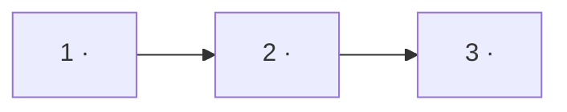

# `work/open/` — one file per open work item

[`../OPEN-WORK.md`](../OPEN-WORK.md) is an **index**: one line per item. The
detail lives here, one file per `W-nn`, named `W-nn-slug.md`.

**Contract**

1. An item's file is created in the same change that opens the item, and its
   row is added to `OPEN-WORK.md` in that same change. The row is one or two
   lines; every other word lives here. The row opens with its ball.
2. **When an item closes its row is deleted and its file MOVES to
   [`archive/open/`](../../archive/open/), in the same change — never
   deleted.** [SR-WORK-OPEN-QUEUE](../../records/0051_WORK-open-queue.md)
   rules 8–12 and 53–57.
3. **It opens with `## At a glance`** — a seven-row table, plus a flowchart
   when the plan has three or more steps — so the item can be put on screen in
   a meeting as it is. Rules: [SR-WORK-LIFECYCLE](../../records/0053_WORK-lifecycle.md)
   decisions 4a–4d; check: `bash scripts/check-work-items.sh`.
   **Its front matter names the people** — `filed_by`, `updated`,
   `updated_by` (decision 4e) — and the queue row repeats `filed by <name>`
   ([SR-WORK-OPEN-QUEUE](../../records/0051_WORK-open-queue.md) rule 14a).
4. A file carries only what a builder needs to start: goal, definition of
   done, blockers, the record it will update (or *no SR affected*), hazards,
   and the **model** that should execute it. Anything longer belongs in a
   record, a compare doc or a proposal, and is linked.
5. A `research` item's file says `**Model:** Cowork` and its row's lane is
   `cowork` (rule 37a).
6. This file is the spec as well as the state. There is no second document.

**Naming.** `W-nn` ids are never reused; the first is `W-01`.

**The file's shape:**

```markdown
---
type: Handoff
name: W-nn
description: "<one sentence: who asked, when, for what>"
item: W-nn
filed: YYYY-MM-DD
filed_by: <Siddharth | Arpit | the person who asked — never a model>
updated: YYYY-MM-DD
updated_by: <the person whose session last edited this file>
ball: agent | human | cowork
---

# W-nn — <title>

## At a glance

| | |
|---|---|
| **What** | <what we are going to do, one line, plain words> |
| **Why** | <the problem it removes or the value it adds — the asker's reason, not an invented one> |
| **Done when** | <the observable result someone in the meeting could check> |
| **Status** | <ball as on the OPEN-WORK row> <ready · waiting · date-gated · needs a ruling> · <N> of <M> DoD done |
| **Waits on** | <W-mm, a ruling, a date — or nothing> |
| **Who** | `<agent \| human \| cowork>` · <Opus \| Sonnet \| Haiku \| Cowork \| NONE> |
| **Record** | <SR-NAME> — or no SR affected |

<!-- Three or more DoD steps: the plan as a flowchart, one node per step, then its ASCII twin. -->



<details>
<summary><b>ASCII twin</b></summary>

```text
  1 <step> --> 2 <step> --> 3 <step>
```

</details>

**<Siddharth | Arpit>, YYYY-MM-DD:** *"<the ask, in their words>"*

**Model:** <Opus | Sonnet | Haiku | Cowork | NONE — who, and why>: <one sentence why>.

## Goal

## Definition of done

| DoD | what | state |
|---|---|---|
| 1 · … | … | ⏳ |

## Blockers

## Record affected

<SR-NAME decision n> — or **no SR affected**.

## Hazards

## Reference
```
