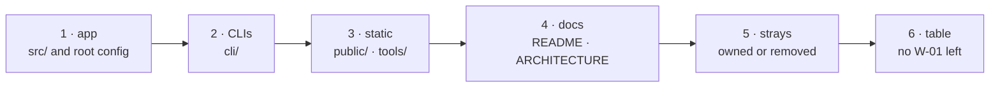

# W-01 — claim every component with a record

## At a glance

| | |
|---|---|
| **What** | Give every part of the product a record that owns it — today the placeholder W-01 owns them all |
| **Why** | A component with no record has no written decisions, and the commit guard can only point at a placeholder |
| **Done when** | No `W-01` is left in the register's Ownership table, and every record's `owns:` matches it |
| **Status** | 🟢 ready · 0 of 6 DoD done |
| **Waits on** | nothing — a ruling only if a stray file is to be deleted |
| **Who** | `agent` · Opus |
| **Record** | new records, plus the register's Ownership table (SR-WORK-OWNERSHIP) |



<details>
<summary><b>ASCII twin</b></summary>

```text
  1 app --> 2 CLIs --> 3 static --> 4 docs --> 5 strays --> 6 table
```

</details>

**Arpit, 2026-10-13:** *"Code folders the records should cover: everything in the repo."*

**Model:** Opus: deciding where one component's decision ends and another's begins is design judgment that no test checks.

## Goal

Replace every `W-01` owner in the register's Ownership table with a Standing
Record (`0101`+) that states the decisions behind that component.

**Since 2026-10-18 most records exist** — SR-COMPARE, SR-BULK-COMPARE, SR-INSPECT, SR-CLI,
SR-REPORT-JSON, SR-REPORT-HTML, SR-MANIFEST, SR-NPM-PACKAGES (all accepted). What remains is
moving each path into the right `owns:` as W-27, W-28, W-09 and W-29 land, plus records for
what none of them covers: the UI shell and flags, annotations, ZIP export/import, `public/`,
the docs.

## Definition of done

| DoD | what | state |
|---|---|---|
| 1 · app | records for `src/` (and `index.html`, `vite.config.ts`, `tsconfig*`, `package*.json`, `flag.env`), split where decisions differ (e.g. feature flags, annotations, ignore-difference). **Spec paths done 2026-10-16:** SR-SPEC-INTAKE, SR-SPEC-CHECK, SR-CONSTANTS — moved to the sealed `src/features/spec/` by `main`'s spec separation; still unclaimed there: `sheetRead.ts`, `sheetSpec.ts` (likely SR-SPEC-INTAKE), `engine.ts`, `pdfjs.ts`, `index.ts`, `spec.css`, `README.md`. Also new on `main`: `pagePairs.ts`, `PagePairing.tsx`, `regionStore.ts`, `DataRegionLayer.tsx` | ⏳ |
| 2 · CLIs | SR-CLI (accepted 2026-10-18) claims `cli/` — W-09 DoD 1; `cli-py/` was removed by W-03 on 2026-10-16 (SR-STACK-TYPESCRIPT) | ⏳ |
| 3 · static | records for `public/` and `tools/` (`public/samples/spec-sample.*` done 2026-10-16; the spec sample now lives in `work/samples/excel-spec-template-v2/`, owned by SR-SPEC-INTAKE) | ⏳ |
| 4 · docs | `README.md`, `spec-standard.md` (done: SR-SPEC-INTAKE), `comparison.md`, `presentation-script.md`, `docs/ARCHITECTURE.md`, `docs/architecture/` owned by the record they describe, or a docs record | ⏳ |
| 5 · strays | `.tmp-old-block.txt`, `.gitignore`, `.claude/launch.json` owned or removed (a removal is Siddharth's or Arpit's call) | ⏳ |
| 6 · table | no `W-01` left in the Ownership table; each record's `owns:` matches it | ⏳ |

## Blockers

None. DoD 5's removals need a ruling only if a file is to be deleted.

## Record affected

Creates new records `0101`+; updates the register's Ownership table
([SR-WORK-OWNERSHIP](../../records/0058_WORK-ownership.md) decision 2).

## Hazards

- Until this closes, every product commit must stage this file or say `no SR
  affected` — the guard treats `W-01` as the owner.
- `spec-standard.md` and `comparison.md` may already carry decisions; move
  them into records rather than restating them (L0).

## Reference

- [`records/README.md`](../../records/README.md) §Ownership
- [SR-WORK-LIFECYCLE](../../records/0053_WORK-lifecycle.md) decision 9
