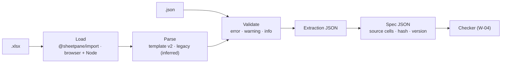

# W-02 — Spec intake: Excel workbook → validated spec JSON

## At a glance

| | |
|---|---|
| **What** | Upload an Excel spec (or a spec JSON), validate it, and compile it to a spec JSON in which every value names its sheet and cell |
| **Why** | Specs are kept in Excel and Excel is the truth; today the app takes JSON only |
| **Done when** | A workbook drops in, every problem is listed with its cell — a missing, in-value or unknown unit is an error, never a guess — and the spec JSON downloads and re-uploads unchanged |
| **Status** | 🟢 9 of 10 DoD done · DoD 5 part-done: decisions 10 (rich text) and 12 (relative values) unbuilt, and no fixture row exercises either |
| **Waits on** | nothing — both blockers cleared: W-05 landed 2026-11-03, `@sheetpane/import` published 0.5.1 |
| **Who** | `agent` · Opus |
| **Record** | SR-SPEC-INTAKE |



<details>
<summary><b>ASCII twin</b></summary>

```text
  .xlsx --> load (@sheetpane/import) --> parse (v2 | legacy = inferred) --\
  .json ---------------------------------------------------------------------->--> validate
        --> extraction JSON --> spec JSON --> checker (W-04)
```

</details>

**Arpit, 2026-10-14:** *"PDF specs are maintained in Excel … every sheet is one
page of a PDF … it contains sections, it
contains dimensions … A PDF will get uploaded and the Excel will get uploaded. We need
to highlight what all things do not match those Excel specs. Excel is the truth."*

**Arpit, 2026-10-16:** *"The Excel will be uploaded and converted to JSON, and the JSON
is what the tool uses to run the validations. If a JSON is uploaded, use it as is."*

**Model:** Opus: reading hand-written sheets — what a prose value means and what may be
asserted from it — is judgment no test catches until the fixtures exist.

**Design:** [SR-SPEC-INTAKE](../../records/0101_SPEC-intake.md) is the spec for this
item; read it first. The research behind it is the graduated
[proposal](../proposals/excel-spec-comparison.md). Checking the PDF against the spec
JSON is **W-04** ([SR-SPEC-CHECK](../../records/0102_SPEC-check.md)), not this item.

## Goal

A reviewer drops an `.xlsx` spec (or a spec JSON) into **Spec driven comparison**. The
app validates it, lists every error, warning and info line with its cell, and produces
a spec JSON whose every assertion names its sheet and cell. The JSON can be downloaded
and uploaded again.

## Definition of done

| DoD | what | state |
|---|---|---|
| 1 · upload | ✅ `uploadKind` accepts `.xlsx`/`.json` and refuses `.xls`, `.xlsm`, `.csv` and anything else, each with its own way out; password-protected mapped from the reader. The tab's own label and `accept` now say `.xlsx` or `.json` too | ✅ |
| 2 · reader | ✅ `specIntake.ts` over `read()` (pinned `0.5.1`), never the zip; refusals mapped; raw size checked before unzip and `maxTotalSize` passed from SR-CONSTANTS; hidden sheets, rows, columns and filtered rows listed with their cells; formulas per decision 5; **units per 7a** in `specTemplate.ts` | ✅ |
| 3 · template v2 | ✅ `specTemplate.ts` reads Pages List, Settings, Lists and the page sheets; merged labels read from the declared range, never forward-filled; the clean fixture reads with **0 errors, 0 warnings, 290 rows**, and the with-errors fixture yields **exactly its ten**. The **blank Template v2 workbook** is written by the same builders as the legacy draft — from the Export menu and from `pdfsuite spec --template <file>` — and reads back through the same reader with no error, asserting nothing until someone edits it | ✅ |
| 4 · legacy | ✅ `specLegacy.ts` reads the nested layout — merged labels from the file's own declared ranges, prose pulled apart into Value / Unit / From with a built-in vocabulary, every cell marked **read**, **inferred** or **unreadable**. `specDraft.ts` writes the draft Template v2 workbook: amber where it inferred, red where it could not read, **Check? = Note on every row**, so the draft itself asserts nothing. The tab offers it as a download and checks nothing until the confirmed workbook comes back. `sheetRead.ts` and `sheetSpec.ts`, which turned a legacy sheet straight into assertions, are gone | ✅ |
| 5 · values | ✅ decision 9 (fractions, comma decimals, leading dots, ranges as bands, `~` and range+Tolerance refused) and decision 11 strikethrough. **Decision 10 rich text and decision 12 relative values not done** — no fixture row exercises either | 🟡 |
| 6 · validation | ✅ the three severities separate as decision 13 draws them — an error on the file or the Pages List stops the run, an error on an element only removes it; the report is the first thing the tab shows, every line naming its sheet and cell, with the rows that have no check and **every accepted assertion in plain words** (decision 14) behind a disclosure | ✅ |
| 7 · outputs | ✅ all four of decision 14, from the Export menu the moment the workbook is read — the **validation report** (HTML, prints, every line with its cell and every assertion in words), the **annotated workbook** (*the uploaded file*, its error cells filled red — blank ones too — and a `Validation` sheet appended; the author's formatting, notes and screenshots untouched), the **extraction JSON** (every row: cell, raw text, parsed value, status) and the **spec JSON**, which uploads again and checks a PDF | ✅ |
| 8 · fixtures | ✅ **except the legacy clause** — the whole extraction, the whole compiled spec and coverage of `report-spec.xlsx` are frozen (`expected-extraction.json`, `expected-spec.json`, `expected-coverage.json`); any drift fails with the first differing line, and `--update` re-freezes it deliberately (decision 16). `report-spec-with-errors.xlsx` yields exactly the ten cells its `expected-validation.json` plants, no others, and **none of them reaches an assertion**. The legacy clause is covered too: `spec-legacy.ts` builds a legacy sheet from the v2 data and proves it yields a draft and **no assertion by any route** | ✅ |
| 9 · docs | ✅ `spec-standard.md` §7 replaced — the old “recommended column layout” for a conversion nobody had written is now Template v2 as the reader enforces it, plus the legacy draft path; §5.1 gained font, bold, italic and colour and §8 says validation happens on the workbook. `docs/ARCHITECTURE.md`'s spec diagram re-drawn (34 nodes, 39 edges) and `architecture/10-spec-driven-comparison.svg` re-rendered with `htmlLabels: false`, matching the other SVGs — one with `foreignObject` labels renders blank in standalone viewers. Glossary terms marked **built**, two of them corrected | ✅ |
| 10 · record | ✅ but **partly**, not yes — decisions 10 and 12 and three of decision 14's four downloads are unbuilt, so the register gained a third value with its meaning stated above the table, and the record's Consequences name exactly what is in and what is out. Decision 16 is now enforced | ✅ |

## Landed

**2026-11-04 — DoD 1 and 2.** `packages/spec/src/specIntake.ts`: `uploadKind` decides on
the extension before a byte is read, and the three near-misses each get their own way out
(`.xls` → save as .xlsx; `.xlsm` → the spec needs no macros; `.csv` → a sheet carries no
Pages List). `readSpecWorkbook` checks the raw size against `MAX_UPLOAD_BYTES` **before**
unzipping, passes `MAX_UNZIPPED_BYTES` as the reader's `maxTotalSize`, maps every
`ImportError` to a message naming the way out, and returns the visible sheets plus a note
for every hidden sheet, hidden row, filtered row, hidden column and formula cell.
Exported from `engine.ts`, so `pdfsuite spec` (W-11) uses the same reader.

`packages/cli/verify/spec-intake.ts`, 17/17, in `npm run verify` — which also proves the reader
works under Node, as decision 3 requires.

**A defect the test caught:** `read()` accepts CSV too and decides partly on the bytes, so
a file *named* `.xlsx` that is not a zip came back as a one-sheet CSV instead of a
refusal — a reviewer would have got a nonsense spec. `wb.source !== 'xlsx'` is now refused.

## Blockers

None. Both are cleared: W-05 landed 2026-11-03, and `@sheetpane/import` reached npm
(0.5.1, MIT, Arpit's repo).

## Record affected

[SR-SPEC-INTAKE](../../records/0101_SPEC-intake.md) — every decision. It also describes
`specStore.ts`, `SpecTestView.tsx` and `validateSpec`, so those commits stage it too.

## Hazards

- **Never assert what the sheet does not pin down.** A value that cannot be read is a
  validation line, never a guessed assertion.
- **Silence is a failure too.** Every row ends parsed, noted, excluded or unreadable in
  the extraction JSON.
- **Real workbooks never enter the repo.** Only the fictional fixtures are committed
  (decision 16); real ones are tested locally and not described in commits.
- **One reader.** `@sheetpane/import`, in the browser and under Node; no `jszip` cell reader
  beside it and no converter in any other language (SR-SPEC-INTAKE decision 3,
  SR-STACK-TYPESCRIPT).
- **Rich-text runs and strikethrough are not in the cell value** — read the `Workbook`'s
  `runs` and `styles`, or decisions 10–11 silently do nothing.
- ~~**The unzipped cap is sheetpane's.**~~ Settled in 0.5.1: `read()` takes
  `maxEntrySize` and `maxTotalSize`, so SR-CONSTANTS's cap is passed in. No upstream change
  needed.
- **`@sheetpane/import` declares `engines: node >=22`** while `packages/cli/package.json` publishes
  `node >=20`. It runs under this machine's Node, but the published `pdfsuite` would be
  claiming support it may not have once W-11 puts the spec check on the CLI. Needs a
  ruling: raise pdfsuite's floor to 22, or ask for 20 upstream.

## Reference

- The validation report's on-screen form is the sheet itself — [W-46](W-46-sheet-viewer.md) draws DoD 6's lines as marks on their cells; editing is [W-47](W-47-sheet-editor.md).

- [`work/samples/excel-spec-template-v2/`](../../work/samples/excel-spec-template-v2/README.md) — the spec sample (Template v2; the legacy-layout fixture was deleted 2026-10-18): a fictional 4-page landscape report with images, a vector graph, an image graph, tables and text; a matching PDF and a PDF with 12 known deviations
- [SR-SPEC-INTAKE](../../records/0101_SPEC-intake.md) · [SR-CONSTANTS](../../records/0103_CONSTANTS.md) · [`work/proposals/excel-spec-comparison.md`](../proposals/excel-spec-comparison.md)
- [`spec-standard.md`](../../spec-standard.md) · [`packages/spec/src/types.ts`](../../packages/spec/src/types.ts) · [`packages/spec/src/SpecTestView.tsx`](../../packages/spec/src/SpecTestView.tsx)
- [`docs/ARCHITECTURE.md`](../../docs/ARCHITECTURE.md) §Spec driven comparison
