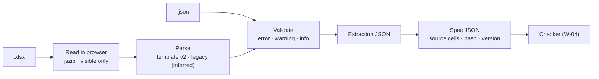

# W-02 — Spec intake: Excel workbook → validated spec JSON

**Arpit, 2026-10-14:** *"PDF specs are maintained in Excel … every sheet is one
page of a PDF … it contains sections, it
contains dimensions … A PDF will get uploaded and the Excel will get uploaded. We need
to highlight what all things do not match those Excel specs. Excel is the truth."*

**Arpit, 2026-10-16:** *"The Excel will be uploaded and converted to JSON, and the JSON
is what the tool uses to run the validations. If a JSON is uploaded, use it as is."*

**Model:** Opus: reading hand-written sheets — what a prose value means and what may be
asserted from it — is judgment no test catches until the fixtures exist.

**Design:** [SR-SPEC-INTAKE](../../records/0101_SPEC-intake.md) is the spec for this
item; read it first. The research behind it is the graduated
[proposal](../proposals/excel-spec-comparison.md). Checking the PDF against the spec
JSON is **W-04** ([SR-SPEC-CHECK](../../records/0102_SPEC-check.md)), not this item.

## Goal

A reviewer drops an `.xlsx` spec (or a spec JSON) into **Spec driven comparison**. The
app validates it, lists every error, warning and info line with its cell, and produces
a spec JSON whose every assertion names its sheet and cell. The JSON can be downloaded
and uploaded again.



<details>
<summary><b>ASCII twin</b></summary>

```text
  .xlsx --> read (jszip, visible cells) --> parse (v2 | legacy = inferred) --\
  .json ---------------------------------------------------------------------->--> validate
        --> extraction JSON --> spec JSON --> checker (W-04)
```

</details>

## Definition of done

| DoD | what | state |
|---|---|---|
| 1 · upload | the spec upload accepts `.xlsx` and `.json`, rejects `.xls`, `.xlsm`, `.csv` and a password-protected `.xlsx` each with its own message; label reads **Excel or JSON spec** (SR-SPEC-INTAKE decision 1) | ⏳ |
| 2 · reader | TypeScript `.xlsx` reader in `src/services/` on the existing `jszip`, no new dependency; size limits before and after unzip; media skipped; hidden sheets, rows, columns and filtered rows skipped and listed; formulas per decision 5 (decisions 3–6) | ⏳ |
| 3 · template v2 | Pages List, page sheets, Lists and Settings read per decision 7; a blank **template v2** workbook committed beside the fixture | ⏳ |
| 4 · legacy | the nested layout read per decision 8 — merges forward-filled, prose parsed, every value marked inferred | ⏳ |
| 5 · values | numbers, ranges, `~`, rich text, editing marks, relative values per decisions 9–12 | ⏳ |
| 6 · validation | the three severities and their examples per decision 13; the validation report shown in the app with each line's cell | ⏳ |
| 7 · outputs | extraction JSON and spec JSON (`source: {sheet, cell}`, workbook SHA-256, template version) downloadable; a downloaded spec JSON re-uploads unchanged (decision 14) | ⏳ |
| 8 · fixtures | expected extraction and spec JSON frozen for `tools/samples/excel-spec-hierarchical/` and a template v2 fixture; a parser change that alters them fails (decision 16) | ⏳ |
| 9 · docs | `spec-standard.md` rewritten for the spec JSON and template v2 (its old §7 removed); `docs/ARCHITECTURE.md` spec diagram re-drawn and its SVG re-rendered; glossary terms marked built | ⏳ |
| 10 · record | SR-SPEC-INTAKE `built` set to yes in the register; its Consequences updated | ⏳ |

## Blockers

- 🟡 **Waiting on W-05** — the size limits, tolerances and depth cap come from
  `src/services/specConstants.ts`, which W-05 creates.

## Record affected

[SR-SPEC-INTAKE](../../records/0101_SPEC-intake.md) — every decision. It also describes
`specStore.ts`, `SpecTestView.tsx` and `validateSpec`, so those commits stage it too.

## Hazards

- **Never assert what the sheet does not pin down.** A value that cannot be read is a
  validation line, never a guessed assertion.
- **Silence is a failure too.** Every row ends parsed, noted, excluded or unreadable in
  the extraction JSON.
- **Real workbooks never enter the repo.** Only the fictional fixtures are committed
  (decision 16); real ones are tested locally and not described in commits.
- **One reader.** No converter in any other language (SR-STACK-TYPESCRIPT).
- **Rich-text runs and strikethrough live in `xl/styles.xml` and the shared strings,**
  not in the cell value — read both, or decisions 10–11 silently do nothing.

## Reference

- [`tools/samples/excel-spec-hierarchical/`](../../tools/samples/excel-spec-hierarchical/README.md) — the legacy-layout fixture: a fictional 4-page landscape report with images, a vector graph, an image graph, tables and text; a matching PDF and a PDF with 12 known deviations
- [SR-SPEC-INTAKE](../../records/0101_SPEC-intake.md) · [SR-CONSTANTS](../../records/0103_CONSTANTS.md) · [`work/proposals/excel-spec-comparison.md`](../proposals/excel-spec-comparison.md)
- [`spec-standard.md`](../../spec-standard.md) · [`src/features/spec/types.ts`](../../src/features/spec/types.ts) · [`src/features/spec/SpecTestView.tsx`](../../src/features/spec/SpecTestView.tsx)
- [`docs/ARCHITECTURE.md`](../../docs/ARCHITECTURE.md) §Spec driven comparison
