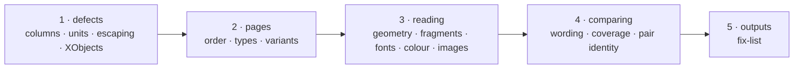

# W-04 — the spec checker, per SR-SPEC-CHECK

## At a glance

| | |
|---|---|
| **What** | Make the spec checker match its record: fix today's false failures, then pages, fonts, colour, images, wording and coverage (the CLI is W-11) |
| **Why** | Today a correct PDF fails three checks, and nothing shows how much of the spec was actually checked |
| **Done when** | The fixture's correct PDF reports no failure, its deviations PDF reports exactly what its README lists, and every finding names its cell |
| **Status** | 🟢 5 of 7 DoD done (1, 2, 4, 5, 6) · DoD 3 part-done (✅ except image content) · 7 open |
| **Waits on** | W-02's spec JSON for DoD 2, 4 and 6. W-05 landed 2026-11-03 |
| **Who** | `agent` · Opus |
| **Record** | SR-SPEC-CHECK |



<details>
<summary><b>ASCII twin</b></summary>

```text
  1 defects --> 2 pages --> 3 reading --> 4 comparing --> 5 outputs
```

</details>

**Arpit, 2026-10-16:** *"Pages should be in the right order … still go ahead and compare
them. If they are not in the right order, call it out as a warning. If there are
additional pages, call them out as warning as well."* … *"If it is a require page, then
throw an error."*

**Model:** Opus: page binding, font and colour normalisation and coverage are design
judgment; DoD 1 alone could be Sonnet.

**Design:** [SR-SPEC-CHECK](../../records/0102_SPEC-check.md); read it first.

## Goal

A spec JSON (W-02) and a PDF go in; every assertion comes out passed, failed or warned,
with its cell; every row the spec states is visible in coverage; the fixture's matching
PDF reports no failure.

## Definition of done

| DoD | what | state |
|---|---|---|
| 1 · defects | ✅ column-aware lines (5), tolerances in the row's unit (11), HTML escaping verified against hostile input (15). **Form XObject images not done** — no fixture has one | ✅ |
| 2 · pages | ✅ `specPages.ts` binds the Pages List to the PDF by each page's **identifying text**, not by its number: Optional absent is noted, Conditional absent is never a failure, Required absent is an error, a variant group must match exactly one, a page out of order is a warning and is still checked, a PDF page nothing claims is a warning, and a repeating page is counted against its Repeats range. Page findings are their own list on the report — they are not spec rows, so coverage must not count them — and an error among them counts toward the verdict | ✅ |
| 3 · reading | ✅ page size (4); normalisation (5, 10); no-text-layer → `unverifiable` (6); **fonts (7)** — subset prefix stripped, family and style normalised, weight words to numbers, a neighbouring weight a warning; **colour (8)** — RGB/gray/CMYK to RGB, CIEDE2000 ΔE against the Settings threshold, actual reported beside expected. **Text colour only — container fills not done.** Image content (9) not done | 🟡 |
| 4 · comparing | ✅ wording is now its own `Text` check — a line is *located* with everything normalised but *judged* strictly: Exact text = Yes is character for character, and a match that only appears after normalising passes **with a note** (10). Tolerances convert from the row's own unit (11) — a 2 mm Tolerance cell was compiling to a 2 **inch** band. Every check carries `Sheet!Cell`, mapped in one place so a new check cannot quietly arrive without one (12). The report carries coverage — “N of M rows checked” beside the verdict (13) — and the pair it tested: workbook, its SHA-256 and template version, the PDF and its SHA-256 (14) | ✅ |
| 5 · outputs | ✅ one builder each, in the feature folder behind `engine.ts` so **W-11**'s CLI calls the same functions: `buildResultJson` (schema `pdfsuite.result/1`, shipped beside it at `schema/result.v1.json`, byte-stable outside `run`), `buildReportHtml` (reads `result.json` and nothing else — script-free, self-contained, `<details>`, images for failing pages only, everything escaped) and `buildManifest` (written last, no timestamp). The tab exports the three as one zip, plus the Markdown fix-list, which stays a UI-only view. The old `specExport.ts` is deleted | ✅ |
| 6 · fixtures | ✅ `cli/verify/spec-fixture.ts` drives the README's own table: `report.pdf` reports **no failure and no page finding**, and `report-with-deviations.pdf` produces all **9 detectable deviations on the named check and nothing else**, while the three undetectable ones appear as neither a finding nor a pass. The *known false failures* section is gone — the defect it described was fixed by DoD 1, and its deviation 12 by this DoD | ✅ |
| 7 · record | SR-SPEC-CHECK `built` set to yes; `docs/ARCHITECTURE.md` spec diagram and SVG updated | ⏳ |

## Landed

**2026-11-03 — column-aware lines (DoD 1, decision 5).** `groupLines` had two defects,
both of them silent mis-measurement rather than an error:

- **Horizontal:** any two fragments sharing a baseline merged, however far apart. On page 3
  the graph's title and y-axis labels sit 327 and 391 points from the regional table on the
  same baselines, so the table's left edge was read from the chart and its rows from
  whatever lined up.
- **Vertical:** the tolerance came from the *current* item's height, measured against the
  line's `top`, which moves as the line grows. A 20pt sidebar heading therefore absorbed an
  11pt table line nine points below it.

Fixed by splitting on geometry and re-joining on what the spec declares: fragments become
column **segments** (baseline grouped with the tolerance from the *smaller* of the two
heights, then cut at a gap wider than 1.2× the type), and `rowsWithin` rebuilds a table row
from the box the spec states. No page-column guessing — the spec's own Left and Width are
better evidence than a gutter.

Measured on the fixture's matching PDF, against `report-spec.xlsx`'s own values: regional
table Left 6.75″, Top 1.40″, Width 3.50″, Rows 7, Columns 4 — every one exact; graph title
and sidebar heading each their own line. `cli/verify/spec-columns.ts`, 7/7, wired into
`npm run verify`.

## Blockers

- 🟡 **W-02's spec JSON** for DoD 2, 4 and 6 (Pages List, source cells). DoD 1's remainder
  and DoD 3 do not need it.
- The two false failures the fixture README tables are gone; its *known false failures*
  section still has to be removed, which is DoD 6 and needs the whole-fixture run.

## Record affected

[SR-SPEC-CHECK](../../records/0102_SPEC-check.md) — every decision.

## Hazards

- **A correct PDF must not fail.** DoD 1 comes first; until it lands the fixture
  false-fails three checks (its README lists them).
- **Coverage is not optional.** An element the checker cannot read is *unverifiable*, never
  a pass.
- **Colour conversion is approximate without the ICC profile** — report the actual colour
  so a human can judge.

## Reference

- [SR-SPEC-CHECK](../../records/0102_SPEC-check.md) · [SR-CONSTANTS](../../records/0103_CONSTANTS.md)
- [`src/features/spec/specCheck.ts`](../../src/features/spec/specCheck.ts) · [`src/features/spec/specExport.ts`](../../src/features/spec/specExport.ts)
- [`work/samples/excel-spec-template-v2/README.md`](../../work/samples/excel-spec-template-v2/README.md) — expected results
