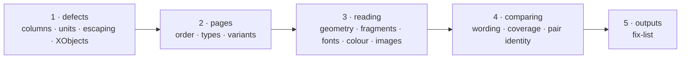

# W-04 — the spec checker, per SR-SPEC-CHECK

## At a glance

| | |
|---|---|
| **What** | Make the spec checker match its record: fix today's false failures, then pages, fonts, colour, images, wording and coverage (the CLI is W-11) |
| **Why** | Today a correct PDF fails three checks, and nothing shows how much of the spec was actually checked |
| **Done when** | The fixture's correct PDF reports no failure, its deviations PDF reports exactly what its README lists, and every finding names its cell |
| **Status** | 🟡 waiting · 0 of 7 DoD done |
| **Waits on** | W-05 for tolerances and the colour threshold; DoD 2, 4 and 6 also need W-02's spec JSON |
| **Who** | `agent` · Opus |
| **Record** | SR-SPEC-CHECK |



<details>
<summary><b>ASCII twin</b></summary>

```text
  1 defects --> 2 pages --> 3 reading --> 4 comparing --> 5 outputs
```

</details>

**Arpit, 2026-10-16:** *"Pages should be in the right order … still go ahead and compare
them. If they are not in the right order, call it out as a warning. If there are
additional pages, call them out as warning as well."* … *"If it is a require page, then
throw an error."*

**Model:** Opus: page binding, font and colour normalisation and coverage are design
judgment; DoD 1 alone could be Sonnet.

**Design:** [SR-SPEC-CHECK](../../records/0102_SPEC-check.md); read it first.

## Goal

A spec JSON (W-02) and a PDF go in; every assertion comes out passed, failed or warned,
with its cell; every row the spec states is visible in coverage; the fixture's matching
PDF reports no failure.

## Definition of done

| DoD | what | state |
|---|---|---|
| 1 · defects | lines grouped within a column (decision 5); tolerances in the spec's units (11); every value escaped in the HTML export (15); images inside Form XObjects placed correctly | ⏳ |
| 2 · pages | Pages List binding, order, extra and missing pages, Optional / Conditional / variant groups, repeats, continuing tables (decisions 1–3) | ⏳ |
| 3 · reading | visible-page geometry and page-size check (4); fragments, soft hyphens, ligatures (5); no text layer (6); fonts (7); colour by ΔE (8); images by position and size, content opt-in (9) | ⏳ |
| 4 · comparing | wording rules (10); tolerance resolution (11); source cell on every finding (12); coverage "N of M rows checked" (13); the tested pair recorded (14) | ⏳ |
| 5 · outputs | the three files from the Spec tab's export (decision 15, amended 2026-10-18 — no JUnit); the Markdown fix-list stays a UI-only view (SR-SURFACE-PARITY); the `pdfsuite spec` command is [W-11](W-11-pdfsuite-spec-cli.md) | ⏳ |
| 6 · fixtures | the fixture's `report.pdf` reports no failure and `report-with-deviations.pdf` reports what its README tables, as a test under `cli/verify/`; the README's *known false failures* section removed | ⏳ |
| 7 · record | SR-SPEC-CHECK `built` set to yes; `docs/ARCHITECTURE.md` spec diagram and SVG updated | ⏳ |

## Blockers

- 🟡 **Waiting on W-05** — tolerances and the colour threshold come from
  `src/services/specConstants.ts`.
- DoD 2, 4 and 6 also need W-02's spec JSON (Pages List, source cells); DoD 1 and 3 do not.

## Record affected

[SR-SPEC-CHECK](../../records/0102_SPEC-check.md) — every decision.

## Hazards

- **A correct PDF must not fail.** DoD 1 comes first; until it lands the fixture
  false-fails three checks (its README lists them).
- **Coverage is not optional.** An element the checker cannot read is *unverifiable*, never
  a pass.
- **Colour conversion is approximate without the ICC profile** — report the actual colour
  so a human can judge.

## Reference

- [SR-SPEC-CHECK](../../records/0102_SPEC-check.md) · [SR-CONSTANTS](../../records/0103_CONSTANTS.md)
- [`src/features/spec/specCheck.ts`](../../src/features/spec/specCheck.ts) · [`src/features/spec/specExport.ts`](../../src/features/spec/specExport.ts)
- [`work/samples/excel-spec-template-v2/README.md`](../../work/samples/excel-spec-template-v2/README.md) — expected results
