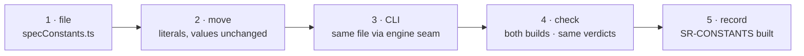

# W-05 — one constants file

## At a glance

| | |
|---|---|
| **What** | One file, `src/services/specConstants.ts`, for every default and limit; today's scattered values move into it unchanged |
| **Why** | The same value lives in up to three places today, and W-02 and W-04 need one place to read theirs from |
| **Done when** | Every engine and CLI module reads from the one file, both builds pass, and the CLI regression run gives the same verdicts |
| **Status** | 🟢 ready · 0 of 5 DoD done |
| **Waits on** | nothing — W-02 and W-04 wait on this |
| **Who** | `agent` · Sonnet |
| **Record** | SR-CONSTANTS |



<details>
<summary><b>ASCII twin</b></summary>

```text
  1 file --> 2 move --> 3 CLI --> 4 check --> 5 record
```

</details>

**Arpit, 2026-10-16:** *"Make sure there is one common file … constants … used by the
whole project."* … *"Go for it."*

**Model:** Sonnet: moving literals into one typed file without changing a value is
mechanical; the type check and the existing tests catch a slip.

## Goal

`src/services/specConstants.ts` exists, holds every default and hard limit in
SR-CONSTANTS decision 2 plus the literals listed in its *Context*, and every engine and
CLI module reads from it. No value changes.

## Definition of done

| DoD | what | state |
|---|---|---|
| 1 · file | `src/services/specConstants.ts`: zero dependencies, every key typed and required, the defaults in SR-CONSTANTS decision 2 | ⏳ |
| 2 · move | `DEFAULT_TOL`, `DEFAULT_ANCHOR_WITHIN` (`specCheck.ts`), `BASE_SCALE` (three copies: `pdfCompare.ts`, `pdfElements.ts`, `specCheck.ts`), `MAX_PAGE_WIDTH` (`pdfCompare.ts`), the page-verdict limits (`changes.ts`), `MOVED_OFFSET_IN` (`exportReport.ts`), `AUTO_SCAN_MAX_PAGES` (`App.tsx`), `DEFAULT_THRESHOLDS` (`cli/src/core/pairs.ts`) moved with values unchanged | ⏳ |
| 3 · CLI | the CLI build imports the same file through its engine seam | ⏳ |
| 4 · check | `npm run build` and the CLI build pass; the CLI regression run gives the same verdicts as before | ⏳ |
| 5 · record | SR-CONSTANTS `built` set to yes in the register; its Consequences updated | ⏳ |

## Blockers

None.

## Record affected

[SR-CONSTANTS](../../records/0103_CONSTANTS.md) decisions 1, 2, 4, 5.

## Hazards

- **Two rules disagree inside the app today** — the strip's `pageHasChange` (moved > 0.02 in)
  and the verdict's `summaryPageDiffers` (offset > 2 px, also the CLI's judge). Move both
  values as they are; W-27 unifies them into `pageVerdict` (SR-COMPARE decision 3).
- **W-29 moves the engine into `packages/core`** — this file moves with it and SR-CONSTANTS's
  `owns:` path follows (W-29 DoD 6). Land this first; it is small.
- The moved literals sit in files W-01 still owns, so those commits stage
  `work/open/W-01-claim-components.md` too.

## Reference

- [SR-CONSTANTS](../../records/0103_CONSTANTS.md)
- [`docs/ARCHITECTURE.md`](../../docs/ARCHITECTURE.md) §Verdict rules: app vs CLI
