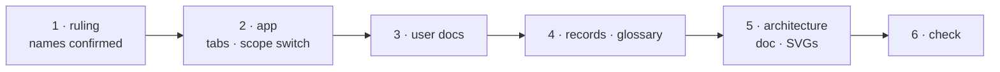

# W-06 — workspace tabs: order, names, and Compare's two scopes

## At a glance

| | |
|---|---|
| **What** | Three tabs in this order — **Compare · Specification · Inspect**; Bulk compare becomes Compare's **Many** scope beside **One**; *Spec driven comparison* becomes **Specification** |
| **Why** | Arpit: better names, the best order, and Compare and Bulk compare should read as one thing |
| **Done when** | The header shows the three tabs in order; Compare has a One · Many switch; every user doc, report footer and record says the new names; the build passes |
| **Status** | 🟢 **6 of 6 DoD done 2026-11-09** · ruled by Siddharth the same day |
| **Waits on** | nothing — ruled 2026-11-09 |
| **Who** | `agent` · Sonnet |
| **Record** | SR-BULK-COMPARE §1 · SR-SURFACE-PARITY · SR-NPM-PACKAGES · SR-LAW-4 wording — names only, no decision changes |



<details>
<summary><b>ASCII twin</b></summary>

```text
  1 ruling --> 2 app --> 3 user docs --> 4 records + glossary --> 5 architecture --> 6 check
```

</details>

**Arpit, 2026-10-18 (first ask):** *"Rather than calling it batch compare, we will call it bulk
compare. And where it says compare 2 PDFs, let's just call it compare. The work item is
more about renaming the tabs through UX designs."*

**Arpit, 2026-10-18 (second ask, supersedes the names above):** *"At the top, the tabs that we
have, what will be the best order to put them in? And can we rename spec-driven comparison
to something better and bulk compare to something else? And is there a way bulk compare and
compare can seem like they are related? … Update the designs and the work items as per this."*

**Arpit, 2026-10-18 (third pass):** *"Rather than calling it spec check, can we just call it a specification? … And where it says one pair and many pair, can we call it just one and bulk? Or many is a better term? You decide."* — decided in session: **One · Many**.

**Model:** Sonnet: labels, one segmented control and copy across known files; the build and a
look at the header catch a slip.

## The ruling — Siddharth, 2026-11-09

**Siddharth: *"do w-06"*** — the proposal below, as written, with no change to the names.

Filed as Arpit's to confirm; either decider rules alone
([SR-WORK-BLOCKERS](../../records/0056_WORK-blockers.md) decision 11), so this is the
ruling and the inbox row is gone. A label Arpit wants different later is a one-line
change and a re-render — cheap, and cheaper than the tabs staying wrong for another
three weeks.

## The proposal — answered in the Cowork session of 2026-10-18

| today | proposed | why |
|---|---|---|
| tab order *Batch · Compare · Spec driven comparison · Inspect* | **Compare · Specification · Inspect** | most-used first, and the order a tester reaches for them: a golden PDF exists → Compare; only a spec exists → Specification; dig into one PDF → Inspect |
| *Batch compare* / *Bulk compare* tab | **Compare › Many** — a scope switch *One · Many* in Compare's sub-header | *One · Many* over *One · Bulk*: two plain words that pair, where *bulk* is jargon; one tab, one engine (`compareMany` calls the same compare, SR-BULK-COMPARE); "Open" on a pair switches to *One* with that pair loaded, so the relation is visible |
| *Spec driven comparison* | **Specification** | Arpit's pick on the second pass (*Specification* was the first proposal) |
| *Inspect* | **Inspect** | already right |

Designs: the *PDF Suite — Proof redesign* canvas (Compare boards carry the scope switch;
*Compare · Many* replaces the Bulk board).

## Definition of done

| DoD | what | state |
|---|---|---|
| 1 · ruling | Arpit confirms or changes the names; this item re-balled 🟢 and its inbox row removed | ✅ Siddharth, 2026-11-09 |
| 2 · app | `packages/ui/src/PdfSuiteApp.tsx` `WORKSPACE_TABS` → `compare` · `spec` · `measure`, labels *Compare* · *Specification* · *Inspect*; Compare's sub-header gains a *One · Many* segmented control (hidden when `FEATURE_BATCH_COMPARE` is off); *Many* renders `BatchView`; "Open" on a pair switches to *One*; `batchExport.ts` footer and user-facing "Batch" text read *Many* | ✅ |
| 3 · user docs | `README.md`, `public/manual.html`, `public/demo.html`, `public/overview.html`, `public/presentation.html`: the new names and order | ✅ |
| 4 · records · glossary | user-facing names amended — SR-BULK-COMPARE §1 *Where you see it*, SR-SURFACE-PARITY section headings, SR-NPM-PACKAGES tab table, SR-LAW-4 §1 and decision 1 wording (tab list only), `docs/GLOSSARY.md`; record handles unchanged | ✅ |
| 5 · architecture | `docs/ARCHITECTURE.md` prose and Mermaid labels; SVGs 01, 02, 05, 10, 12 re-rendered | ✅ |
| 6 · check | `npm run build` passes; `sh scripts/check-boundary.sh` clean; the header seen with `FEATURE_BATCH_COMPARE` on and off | ✅ |

## What landed — 2026-11-09

- **Three tabs: Compare · Specification · Inspect.** `Workspace` is now those three ids;
  `batch` is gone from the union, which is a change to `PdfSuiteConfig` and safe to make
  because nothing is published yet — and a config naming a tab that no longer exists
  would be worse than a breaking type.
- **Compare has a *One · Many* switch** in its own sub-header, shown whether or not
  anything is loaded, because that is how somebody reaches *Many* in the first place. It
  is behind `FEATURE_BATCH_COMPARE`, and a scope folded back to *One* when the flag is
  off, so flipping it cannot strand anybody somewhere that no longer exists.
- **"Open" on a pair switches to *One*** with that pair loaded, which is what makes the
  two scopes read as one thing.
- **The export corner follows the scope**, not the tab: *Many* gets `BatchExportMenu`,
  *One* gets `ExportMenu` and Import ZIP.
- **Names everywhere a person reads them:** 33 lines across `README.md` and the four
  `public/*.html` pages, 24 across four records, the glossary and ARCHITECTURE. SVGs 01,
  02 and 20 re-rendered.

### Verified in the browser, both ways

With `FEATURE_BATCH_COMPARE` **off**: three tabs, no scope switch. **On**: the switch
appears with *One* active and its hint; *Many* renders the bulk view with its own export
menu and the hint changes to *"Every pair in two folders — open any pair to look at it on
its own."*

### Three sentences the blanket rename got wrong

"Compare · Many **tab**" — it is a scope, not a tab — in SR-BULK-COMPARE twice and in
ARCHITECTURE twice, plus the `flag.env` comment calling it a workspace tab. Each was
rewritten by hand. A rename script is right about the words and wrong about the grammar
around them.

## Out of scope, unless Arpit or Siddharth says otherwise

- **Internal identifiers stay:** the `batch` / `spec` / `measure` workspace ids, `batchStore`,
  `BatchView`, `batch-*` CSS classes, file names, and the `FEATURE_BATCH_COMPARE` key
  (renaming the key would silently reset anyone's `flag.env`).
- Record handles (SR-BULK-COMPARE stays SR-BULK-COMPARE) and the CLI's command names.
- Text inside the sealed `packages/spec/src/` folder.

## Blockers

- None. Ruled 2026-11-09.

## Record affected

Names only, no decision changes: [SR-BULK-COMPARE](../../records/0113_BULK-compare.md) §1,
[SR-SURFACE-PARITY](../../records/0106_SURFACE-parity.md), [SR-NPM-PACKAGES](../../records/0107_NPM-packages.md),
[SR-LAW-4](../../records/0006_LAW-4-how-packages-work.md) (the law's tab list — wording, not
substance; Arpit's confirmation is the ruling). W-01 owns the touched files until W-33 claims them.

## Hazards

- ~~**The sealed folder**~~ — settled: **W-32** made the spec feature an ordinary package
  on 2026-11-06, so its README is edited here like anything else. It no longer mentions
  the old name.
- **Deep links:** W-35 adds hash routes per tab; *Many* needs its own route
  (`#/compare/many`) so a bookmark still lands there.
- The touched files are W-01's, so commits stage `work/open/W-01-claim-components.md` too.
- HTML report text changes; nothing asserts on it today, but `packages/cli/verify/` must still pass.

## Reference

- [`packages/ui/src/PdfSuiteApp.tsx`](../../packages/ui/src/PdfSuiteApp.tsx) `WORKSPACE_TABS`
- [`docs/ARCHITECTURE.md`](../../docs/ARCHITECTURE.md) §UI shell and state, §Batch compare
