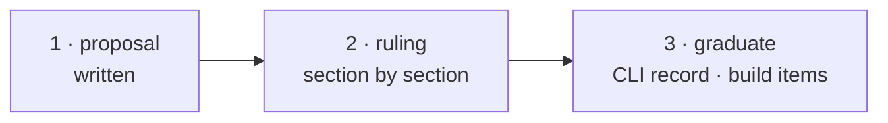

# W-07 — pdfsuite compare, redesigned

## At a glance

| | |
|---|---|
| **What** | A blank-slate design for `pdfsuite compare` — command shape, pairing, verdict, exit codes, output files — put to a ruling |
| **Why** | Arpit asked how the CLI should ideally be, ignoring what is built today |
| **Done when** | Siddharth or Arpit have ruled on each section and the ruled parts are a CLI record with build items |
| **Status** | 🔴 needs a ruling · 1 of 3 DoD done — command shape, outputs, console, verdict policy and determinism ruled; six points open |
| **Waits on** | Siddharth's or Arpit's ruling (inbox) |
| **Who** | `cowork` · Cowork |
| **Record** | SR-CLI and SR-COMPARE hold the ruled sections (accepted 2026-10-18); DoD 3 folds in the rest |



<details>
<summary><b>ASCII twin</b></summary>

```text
  1 proposal --> 2 ruling --> 3 graduate
```

</details>


**Arpit, 2026-10-18:** *"Research and propose ideally how it should be, ignore what has
been built today."* … *"File this as a work item."*

**Model:** Cowork: the shape is a design proposal reached by reading; it closes on a ruling.

## Goal

Siddharth or Arpit rule on [the proposal](../proposals/pdfsuite-compare-cli.md) — adopt,
amend or reject it section by section. On adoption it graduates into a CLI record and
`build` items; on rejection this item closes with the reason.

## Arpit's steer, 2026-10-18 (not yet a ruling)

*"Wouldn't it be a good idea to just have the CLI command for one file, and if somebody
needs to run it in a batch, maybe they can write a script on top of it."* … *"One HTML
file, which is readable, and one JSON file on what is the report, and a manifest file,
which tells what all files are present. I don't believe we need to go into more detail."*
Console output: agreed as proposed — split out as [W-08](W-08-cli-console-output.md).

## Ruled, 2026-10-18

- **Command shape:** Option A — one pair per command; many pairs by `pdfsuite compare --each`, the same function in one process (ruled later the same day, replacing the README script). → [W-09](W-09-pdfsuite-compare-one-pair.md)
- **Output files:** three — report.html (images embedded), result.json, manifest.json (hashes inputs too); no JUnit, CSV or Markdown. → W-09
- **Console output:** as proposed. → W-08
- **Verdict policy (§3, first bullet):** one fixed, versioned rule shared with the app; its id and every knob that moves it in `result.json` → SR-COMPARE decisions 3–4, SR-REPORT-JSON `policy`. → W-27
- **Determinism (§5):** findings byte-stable, wall-clock only in `run`, environment fingerprint in `env`, config precedence flag › `PDFSUITE_*` › file › default → SR-REPORT-JSON decision 3, SR-CLI decision 7, SR-TESTING decision 7; bundled fonts → W-13.
- **Still open — six points, one inbox row:** (1) exit code **3** — split today's 2 into usage 2 / runtime 3 (SR-CLI decision 5); (2) `pdfsuite approve` — promote candidate → golden with an approvals log; (3) the `expected.json` **ledger** of accepted differences — if adopted, *Mark expected* moves from UI-only into the core (SR-SURFACE-PARITY); (4) **masks** for generated content (dates, run ids), declared with reasons; (5) `--redact-text`; (6) `--jobs`, `--only`, `--fail-fast`, `--changed-only`.

## Definition of done

| DoD | what | state |
|---|---|---|
| 1 · proposal | commands, pairing, verdict, exit codes, determinism, output files — written | ✅ |
| 2 · ruling | Siddharth or Arpit rule on the six open points above — adopt, amend or reject each | ⏳ |
| 3 · graduate | the ruled points folded into SR-CLI / SR-COMPARE in place; `build` items filed for what was adopted; the proposal archived (SR-WORK-LIFECYCLE decision 11) | ⏳ |

## Blockers

- 🔴 Siddharth's or Arpit's ruling — the inbox row in `OPEN-WORK.md`.

## Record affected

[SR-CLI](../../records/0115_CLI.md) decisions 5 and 9 and [SR-COMPARE](../../records/0111_COMPARE.md) — amended in place by DoD 3 for whatever is adopted; [SR-SURFACE-PARITY](../../records/0106_SURFACE-parity.md)'s *Mark expected* row if the ledger is.

## Hazards

- **The exit codes are CI's contract.** Today 2 means any tool failure; the proposal splits
  it into 2 (usage) and 3 (runtime). Existing pipelines need a note.
- **One shared verdict policy** touches the app's `summaryPageDiffers` too, not only the CLI.
- **`pdfsuite` 1.0.0 is packaged for npm.** A redesign is a 2.0.0, with a migration note.

## Reference

- [proposal](../proposals/pdfsuite-compare-cli.md)
- [`docs/ARCHITECTURE.md`](../../docs/ARCHITECTURE.md) Part 3 · CLI
