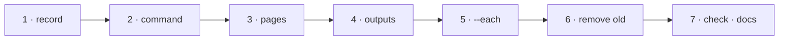

# W-09 — pdfsuite compare: one pair per command, three output files

## At a glance

| | |
|---|---|
| **What** | `pdfsuite compare <golden.pdf> <candidate.pdf> --out <dir>` compares one pair and writes report.html, result.json and manifest.json; `--each <golden-dir> <candidate-dir>` runs every pair in one process |
| **Why** | Arpit chose Option A (one pair per command), then ruled bulk into the package as `--each` so nobody hand-writes the loop or forgets orphans |
| **Done when** | One pair in → three files out, exit code for that pair; `--each` fails on missing and new files with one combined exit code; a CLI record states it |
| **Status** | 🟡 waiting · 0 of 7 DoD done |
| **Waits on** | W-27 — the shared compare core and report builders |
| **Who** | `agent` · Opus |
| **Record** | SR-CLI · SR-COMPARE · SR-BULK-COMPARE (the files: SR-REPORT-JSON, SR-REPORT-HTML, SR-MANIFEST) |



<details>
<summary><b>ASCII twin</b></summary>

```text
  1 record --> 2 command --> 3 pages --> 4 outputs --> 5 --each --> 6 remove old --> 7 check + docs
```

</details>

**Arpit, 2026-10-18:** *"We will go with option A."* … for outputs: *"3 files, refined"* —
images embedded in the HTML, the manifest also hashing both input PDFs.

**Model:** Opus: it replaces the CLI's command shape and output contract and writes the
record that governs them.

## Goal

```
pdfsuite compare golden/invoice.pdf candidate/invoice.pdf --out reports/invoice
pdfsuite compare golden/invoice.pdf candidate/invoice.pdf --pages "1:1,2:-,3:2"
```

One pair per run; the exit code is that pair's verdict. Many pairs:

```
pdfsuite compare --each golden/ candidate/ --out reports/   # every pair, one process
```

## Definition of done

| DoD | what | state |
|---|---|---|
| 1 · record | SR-CLI's `owns:` claims `cli/` (or `packages/cli` after W-29) and the register's Ownership table releases W-01's claim; SR-CLI, SR-COMPARE and SR-BULK-COMPARE already state the command, `--pages`, the three files and the exit codes — amend them in place only where the build proves them wrong | ⏳ |
| 2 · command | positional `<golden.pdf> <candidate.pdf>`, `--out <dir>`; two files only — a folder is a usage error | ⏳ |
| 3 · pages | `--pages "g:c,…"`, `g:-` = golden page with no partner, `-:c` = extra candidate page; unmapped default 1:1; nothing inferred | ⏳ |
| 4 · outputs | exactly three files in `--out`: **report.html** (self-contained, page images embedded, every value escaped), **result.json** (versioned schema; the source of truth — the HTML is rendered from it; wall-clock only in a `run` block), **manifest.json** (SHA-256 and bytes of both input PDFs and of the two other outputs) | ⏳ |
| 5 · --each | `pdfsuite compare --each <golden-dir> <candidate-dir> --out <dir>`: pairs by relative path, calls `compareMany` (the function Bulk compare calls — W-27), one sub-folder of three files per pair plus a summary `result.json`; a **missing** or **new** file fails; one combined exit code | ⏳ |
| 6 · remove old | `pairs.json`, folder inputs, the `pairs` command and the JUnit / CSV / Markdown writers removed; version 2.0.0 with a migration note | ⏳ |
| 7 · check · docs | `npm run build` in `cli/` passes; `cli/verify` passes or is updated to single-pair calls; `docs/ARCHITECTURE.md` Part 3 and its SVGs redrawn | ⏳ |

## Out of scope — still open on W-07

Exit codes stay **0 · 1 · 2** as today (W-07 proposes a 3); the shared verdict policy;
`approve`; the `expected.json` ledger; masks; bundled fonts. Console output is W-08.

## Blockers

- 🟡 **Waiting on W-27** — the command is built on `comparePair` and the shared report builders, so the app and the CLI produce the same files.
- W-08 touches the same file — whichever lands second rebases.

## Record affected

[SR-CLI](../../records/0115_CLI.md) · [SR-COMPARE](../../records/0111_COMPARE.md) · [SR-BULK-COMPARE](../../records/0113_BULK-compare.md), and for the files [SR-REPORT-JSON](../../records/0109_REPORT-json.md) · [SR-REPORT-HTML](../../records/0108_REPORT-html.md) · [SR-MANIFEST](../../records/0110_MANIFEST.md) — all accepted 2026-10-18. W-01 owns `cli/` until DoD 1.

## Hazards

- **Where it lives (SR-NPM-PACKAGES):** the `compare` command is `@pdfsuite/compare`'s command module, loaded by the `pdfsuite` host (W-30), with `pdfsuite-compare` as its own bin.
- **Breaking change** for anyone on `pairs.json` or reading JUnit in Jenkins — say so in
  the migration note; a pipeline that needs JUnit converts `result.json`.
- **Orphans:** `--each` must report a golden with no candidate and a candidate with no golden — test both.
- **Report size:** embedded images grow `report.html`; keep only failing pages' images.
- The touched files are W-01's until DoD 1, so commits stage `work/open/W-01-claim-components.md`.

## Reference

- [proposal](../proposals/pdfsuite-compare-cli.md) · [W-07](W-07-pdfsuite-compare-redesign.md)
- `cli/src/commands/compare.ts` · `cli/src/core/pairs.ts` · `cli/src/report/`
