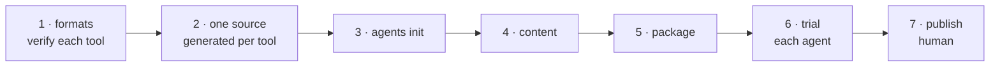

# W-10 — `@pdfsuite/agents`, and publishing the packages

## At a glance

| | |
|---|---|
| **What** | Build `@pdfsuite/agents` — the agent-facing files Claude, Kiro, Codex and Copilot read, so those agents can run pdfsuite and explain its results — and publish every `@pdfsuite` package together — seven, per SR-NPM-PACKAGES |
| **Why** | Arpit wants the CLI installable by anyone and usable through the AI coding agents teams already use |
| **Done when** | Every `@pdfsuite` package installs from the registry; `pdfsuite agents init` writes each tool's files into a project; an agent in each tool runs a compare and reads its result correctly |
| **Status** | 🟡 waiting · 0 of 7 DoD done |
| **Waits on** | W-09 |
| **Who** | `agent` · Opus |
| **Record** | SR-NPM-PACKAGES |



<details>
<summary><b>ASCII twin</b></summary>

```text
  1 formats --> 2 one source --> 3 agents init --> 4 content --> 5 package --> 6 trial --> 7 publish (human)
```

</details>

**Arpit, 2026-10-18:** *"All the CLI that we are building, it can be published as an NPM
package. And in the NPM package, I want to create skills for Claude, Kiro, and Codex, as
well as Copilot to execute these or help with these CLI executions."* — and, asked: the
**whole agent-facing set** for each tool, not only skills.

**Model:** Opus: four tools' formats, one source that cannot drift, and a public release.

## Definition of done

| DoD | what | state |
|---|---|---|
| 1 · formats | each tool's current native files checked against its **vendor docs** at build time and listed in the record — expected: Claude skill (`SKILL.md`); Kiro steering file; Codex `AGENTS.md` and/or skill; Copilot repository instructions + prompt file. Where a tool reads the open `SKILL.md` format, use it | ⏳ |
| 2 · one source | one canonical Markdown source in `packages/agents/`; a deterministic generator writes each tool's files from it; a check fails the build if a generated file differs from a fresh generation | ⏳ |
| 3 · agents init | `pdfsuite agents init [--tool claude\|kiro\|codex\|copilot\|all]` writes the files to each tool's expected path in the current project; never overwrites without `--force`; prints what it wrote | ⏳ |
| 4 · content | what an agent needs: install; `pdfsuite compare` with `--pages`; the three output files and how to read `result.json`; exit codes; `pdfsuite compare --each` for many pairs; never replace a golden without being asked; never paste PDF content anywhere — the PDFs may be confidential. `pdfsuite spec` and `pdfsuite inspect` are added when W-11 and W-28 ship them | ⏳ |
| 5 · package | `@pdfsuite/agents` packs with a `files` whitelist; from packed tarballs, a fresh project with `@pdfsuite/compare` runs `pdfsuite compare` and `pdfsuite agents init --tool all` | ⏳ |
| 6 · trial | in each of the four tools, ask the agent to compare a fictional sample pair; it runs the command, reads `result.json`, and reports the verdict correctly | ⏳ |
| 7 · publish | claim the `pdfsuite` npm organisation; publish every `@pdfsuite` package in lockstep from GitHub Actions with provenance (SR-TESTING decision 10) — **done by Siddharth or Arpit** (public or internal registry) | ⏳ |

## Blockers

- 🟡 **Waiting on W-09** — the files describe the single-pair command and its three
  outputs; writing them for today's CLI would mean writing them twice.
- DoD 7 is a human step; the agent stops at DoD 6 and hands over.

## Record affected

[SR-NPM-PACKAGES](../../records/0107_NPM-packages.md) — decisions 1, 7 and 9; the CLI record W-09 creates gains `agents init`.

## Hazards

- **Formats move fast.** All four tools changed their instruction formats in the last year;
  DoD 1 checks vendor docs, never memory or a third-party blog.
- **Drift:** four hand-edited copies diverge within a release — hence DoD 2's generator and check.
- **Confidential specs and PDFs:** no real workbook or PDF in the package, the agent files
  or their examples — fictional samples only.
- **A public package is hard to take back** (npm's unpublish window is short) — DoD 7 is a
  deliberate human step.

## Reference

- [W-09](W-09-pdfsuite-compare-one-pair.md) · [proposal](../proposals/pdfsuite-compare-cli.md)
- `cli/package.json` (`files`, `bin`) · `cli/README.md`
