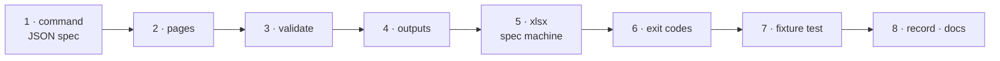

# W-11 — pdfsuite spec: the spec-driven check on the command line

## At a glance

| | |
|---|---|
| **What** | `pdfsuite spec <spec.json\|spec.xlsx> <file.pdf> --out <dir>` checks one PDF against one spec and writes report.html, result.json and manifest.json, like `pdfsuite compare` |
| **Why** | Arpit wants the spec-driven comparison runnable from CI and scripts, not only in the app |
| **Done when** | A JSON spec and a PDF in → three files out, exit code = the verdict; `.xlsx` in once the reader runs under Node; the fictional fixture gives the results its README lists |
| **Status** | 🟡 waiting · 0 of 8 DoD done |
| **Waits on** | W-09 for the shared output writers and exit codes; DoD 5 on the spec machine |
| **Who** | `agent` · Opus |
| **Record** | SR-SPEC · SR-CLI · SR-SPEC-CHECK decision 15 (amended 2026-10-18) · SR-SURFACE-PARITY's Spec rows |



<details>
<summary><b>ASCII twin</b></summary>

```text
  1 command --> 2 pages --> 3 validate --> 4 outputs --> 5 xlsx (spec machine) --> 6 exit codes --> 7 fixture test --> 8 record + docs
```

</details>

**Arpit, 2026-10-18:** *"We need CLI for spec-driven comparison as well. Research and
file a work item."*

**Model:** Opus: it crosses the sealed-feature boundary through its contract only, and two
machines must keep working.

## Research — what exists today (checked 2026-10-18)

- **The engine already runs headless.** `src/features/spec/engine.ts` exports `runSpec`,
  `validateSpec`, `loadPdf`, `readWorkbook`, `sheetToSpec`; `cli/verify/spec-target.ts`
  already calls `runSpec` under Node (8/8), including one spec page against a chosen PDF
  page (`specPageIndex`, `pdfPageOverride`).
- **Excel does not run under Node yet:** `sheetRead.ts` parses sheet XML with `DOMParser`,
  which the CLI's DOM shim does not provide.
- **The exports are browser-only:** `exportSpecJson` / `exportSpecHtml` trigger a download
  through `document.createElement('a')` — the CLI must render from `result.json` itself.
- **W-04 DoD 5 claimed `pdfsuite spec`** with one JUnit testsuite per page; that moves here
  and follows Arpit's three-file ruling instead.

## Goal

```
pdfsuite spec spec.json report.pdf --out reports/report
pdfsuite spec spec.json report.pdf --pages "1:2,2:3"      # spec page : PDF page
pdfsuite spec spec.xlsx --validate-only                    # spec authors: check the spec alone
```

## Definition of done

| DoD | what | state |
|---|---|---|
| 1 · command | `pdfsuite spec <spec> <pdf> --out <dir>` in `cli/`, reaching the feature **only through `engine.ts`**; one spec and one PDF per run (SR-CLI names no `--each` for spec — many runs are the caller's loop) | ⏳ |
| 2 · pages | `--pages "s:p,…"` maps spec page → PDF page (today's `specPageIndex` / `pdfPageOverride`); unmapped = the page the spec declares. When W-04's Pages List binding lands, it becomes the default and `--pages` the override | ⏳ |
| 3 · validate | the spec is validated before any PDF is opened; `--validate-only` checks the spec alone; every message names its cell or JSON path | ⏳ |
| 4 · outputs | the same three files as W-09, through W-09's writers: **report.html** (rendered by the spec feature's own pure builder, exported from `engine.ts` — asked of the spec machine so the Spec tab and the CLI share it; a CLI-side renderer only until it arrives; findings boxed on embedded page images, every value escaped), **result.json** (per element: expected · actual · delta · status · source cell; coverage "N of M rows checked"; the compiled spec embedded), **manifest.json** (SHA-256 of the spec file, the PDF and both other outputs — SR-SPEC-CHECK decision 14) | ⏳ |
| 5 · xlsx | `.xlsx` accepted once `readWorkbook` runs under Node — on `@sheetpane/import`, which reads without a DOM (SR-SPEC-INTAKE decision 3), **wired on the spec machine** and exported from `engine.ts`; until then `.xlsx` exits 2 with "convert in the app or pass JSON" | ⏳ |
| 6 · exit codes | 0 = no failed assertion (warnings, notes, unverifiable allowed, all listed); 1 = a failed assertion or an error finding (e.g. a missing Required page); 2 = bad arguments or the spec fails validation; W-07's open "3" applies here too | ⏳ |
| 7 · fixture test | `cli/verify/` runs `pdfsuite spec` on the fictional fixture (`work/samples/excel-spec-template-v2/`, `public/samples/spec-sample.*`); results match their README, today's known false failures named until W-04 fixes them | ⏳ |
| 8 · record · docs | SR-SPEC's Consequences and SR-CLI marked built for `spec` (SR-SPEC-CHECK decision 15 was already amended on 2026-10-18 — three files, no JUnit); `cli/README.md`, `docs/ARCHITECTURE.md` Part 3 and the W-10 agent files cover `spec` | ⏳ |

## Blockers

- 🟡 **Waiting on W-09** — the output writers, manifest and exit codes are shared.
- **DoD 5 needs the spec machine.** This machine must not edit `src/features/spec/`;
  the reader moves to `@sheetpane/import` there. DoD 1–4 and 6–8 do not wait on it.

## Record affected

[SR-SPEC](../../records/0112_SPEC.md) decisions 1 and 4 · [SR-CLI](../../records/0115_CLI.md) (the `spec` command) · [SR-SPEC-CHECK](../../records/0102_SPEC-check.md) decision 15 (already amended) · the Spec rows of [SR-SURFACE-PARITY](../../records/0106_SURFACE-parity.md).

## Hazards

- **Where it lives (SR-NPM-PACKAGES):** the `spec` command is `@pdfsuite/spec`'s command module (W-32), loaded by the `pdfsuite` host (W-30), with `pdfsuite-spec` as its own bin.
- **The contract is `engine.ts`, and the live one is on the other machine.** This CLI is
  built against the stale mirror; if the spec machine changes an export, the CLI breaks
  there. Depend on nothing outside `engine.ts`; run `sh scripts/check-boundary.sh`.
- **Real workbooks never leave the spec machine.** It receives this CLI by zip refresh and
  is the only place it can run on real specs — say so in `cli/README.md`.
- **Confidential:** fictional fixtures only; no real workbook or PDF in tests, the README
  or the W-10 agent files.
- **No silent pass:** an element the checker cannot read is *unverifiable* and listed, never
  counted as passed (SR-SPEC-CHECK decision 13).
- **Dependencies:** the reader's one dependency is `@sheetpane/import` (SR-SPEC-INTAKE
  decision 3) — no other XML library in the CLI shim to work around DoD 5.

## Reference

- [`src/features/spec/engine.ts`](../../src/features/spec/engine.ts) · [`src/features/spec/README.md`](../../src/features/spec/README.md)
- [SR-SPEC-CHECK](../../records/0102_SPEC-check.md) · [SR-SPEC-INTAKE](../../records/0101_SPEC-intake.md)
- [W-09](W-09-pdfsuite-compare-one-pair.md) · [W-04](W-04-spec-check-v2.md) · `cli/verify/spec-target.ts`
