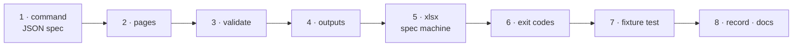

# W-11 — pdfsuite spec: the spec-driven check on the command line

## At a glance

| | |
|---|---|
| **What** | `pdfsuite spec <spec.json\|spec.xlsx> <file.pdf> --out <dir>` checks one PDF against one spec and writes report.html, result.json and manifest.json, like `pdfsuite compare` |
| **Why** | Arpit wants the spec-driven comparison runnable from CI and scripts, not only in the app |
| **Done when** | A JSON spec and a PDF in → three files out, exit code = the verdict; `.xlsx` in once the reader runs under Node; the fictional fixture gives the results its README lists |
| **Status** | 🟢 8 of 8 DoD done · ready to close on a ruling about the Node floor |
| **Waits on** | nothing to build — W-09's writers were overtaken by W-04 DoD 5's builders, and the spec machine by the 2026-11-03 ruling. **Publishing** waits on the Node-floor ruling (W-02 §Hazards) |
| **Who** | `agent` · Opus |
| **Record** | SR-SPEC · SR-CLI · SR-SPEC-CHECK decision 15 (amended 2026-10-18) · SR-SURFACE-PARITY's Spec rows |



<details>
<summary><b>ASCII twin</b></summary>

```text
  1 command --> 2 pages --> 3 validate --> 4 outputs --> 5 xlsx (spec machine) --> 6 exit codes --> 7 fixture test --> 8 record + docs
```

</details>

**Arpit, 2026-10-18:** *"We need CLI for spec-driven comparison as well. Research and
file a work item."*

**Model:** Opus: it crosses the sealed-feature boundary through its contract only, and two
machines must keep working.

## Research — what exists today (checked 2026-10-18)

- **The engine already runs headless.** `packages/spec/src/engine.ts` exports `runSpec`,
  `validateSpec`, `loadPdf`, `readWorkbook`, `sheetToSpec`; `packages/cli/verify/spec-target.ts`
  already calls `runSpec` under Node (8/8), including one spec page against a chosen PDF
  page (`specPageIndex`, `pdfPageOverride`).
- **Excel does not run under Node yet:** `sheetRead.ts` parses sheet XML with `DOMParser`,
  which the CLI's DOM shim does not provide.
- **The exports are browser-only:** `exportSpecJson` / `exportSpecHtml` trigger a download
  through `document.createElement('a')` — the CLI must render from `result.json` itself.
- **W-04 DoD 5 claimed `pdfsuite spec`** with one JUnit testsuite per page; that moves here
  and follows Arpit's three-file ruling instead.

## Goal

```
pdfsuite spec spec.json report.pdf --out reports/report
pdfsuite spec spec.json report.pdf --pages "1:2,2:3"      # spec page : PDF page
pdfsuite spec spec.xlsx --validate-only                    # spec authors: check the spec alone
```

## Definition of done

| DoD | what | state |
|---|---|---|
| 1 · command | ✅ `pdfsuite spec <spec> [pdf] --out <dir>` in `packages/cli/src/commands/spec.ts`, reaching the feature only through `engine.ts`, re-exported once in `packages/cli/src/platform/engine.ts` | ✅ |
| 2 · pages | ✅ the Pages List binding is the default, as this DoD foresaw; `--pages "1:2,2:3"` overrides it per page via `runSpec`'s new `pageMap`, and a malformed map is a tool error | ✅ |
| 3 · validate | ✅ the spec is read and reported on before any PDF is opened, every line naming its sheet and cell; `--validate-only` opens none and **exits 2 when any row is refused**, so a pipeline can gate on the spec alone | ✅ |
| 4 · outputs | ✅ `result.json`, `report.html` and `manifest.json`, written by the spec feature's own builders (W-04 DoD 5) rather than waiting for W-09's writers — the tab and the CLI call the same functions, which is what the DoD wanted W-09 for. The manifest is written last, over the final bytes | ✅ |
| 5 · xlsx | ✅ and **no longer needs the spec machine**: Siddharth's 2026-11-03 ruling unsealed the folder, and the reader is `@sheetpane/import`, which needs no DOM. A legacy workbook is refused here with the route out — convert it in the app and confirm the draft | ✅ |
| 6 · exit codes | ✅ 0 no failed assertion · 1 a failed assertion or an error finding · 2 bad arguments or a spec that does not read. The code comes from `result.summary.exitCode`, so the file and the pipeline cannot disagree (SR-REPORT-JSON decision 7) | ✅ |
| 7 · fixture test | ✅ `packages/cli/verify/spec-cli.ts` 19/19 runs the **built binary as a process** against the fictional fixture — arguments, the three files, the hashes and every exit code. There are no known false failures left to name: the matching PDF passes | ✅ |
| 8 · record · docs | ✅ SR-SPEC and SR-CLI say **partly** built with `spec` named; `packages/cli/README.md` has a `spec` section and the exit-code table covers it; `docs/ARCHITECTURE.md` Part 3 gains a `pdfsuite spec` section with its own diagram and SVG. **The W-10 agent files are still unwritten** — W-10 is unbuilt, so covering `spec` there is its obligation, not one this item can discharge | ✅ |

## Blockers

- 🟡 **Waiting on W-09** — the output writers, manifest and exit codes are shared.
- **DoD 5 needs the spec machine.** This machine must not edit `packages/spec/src/`;
  the reader moves to `@sheetpane/import` there. DoD 1–4 and 6–8 do not wait on it.

## Record affected

[SR-SPEC](../../records/0112_SPEC.md) decisions 1 and 4 · [SR-CLI](../../records/0115_CLI.md) (the `spec` command) · [SR-SPEC-CHECK](../../records/0102_SPEC-check.md) decision 15 (already amended) · the Spec rows of [SR-SURFACE-PARITY](../../records/0106_SURFACE-parity.md).

## Hazards

- **Where it lives (SR-NPM-PACKAGES):** the `spec` command is `@pdfsuite/spec`'s command module (W-32), loaded by the `pdfsuite` host (W-30), with `pdfsuite-spec` as its own bin.
- **The contract is `engine.ts`, and the live one is on the other machine.** This CLI is
  built against the stale mirror; if the spec machine changes an export, the CLI breaks
  there. Depend on nothing outside `engine.ts`; run `sh scripts/check-boundary.sh`.
- **Real workbooks never leave the spec machine.** It receives this CLI by zip refresh and
  is the only place it can run on real specs — say so in `packages/cli/README.md`.
- **Confidential:** fictional fixtures only; no real workbook or PDF in tests, the README
  or the W-10 agent files.
- **No silent pass:** an element the checker cannot read is *unverifiable* and listed, never
  counted as passed (SR-SPEC-CHECK decision 13).
- **Dependencies:** the reader's one dependency is `@sheetpane/import` (SR-SPEC-INTAKE
  decision 3) — no other XML library in the CLI shim to work around DoD 5.

## Reference

- [`packages/spec/src/engine.ts`](../../packages/spec/src/engine.ts) · [`packages/spec/README.md`](../../packages/spec/README.md)
- [SR-SPEC-CHECK](../../records/0102_SPEC-check.md) · [SR-SPEC-INTAKE](../../records/0101_SPEC-intake.md)
- [W-09](W-09-pdfsuite-compare-one-pair.md) · [W-04](W-04-spec-check-v2.md) · `packages/cli/verify/spec-target.ts`
