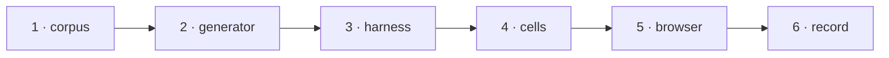

# W-12 — PDF-kinds fixture corpus and the support-matrix harness

## At a glance

| | |
|---|---|
| **What** | One fictional PDF (or pair) per kind in SR-PDF-SUPPORT, plus a script that runs every surface over them and prints the support table |
| **Why** | SR-PDF-SUPPORT was read from code; every later item needs a file that proves its row |
| **Done when** | The harness prints the SR's table for the Node-run columns, and it matches §1 |
| **Status** | 🟢 ready · 0 of 6 DoD done |
| **Waits on** | nothing |
| **Who** | `agent` · Opus |
| **Record** | SR-PDF-SUPPORT |



<details>
<summary><b>ASCII twin</b></summary>

```text
  1 corpus --> 2 generator --> 3 harness --> 4 cells --> 5 browser --> 6 record
```

</details>

**Arpit, 2026-10-18:** *"File work items for each and everything that doesn't exist today … research and file work items on how they can be built out. Example, fonts not embedded in CLI, it may not draw the text, but I still want a filing to be there that, okay, there is a difference or not."*

**Model:** Opus: deciding what each ✅ / ⚠️ / ❌ means as an executable check is design judgment.

## How it can be built — research, 2026-10-18

- **Folder:** `work/samples/pdf-kinds/<kind>/` — `golden.pdf`, and where Compare needs one, `variant.pdf` with one known change; a `README.md` per kind saying what is in it and how it was made.
- **Generator in TypeScript with pdf-lib** (already a dependency): not-embedded standard fonts, AcroForm fields (and a flattened copy), annotations, rotation, crop box, mixed sizes, Form XObjects, invisible OCR text (render mode 3 via raw operators), outlined text (glyphs as paths), a scan (an embedded PNG of text).
- **Made once with a dev tool, committed with provenance:** encrypted (qpdf), tagged, XFA, signed, CJK — only with self-made fictional content and fonts whose licence allows it. No Python (SR-STACK-TYPESCRIPT).
- **Harness:** `cli/verify/support-matrix.ts`, Node, through the engine seam: per kind and surface it asserts observable facts (text found, font named, field value read, image box within 1 pt of truth, message shown) and prints ✅ / ⚠️ / ❌ in the SR's table shape.
- **App columns** need a browser (system fonts differ from Node): checked by a Playwright run, or recorded by hand with the date until one exists.

## Definition of done

| DoD | what | state |
|---|---|---|
| 1 · corpus | `work/samples/pdf-kinds/`: one folder per kind, all 20 rows, fictional, each with a README | ⏳ |
| 2 · generator | `generate.ts` (pdf-lib) rebuilds every generable fixture byte-for-byte; the rest carry provenance | ⏳ |
| 3 · harness | `cli/verify/support-matrix.ts` prints the table; `npm run verify:matrix` in `cli/` | ⏳ |
| 4 · cells | each cell's ✅ / ⚠️ / ❌ defined as a named assertion, listed in the corpus README | ⏳ |
| 5 · browser | the Inspect and Compare columns checked in a browser (Playwright, or a dated manual record) | ⏳ |
| 6 · record | SR-PDF-SUPPORT §1 matches the harness; its veto condition points at the harness | ⏳ |

## Spec machine — asked, not tracked here

Spec cells come from this repository's mirror (SR-PDF-SUPPORT decision 4). Ask the spec machine to run the harness after a zip refresh — the only place real workbooks exist. The spec machine cannot push, so its side never closes anything in this queue.

## Blockers

None.

## Record affected

[SR-PDF-SUPPORT](../../records/0105_PDF-support.md) — the row(s) naming W-12 in its *closed by* column.

## Hazards

- **Confidential:** fictional content only — never a real spec workbook or PDF.
- **Fonts and licences:** embed only fonts whose licence allows redistribution.
- **Node is not the browser:** a cell can differ between them; the harness says which it ran.
- The touched files are W-01's, so commits stage `work/open/W-01-claim-components.md` too; never edit `src/features/spec/` from this machine.

## Reference

- `src/services/pdfCompare.ts` · `src/services/pdfElements.ts` · `cli/verify/`
- [SR-PDF-SUPPORT](../../records/0105_PDF-support.md) — the row(s) this item closes
