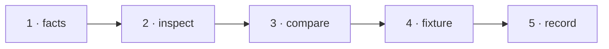

# W-15 — Font weight and style from the font descriptor, not the font name

## At a glance

| | |
|---|---|
| **What** | Read weight and italic from the PDF's font descriptor; when nothing says, show "unknown" instead of guessing Regular |
| **Why** | Stripped or Type3 font names make Inspect say "unknown"/"Regular" for bold text and make Compare miss style changes |
| **Done when** | The stripped-names fixture shows the right weight; a weight change on it is reported by Compare |
| **Status** | 🟡 waiting · 0 of 5 DoD done |
| **Waits on** | W-14 |
| **Who** | `agent` · Sonnet |
| **Record** | SR-PDF-SUPPORT |



<details>
<summary><b>ASCII twin</b></summary>

```text
  1 facts --> 2 inspect --> 3 compare --> 4 fixture --> 5 record
```

</details>

**Arpit, 2026-10-18:** *"File work items for each and everything that doesn't exist today … research and file work items on how they can be built out. Example, fonts not embedded in CLI, it may not draw the text, but I still want a filing to be there that, okay, there is a difference or not."*

**Model:** Sonnet: reading three descriptor fields with the facts reader W-14 builds.

## How it can be built — research, 2026-10-18

- **pdf.js guesses from the name:** its `bold` / `italic` come from `/bold/i` and `/oblique|italic/i` on the font name — useless when names are stripped.
- **The descriptor is authoritative:** `/FontWeight` (100–900), `/Flags` bit 19 ForceBold and bit 7 Italic, `/ItalicAngle` ≠ 0 — read through `pdfFacts.ts`.
- **Order:** descriptor → name words → **unknown**. Never Regular by default.
- **Type3:** say "Type3 (drawn glyphs) — weight unknown".

## Definition of done

| DoD | what | state |
|---|---|---|
| 1 · facts | `pdfFacts.ts` returns weight, italic and their source (descriptor · name · unknown) per font | ⏳ |
| 2 · inspect | weight shown as a number with its source; "unknown" when nothing says | ⏳ |
| 3 · compare | `resolveStyle` uses the same facts, so a weight change is a style change | ⏳ |
| 4 · fixture | fictional fixture(s) for this kind added to W-12's corpus; the harness shows the new behaviour | ⏳ |
| 5 · record | SR-PDF-SUPPORT row(s) for this kind rewritten to today's truth; `docs/ARCHITECTURE.md` updated where a flow changed | ⏳ |

## Spec machine — asked, not tracked here

Ask the spec machine to map weights the same way (SR-SPEC-CHECK decision 7). The spec machine cannot push, so its side never closes anything in this queue.

## Blockers

- 🟡 **Waiting on W-14** — the `src/services/pdfFacts.ts` reader this builds on.

## Record affected

[SR-PDF-SUPPORT](../../records/0105_PDF-support.md) — the row(s) naming W-15 in its *closed by* column.

## Hazards

- Do not infer weight from glyph shapes — probabilistic; "unknown" is the honest answer.
- The touched files are W-01's, so commits stage `work/open/W-01-claim-components.md` too; never edit `src/features/spec/` from this machine.

## Reference

- `src/services/pdfElements.ts` · `src/services/pdfCompare.ts` `resolveStyle`
- [SR-PDF-SUPPORT](../../records/0105_PDF-support.md) — the row(s) this item closes
