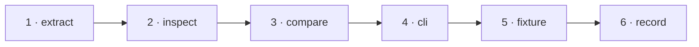

# W-19 — Read comments and annotations

## At a glance

| | |
|---|---|
| **What** | List comments, stamps, highlights and links; inspect them, and compare them separately from the page content |
| **Why** | Annotations are drawn into the page image but never read, so a new comment shows up only as unexplained changed pixels |
| **Done when** | On the annotated fixture, Inspect lists each annotation and Compare reports an added comment as an annotation finding |
| **Status** | 🟡 waiting · 0 of 6 DoD done |
| **Waits on** | W-12 |
| **Who** | `agent` · Opus |
| **Record** | SR-PDF-SUPPORT |



<details>
<summary><b>ASCII twin</b></summary>

```text
  1 extract --> 2 inspect --> 3 compare --> 4 cli --> 5 fixture --> 6 record
```

</details>

**Arpit, 2026-10-18:** *"File work items for each and everything that doesn't exist today … research and file work items on how they can be built out. Example, fonts not embedded in CLI, it may not draw the text, but I still want a filing to be there that, okay, there is a difference or not."*

**Model:** Opus: it splits the pixel diff into page content and annotations, which changes what fails.

## How it can be built — research, 2026-10-18

- **pdf.js:** `page.getAnnotations()` — non-widget subtypes (Text, FreeText, Highlight, Stamp, Ink, Link…) with `contents`, `titleObj` (author), `rect`, `modificationDate`, link `url`.
- **Separate the content:** render the page for the pixel diff with `annotationMode: AnnotationMode.DISABLE`, so a comment is reported as an annotation finding, not as changed page pixels.
- **Compare:** annotation added, removed, text changed, moved; link target changed.

## Definition of done

| DoD | what | state |
|---|---|---|
| 1 · extract | annotation elements in the shared engine | ⏳ |
| 2 · inspect | annotations listed and outlined with type, author, text | ⏳ |
| 3 · compare | content pixels rendered without annotations; annotation findings beside them | ⏳ |
| 4 · cli | the same findings in the CLI report | ⏳ |
| 5 · fixture | fictional fixture(s) for this kind added to W-12's corpus; the harness shows the new behaviour | ⏳ |
| 6 · record | SR-PDF-SUPPORT row(s) for this kind rewritten to today's truth; `docs/ARCHITECTURE.md` updated where a flow changed | ⏳ |

## Spec machine — asked, not tracked here

Ask the spec machine to record annotations in coverage as "excluded" rather than ignore them silently. The spec machine cannot push, so its side never closes anything in this queue.

## Blockers

- 🟡 **Waiting on W-12** — its fictional fixture and the harness are what prove this item.

## Record affected

[SR-PDF-SUPPORT](../../records/0105_PDF-support.md) — the row(s) naming W-19 in its *closed by* column.

## Hazards

- **In the inbox (2026-10-18):** does an annotation difference fail the pair? Ruled with the other new finding types in one row of `OPEN-WORK.md`. Build with the default — failing — the ruling flips one flag in `pageVerdict`.
- The touched files are W-01's, so commits stage `work/open/W-01-claim-components.md` too; never edit `src/features/spec/` from this machine.

## Reference

- `src/services/pdfCompare.ts` `renderAndExtract` · `src/services/changes.ts`
- [SR-PDF-SUPPORT](../../records/0105_PDF-support.md) — the row(s) this item closes
