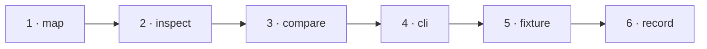

# W-21 — Read tags: headings, paragraphs, tables, alt text

## At a glance

| | |
|---|---|
| **What** | Show each element's tag in Inspect and report tag changes in Compare |
| **Why** | Tagged PDFs carry structure and accessibility information that every surface ignores |
| **Done when** | On the tagged fixture, Inspect shows "Document › Sect › H1" for a heading and Compare reports a heading turned paragraph |
| **Status** | 🟡 waiting · 0 of 6 DoD done |
| **Waits on** | W-12 |
| **Who** | `agent` · Opus |
| **Record** | SR-PDF-SUPPORT |



<details>
<summary><b>ASCII twin</b></summary>

```text
  1 map --> 2 inspect --> 3 compare --> 4 cli --> 5 fixture --> 6 record
```

</details>

**Arpit, 2026-10-18:** *"File work items for each and everything that doesn't exist today … research and file work items on how they can be built out. Example, fonts not embedded in CLI, it may not draw the text, but I still want a filing to be there that, okay, there is a difference or not."*

**Model:** Opus: mapping marked content to text runs is fiddly and easy to get subtly wrong.

## How it can be built — research, 2026-10-18

- **pdf.js:** `pdf.getMarkInfo()` says whether the file is tagged; `page.getStructTree()` gives the tree (role, alt, children); `getTextContent({ includeMarkedContent: true })` interleaves marked-content ids that link text runs to tree nodes.
- **Inspect:** the role path and alt text for the selected element; "untagged" when there are no tags.
- **Compare:** role changed, alt text changed, element left the tree — informational findings, not failing by default.

## Definition of done

| DoD | what | state |
|---|---|---|
| 1 · map | text runs and images linked to structure nodes in the shared engine | ⏳ |
| 2 · inspect | role path and alt text for the selected element | ⏳ |
| 3 · compare | tag findings, informational | ⏳ |
| 4 · cli | the same findings in the CLI report | ⏳ |
| 5 · fixture | fictional fixture(s) for this kind added to W-12's corpus; the harness shows the new behaviour | ⏳ |
| 6 · record | SR-PDF-SUPPORT row(s) for this kind rewritten to today's truth; `docs/ARCHITECTURE.md` updated where a flow changed | ⏳ |

## Spec machine — asked, not tracked here

None asked — tag assertions in a spec are a future idea, not a gap. The spec machine cannot push, so its side never closes anything in this queue.

## Blockers

- 🟡 **Waiting on W-12** — its fictional fixture and the harness are what prove this item.

## Record affected

[SR-PDF-SUPPORT](../../records/0105_PDF-support.md) — the row(s) naming W-21 in its *closed by* column.

## Hazards

- Reading order from the tree may differ from visual order — do not let it change today's text diff.
- The touched files are W-01's, so commits stage `work/open/W-01-claim-components.md` too; never edit `src/features/spec/` from this machine.

## Reference

- `src/services/pdfElements.ts` · `src/services/pdfCompare.ts`
- [SR-PDF-SUPPORT](../../records/0105_PDF-support.md) — the row(s) this item closes
