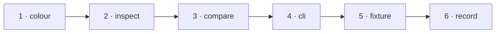

# W-22 — Read colour: text colour in Inspect, recoloured text in Compare

## At a glance

| | |
|---|---|
| **What** | Show the fill colour of text and shapes in Inspect, and name a colour-only change "recoloured" in Compare |
| **Why** | CMYK and print PDFs open fine, but no surface can say what colour anything is, and a colour change is only an unnamed pixel difference |
| **Done when** | On the CMYK fixture, Inspect shows each text run's colour and Compare reports a recoloured word |
| **Status** | 🟡 waiting · 0 of 6 DoD done |
| **Waits on** | W-12 |
| **Who** | `agent` · Opus |
| **Record** | SR-PDF-SUPPORT |



<details>
<summary><b>ASCII twin</b></summary>

```text
  1 colour --> 2 inspect --> 3 compare --> 4 cli --> 5 fixture --> 6 record
```

</details>

**Arpit, 2026-10-18:** *"File work items for each and everything that doesn't exist today … research and file work items on how they can be built out. Example, fonts not embedded in CLI, it may not draw the text, but I still want a filing to be there that, okay, there is a difference or not."*

**Model:** Opus: aligning operator-list colour state with text runs, and a perceptual threshold.

## How it can be built — research, 2026-10-18

- **Colour state from the operator list:** pdf.js normalises fill colours to RGB (`setFillRGBColor`); track it through `save` / `restore` and attach it to each `showText` run, in content order, to the matching text item.
- **Compare:** same text, same place, colour distance above a threshold (CIEDE2000 ΔE, threshold in `specConstants.ts`) → a **recoloured** change.
- **Print PDFs:** the output intent (PDF/X) shown in document properties (W-26).

## Definition of done

| DoD | what | state |
|---|---|---|
| 1 · colour | fill colour per text run and per filled shape in the shared engine | ⏳ |
| 2 · inspect | colour swatch and hex for the selected element | ⏳ |
| 3 · compare | "recoloured" change type, ΔE threshold from `specConstants.ts` | ⏳ |
| 4 · cli | recoloured changes in the CLI report | ⏳ |
| 5 · fixture | fictional fixture(s) for this kind added to W-12's corpus; the harness shows the new behaviour | ⏳ |
| 6 · record | SR-PDF-SUPPORT row(s) for this kind rewritten to today's truth; `docs/ARCHITECTURE.md` updated where a flow changed | ⏳ |

## Spec machine — asked, not tracked here

SR-SPEC-CHECK decision 8 (colour by ΔE) is W-04's, on the spec machine; the ΔE formula is duplicated there, not shared (sealed boundary). The spec machine cannot push, so its side never closes anything in this queue.

## Blockers

- 🟡 **Waiting on W-12** — its fictional fixture and the harness are what prove this item.

## Record affected

[SR-PDF-SUPPORT](../../records/0105_PDF-support.md) — the row(s) naming W-22 in its *closed by* column.

## Hazards

- **Approximate:** pdf.js converts CMYK without the ICC profile — show "converted from CMYK" so a human can judge.
- The touched files are W-01's, so commits stage `work/open/W-01-claim-components.md` too; never edit `src/features/spec/` from this machine.

## Reference

- `src/services/pdfCompare.ts` · `src/services/pdfElements.ts` · `src/services/changes.ts`
- [SR-PDF-SUPPORT](../../records/0105_PDF-support.md) — the row(s) this item closes
