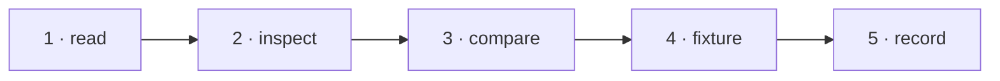

# W-25 — Show signatures and earlier versions

## At a glance

| | |
|---|---|
| **What** | Show who signed a PDF and how many versions it holds; report signature and version differences in Compare |
| **Why** | Signed or edited-in-place PDFs open fine, but nothing says they are signed or that earlier versions exist |
| **Done when** | On the signed fixture, Inspect shows the signer and "not verified", and Compare reports a signature present on one side only |
| **Status** | 🟡 waiting · 0 of 5 DoD done |
| **Waits on** | W-14 |
| **Who** | `agent` · Sonnet |
| **Record** | SR-PDF-SUPPORT |



<details>
<summary><b>ASCII twin</b></summary>

```text
  1 read --> 2 inspect --> 3 compare --> 4 fixture --> 5 record
```

</details>

**Arpit, 2026-10-18:** *"File work items for each and everything that doesn't exist today … research and file work items on how they can be built out. Example, fonts not embedded in CLI, it may not draw the text, but I still want a filing to be there that, okay, there is a difference or not."*

**Model:** Sonnet: reading fields and counting markers; no cryptography.

## How it can be built — research, 2026-10-18

- **Signatures:** `getMetadata().info.IsSignaturesPresent`; signature fields via `pdf.getFieldObjects()` (type `Sig`) and their `/V` dictionary (`Name`, `M`, `Reason`, `SubFilter`) through `pdfFacts.ts`.
- **Versions:** count `%%EOF` / `startxref` markers in the raw bytes; the bytes up to each marker are a loadable earlier version.
- **Never claim validity:** show "signed by X on D — not verified". Cryptographic verification is out of scope (certificates, revocation).

## Definition of done

| DoD | what | state |
|---|---|---|
| 1 · read | signatures and version count in `pdfFacts.ts` | ⏳ |
| 2 · inspect | signer, date, reason, "not verified"; version count | ⏳ |
| 3 · compare | signature added, removed or changed, and version-count differences, as informational findings | ⏳ |
| 4 · fixture | fictional fixture(s) for this kind added to W-12's corpus; the harness shows the new behaviour | ⏳ |
| 5 · record | SR-PDF-SUPPORT row(s) for this kind rewritten to today's truth; `docs/ARCHITECTURE.md` updated where a flow changed | ⏳ |

## Spec machine — asked, not tracked here

None asked. The spec machine cannot push, so its side never closes anything in this queue.

## Blockers

- 🟡 **Waiting on W-14** — the `src/services/pdfFacts.ts` reader this builds on.

## Record affected

[SR-PDF-SUPPORT](../../records/0105_PDF-support.md) — the row(s) naming W-25 in its *closed by* column.

## Hazards

- Showing a signer name is not verifying it — "not verified" must be on screen.
- The touched files are W-01's, so commits stage `work/open/W-01-claim-components.md` too; never edit `src/features/spec/` from this machine.

## Reference

- `src/services/pdfCompare.ts` · `src/services/pdfFacts.ts` (W-14)
- [SR-PDF-SUPPORT](../../records/0105_PDF-support.md) — the row(s) this item closes
