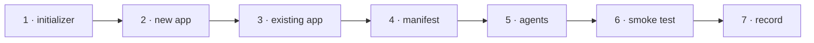

# W-31 — `npm create @pdfsuite`: a new app, or pdfsuite added to an existing one

## At a glance

| | |
|---|---|
| **What** | `@pdfsuite/create` writes a thin shell over `@pdfsuite/ui` — into a new directory, or as `src/pdfsuite/` in an existing React app — installs core, compare, spec, ui and agents, and records every file in `.pdfsuite/installed.json` |
| **Why** | Arpit: pdfsuite is everything — run create on a new or existing app and get the UI and the CLI (L4) |
| **Done when** | A new app builds and runs all four tabs; an existing Vite + React app gains `src/pdfsuite/` with no existing file changed; `npx pdfsuite compare` works in both |
| **Status** | 🟢 **6 of 7 DoD done 2026-11-09** · DoD 5 (agent files) waits on W-10 |
| **Waits on** | nothing — W-33 landed 2026-11-06 |
| **Who** | `agent` · Opus |
| **Record** | SR-NPM-PACKAGES |



<details>
<summary><b>ASCII twin</b></summary>

```text
  1 initializer --> 2 new app --> 3 existing app --> 4 manifest --> 5 agents --> 6 smoke test --> 7 record
```

</details>

**Arpit, 2026-10-18:** *"I'm going to run npm create pdf suite my app. So it could be an
existing app, it could be a new app … Then there is going to be a UI that is going to get
created for spec, compare, and bulk compare, and inspect, like a React application."*

**Model:** Opus: two install modes into code it does not own, and nothing may be broken.

## How it can be built — research, 2026-10-18

- **npm's mapping:** `npm create @pdfsuite` runs `@pdfsuite/create` (npm docs).
- **Mode by target:** an empty or new directory → a full Vite + React app; a directory with a
  `package.json` that has React → add mode; anything else → refuse with the reason.
- **Thin shell:** `main.tsx` mounting `<PdfSuiteApp/>`, a config file (base path, enabled
  tabs, theme), and nothing more — screens come from `@pdfsuite/ui` (W-33).
- **Add mode never edits existing files:** it writes `src/pdfsuite/` and adds `@pdfsuite/*`
  dependencies, then prints the one line to add to the app's router.
- **Manifest:** `.pdfsuite/installed.json` — pdfsuite version, and each written file with its
  SHA-256; W-34's sync reads it.
- **Zero new dependencies:** `node:fs`, `node:crypto`.

## Definition of done

| DoD | what | state |
|---|---|---|
| 1 · initializer | `packages/create` with a bin; detects new vs existing; refuses an unsupported target with the reason | ✅ |
| 2 · new app | a Vite + React app: the shell, `@pdfsuite/ui`, `compare`, `spec`, `core` at one exact version | ✅ |
| 3 · existing app | `src/pdfsuite/` and the dependencies added; no existing file changed (checked by hash before and after); the router line printed | ✅ |
| 4 · manifest | `.pdfsuite/installed.json` with version and per-file SHA-256 | ✅ |
| 5 · agents | agent files for all four tools unless `--no-agents` | 🟡 |
| 6 · smoke test | from packed tarballs: a new app and a sample existing app each install, build, show four tabs, and run `npx pdfsuite compare` on a fixture | ✅ |
| 7 · record | SR-NPM-PACKAGES decisions 7 and 8 marked built; a README | ✅ |

## What landed — 2026-11-09

- **`packages/create`**, with no dependencies at all — `node:fs`, `node:path`,
  `node:crypto` — because it runs before anything is installed. Four modules: `detect`
  (which mode, or refuse), `templates` (every file, as data), `manifest`
  (`.pdfsuite/installed.json`) and `index` (`plan()` and `create()`, so the decision and
  the side effect can be looked at apart).
- **The mode comes from what is on disk, never from a flag.** An empty directory — or one
  holding only `.git`, a `.gitignore`, a README, editor noise — is **new**; a
  `package.json` that depends on React is **add**; anything else is **refused with the
  reason**. That is the whole risk of this package in one function: `npm create
  @pdfsuite .` is run inside working applications.
- **A new app is seven files and exactly one component** — the entry point. Every screen
  comes from `@pdfsuite/ui`, because a screen written into somebody's project by a
  scaffolder could never be delivered to them later by `npm update` (L4 decision 5).
- **Add mode writes one folder and edits one file**, stated rather than quiet:
  `package.json` gains `@pdfsuite/*` dependency entries and keeps its own keys, its own
  indentation and its own trailing newline. The router line is **printed, not written** —
  a wrong edit to somebody's router is worse than a line they paste.
- **Re-running is refused, not an overwrite**, and the refusal names `--sync` (W-34).

### Proved

[`scripts/check-create.sh`](../../scripts/check-create.sh) — **39 checks**, all from
packed tarballs so nothing resolves through this workspace. A created app installs,
**builds**, and its bundle contains the Spec and Inspect tabs; `npx pdfsuite compare`
runs inside it and writes `result.json`. For add mode it **hashes the whole project
before and after**: the only pre-existing file that differs is `package.json`. Both
refusals exit 2 with their reason.

### The smoke test found a packaging defect

A created app **could not run `tsc`**. Every `@pdfsuite` package publishes TypeScript
*source* as its entry point, so a consumer's compiler type-checks our source with their
settings and reports eleven errors that are ours: no `@types` for `pixelmatch` and
`diff`, the `?url` import only Vite resolves, `import.meta.env`, an implicit `any` in
`pdfCompare.ts`. The created app's `build` is therefore `vite build` alone — which works,
and says in the file why. Filed as **B-022**, and it should land **before** anything is
published: a library nobody can type-check against is worse than a library published a
week later.

### DoD 5 waits on W-10

`@pdfsuite/agents` is a shell, and **W-10** owns what a file for Claude, Kiro, Codex or
Copilot contains and writes `pdfsuite agents init`. Inventing four files here would be
guessing at content another item is about to specify, and they would then have to be
un-written from every app created in between. `--no-agents` is parsed so the default does
not change when W-10 lands, and the output says the files are not there yet.

## Blockers

- 🟡 **DoD 5 waits on W-10** — it owns the agent files and `pdfsuite agents init`. Nothing
  else in this item is blocked.
- ~~W-33~~ landed 2026-11-06, and ~~the Spec tab needs W-32~~ landed the same day: a
  created app ships all four tabs.

## Record affected

[SR-NPM-PACKAGES](../../records/0107_NPM-packages.md) decisions 7 and 8 (the manifest).

## Hazards

- **Never edit a consumer file** in add mode — a wrong edit to someone else's app is worse than a printed line.
- **Presentation only** in the shell (L3, L4 decision 3).

## Reference

- [npm docs — `npm init`](https://docs.npmjs.com/cli/v10/commands/npm-init) · [SR-NPM-PACKAGES](../../records/0107_NPM-packages.md) · [SR-LAW-4](../../records/0006_LAW-4-how-packages-work.md) · [W-33](W-33-ui-package.md) · [W-34](W-34-create-sync.md)
