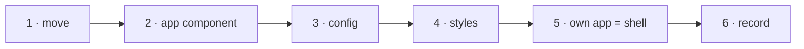

# W-33 — `@pdfsuite/ui`: the screens as a package

## At a glance

| | |
|---|---|
| **What** | Move today's screens out of `src/` into `packages/ui`: Compare, Bulk compare, Spec, Inspect as components, and `<PdfSuiteApp/>` that mounts them all |
| **Why** | Created apps must receive new screens and features on upgrade; copied screens cannot be synced |
| **Done when** | This repository's own app is a thin shell rendering `<PdfSuiteApp/>`; every tab works as today; each tab imports only its own package |
| **Status** | 🟢 **5 of 6 DoD done 2026-11-06** · DoD 4 part-done: the stylesheet ships, its class names are not prefixed (**B-021**) |
| **Waits on** | nothing — W-29 landed 2026-11-06 |
| **Who** | `agent` · Opus |
| **Record** | SR-NPM-PACKAGES |



<details>
<summary><b>ASCII twin</b></summary>

```text
  1 move --> 2 app component --> 3 config --> 4 styles --> 5 own app = shell --> 6 record
```

</details>

**Arpit, 2026-10-18:** *"There is going to be a UI that is going to get created for spec,
compare, and bulk compare, and inspect, like a React application … when we upgrade pdf
suite, we might be trying to sync with the newer files and newer functionalities."*

**Model:** Opus: the whole UI moves package without a visible change.

## How it can be built

- **Components:** `CompareView`, `BulkCompareView`, `SpecView`, `InspectView`, and
  `<PdfSuiteApp config={…}/>` with the workspace tabs (named per W-06).
- **Imports:** Compare and Bulk from `@pdfsuite/compare`, Spec from `@pdfsuite/spec`, Inspect
  from `@pdfsuite/core` — nothing else (SR-NPM-PACKAGES decision 6).
- **Config, not edits:** enabled tabs, base path, theme tokens, feature flags — passed as
  props, so a created app never has to change a component.
- **Styles** ship with the package (one CSS file, prefixed classes); React is a peer dependency.
- **Spec tab:** mounted only when `@pdfsuite/spec` is installed (W-32).

## Definition of done

| DoD | what | state |
|---|---|---|
| 1 · move | `src/components`, `src/store`, `App.tsx` move to `packages/ui`, unchanged in behaviour | ✅ |
| 2 · app component | `<PdfSuiteApp/>` and one component per tab exported | ✅ |
| 3 · config | tabs, base path, theme, flags as props; `flag.env` becomes the repository app's config | ✅ |
| 4 · styles | one stylesheet shipped with the package; class names prefixed | 🟡 |
| 5 · own app = shell | this repository's app is exactly what `create` writes for a new app, plus its config | ✅ |
| 6 · record | SR-NPM-PACKAGES decision 7 marked built; `docs/ARCHITECTURE.md` UI shell redrawn | ✅ |

## What landed — 2026-11-06

- **Everything moved and nothing changed.** `src/components`, `src/store`, `src/services`,
  `App.tsx`, `styles.css` and the flag list are `packages/ui/src/`. This repository's
  `src/` is now **`main.tsx` and `vite-env.d.ts`** — twenty-six lines of app.
- **`<PdfSuiteApp config={…}/>`** takes `tabs`, `initialTab` and `flags`, all optional:
  rendered bare it is the whole suite with every feature on. Nothing in that object can
  change what a comparison *finds* — a knob that moved a verdict would be a decision
  living in the UI package, which L3 and L4 decision 3 both forbid.
- **`flag.env` survives as this app's configuration.** The package could not keep reading
  `virtual:feature-flags`: that module is synthesised by *this* repository's
  `vite.config.ts`, and a package that needs a host's build plugin is a package that does
  not install. The package owns the flag list and the defaults; the shell reads the file
  and parses it with the package's own `parseFlagEnv`.
- **Three flag reads had to move.** They ran while their *module* was evaluating, which is
  before a host can configure anything: the tab list and Layout's view list are computed
  per render now, and the compare store's initial view mode — which cannot be deferred
  without making the store lazy — is corrected by `<PdfSuiteApp>` at mount.

### Verified in the browser

All three tabs render from the packages. `FEATURE_BATCH_COMPARE=false` in `flag.env` still
hides the Bulk tab and `FEATURE_LAYOUT_SIDE_BY_SIDE=false` still collapses Overlapping to
a single view — through the new config prop rather than the virtual module, which is the
plumbing most likely to have broken silently. Compare loaded the two samples and reported
6.15% different with the page strip, change counts and styling intact.

### What DoD 4 does not cover

The stylesheet ships with the package and is reachable at `@pdfsuite/ui/styles.css`, but
its class names are **not prefixed**: `.card`, `.btn`, `.tabs` are global, and in a host
application with its own CSS they collide both ways. Prefixing them is a mechanical
rename across 1,260 lines of CSS and sixteen components with no behaviour to show for it,
so it is filed as **B-021** rather than done badly in passing.

### Two things found on the way

- **Five dead declarations** the app's looser tsconfig never checked — `fmtInch`,
  `movedThreshold`, `offsetThresholdIn` and two unused `PageSummary` imports, most of them
  left behind when W-27 moved the page-changed rule into `pageVerdict`. Removed.
- **The CLI's spike had been broken since W-29** and nobody had run it: its sample path
  said `../../public`, correct while the CLI lived at `cli/` and pointing at
  `packages/public` ever since. Found because the spike was the last thing in `packages/`
  reaching into the app; it is repointed at `@pdfsuite/compare`'s builders and passes.

## Blockers

- None. W-29 landed 2026-11-06.

## Record affected

[SR-NPM-PACKAGES](../../records/0107_NPM-packages.md) decisions 6, 7, 11.

## Hazards

- ~~**Sealed folder**~~ — settled: W-32 made the spec feature a package on 2026-11-06, and `@pdfsuite/ui` imports it by name like any other.
- **No logic in `ui`** — anything that changes a result belongs in a domain package (L3, L4 decision 3).

## Reference

- `packages/ui/src/PdfSuiteApp.tsx` · `packages/ui/src/components/` · `packages/ui/src/store/` · `flag.env` · [SR-LAW-4](../../records/0006_LAW-4-how-packages-work.md)
